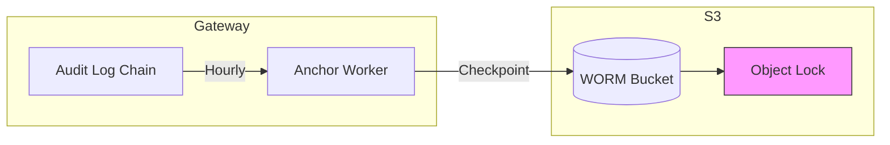

import { Aside, Steps, Tabs, TabItem } from '@astrojs/starlight/components';

This guide covers setting up S3 Object Lock (WORM - Write Once Read Many) storage for tamper-evident audit log anchoring.

## Why WORM Storage?

The gateway's audit log uses a cryptographic chain (HMAC-SHA256) to make logs tamper-evident. However, this chain lives in PostgreSQL, which could be compromised. S3 Object Lock anchors solve this by:

- **External immutability** - Checkpoints written to S3 with COMPLIANCE mode cannot be modified
- **Non-repudiation** - Once written, anchors cannot be deleted (even by AWS account owner)
- **Independent verification** - Auditors can read the anchors with read-only credentials and check the database against them
- **Regulatory compliance** - Meets SOC 2, financial records, and audit requirements



## How It Works

### Anchor Cadence

The gateway writes at most one anchor per hour. A periodic job runs every `AUDIT_ANCHOR_INTERVAL_MINUTES` (default
60) and when the gateway starts; anchors are keyed by hour, so a run that finds this hour's anchor already written
does nothing. `rack-gateway-api write-anchor` writes one by hand.

### Anchor Content

Each anchor is a JSON blob containing chain state:

```json
{
  "chain_id": "production",
  "last_seq": 8723412,
  "last_hash": "b7e9f82a3c1d4e5f6a7b8c9d0e1f2a3b...",
  "ts_utc": "2025-01-15T14:00:03Z",
  "db_snapshot_lsn": "",
  "prev_anchor_hash": "1d4f90e2b3c4d5e6f7a8b9c0d1e2f3a4...",
  "format": 2,
  "hash_v2_from_seq": 8100000
}
```

| Field | Purpose |
|-------|---------|
| `chain_id` | Environment identifier (`AUDIT_ANCHOR_CHAIN_ID`) |
| `last_seq` | Latest event's chain index (0 with an empty `last_hash` when there are no events) |
| `last_hash` | Latest event's hash (hex-encoded) |
| `ts_utc` | When the anchor job was scheduled; the key is derived from its hour |
| `db_snapshot_lsn` | Reserved, always empty |
| `prev_anchor_hash` | SHA-256 of the anchor written before this one (creates the anchor chain) |
| `format` | `2` for anchors written by current versions; absent in older anchors |
| `hash_v2_from_seq` | Chain index of the first hash v2 event, once there is one |

Older anchors (no `format`) have a known bug: once the bucket held more than 1000 anchors, the writer only saw the
first 1000, so their `prev_anchor_hash` stopped pointing at the previous anchor. Verification counts these instead
of failing.

### S3 Object Structure

```
s3://bucket/chain_id/YYYY/MM/DD/HH/anchor-YYYYMMDDTHH.json
```

Example:
```
s3://audit-anchors-prod/production/2025/01/15/14/anchor-20250115T14.json
```

Object Lock buckets are always versioned. Writing an anchor's key again doesn't replace the locked version, it adds
another one, and deleting it only adds a delete marker. Verification lists every version, so either shows up.

## Cost Analysis

S3 Object Lock is extremely cost-effective:

| Item | Calculation | Annual Cost |
|------|-------------|-------------|
| Storage (steady state) | 24 anchors/day × 400 days × 2 KB | ~$0.01 |
| PUT requests | 24 × 365 = 8,760 @ $0.005/1k | ~$0.04 |
| KMS encryption | 8,760 requests @ $0.03/10k | ~$0.03 |
| GET requests (verification) | 8,760 @ $0.0004/1k | ~$0.00 |
| **Total** | | **~$0.08/year** |

<Aside type="tip">
Even with cross-region replication and 7-year retention, total cost is under $1/year.
</Aside>

## Terraform Configuration

### S3 Bucket with Object Lock

<Aside type="caution">
Object Lock can **only** be enabled at bucket creation. It cannot be added later.
</Aside>

```hcl
resource "aws_s3_bucket" "audit_anchors" {
  bucket = "audit-anchors-${var.environment}-${random_id.bucket_suffix.hex}"

  # Object Lock must be enabled at creation
  object_lock_enabled = true

  tags = merge(var.tags, {
    Name    = "audit-anchors-${var.environment}"
    Purpose = "WORM audit log anchoring"
  })
}

resource "random_id" "bucket_suffix" {
  byte_length = 4
}
```

### Object Lock Configuration

```hcl
resource "aws_s3_bucket_object_lock_configuration" "audit_anchors" {
  bucket = aws_s3_bucket.audit_anchors.id

  rule {
    default_retention {
      mode = "COMPLIANCE"
      days = var.worm_retention_days  # e.g., 400
    }
  }
}
```

**COMPLIANCE mode** means:
- Objects cannot be deleted or modified by anyone
- Even AWS account root cannot override
- Only way to delete is wait for retention to expire

### Versioning (Required)

```hcl
resource "aws_s3_bucket_versioning" "audit_anchors" {
  bucket = aws_s3_bucket.audit_anchors.id

  versioning_configuration {
    status = "Enabled"
  }
}
```

### Encryption

```hcl
resource "aws_s3_bucket_server_side_encryption_configuration" "audit_anchors" {
  bucket = aws_s3_bucket.audit_anchors.id

  rule {
    apply_server_side_encryption_by_default {
      sse_algorithm     = "aws:kms"
      kms_master_key_id = aws_kms_key.audit_anchors.arn
    }
    bucket_key_enabled = true
  }
}

resource "aws_kms_key" "audit_anchors" {
  description             = "Audit anchor encryption - ${var.environment}"
  deletion_window_in_days = 30
  enable_key_rotation     = true

  tags = var.tags
}
```

### Public Access Block

```hcl
resource "aws_s3_bucket_public_access_block" "audit_anchors" {
  bucket = aws_s3_bucket.audit_anchors.id

  block_public_acls       = true
  block_public_policy     = true
  ignore_public_acls      = true
  restrict_public_buckets = true
}
```

### Bucket Policy

```hcl
resource "aws_s3_bucket_policy" "audit_anchors" {
  bucket = aws_s3_bucket.audit_anchors.id

  policy = jsonencode({
    Version = "2012-10-17"
    Statement = [
      {
        Sid       = "DenyUnencryptedUploads"
        Effect    = "Deny"
        Principal = "*"
        Action    = "s3:PutObject"
        Resource  = "${aws_s3_bucket.audit_anchors.arn}/*"
        Condition = {
          StringNotEquals = {
            "s3:x-amz-server-side-encryption" = "aws:kms"
          }
        }
      },
      {
        Sid       = "DenyWithoutObjectLock"
        Effect    = "Deny"
        Principal = "*"
        Action    = "s3:PutObject"
        Resource  = "${aws_s3_bucket.audit_anchors.arn}/*"
        Condition = {
          StringNotEquals = {
            "s3:x-amz-object-lock-mode" = "COMPLIANCE"
          }
        }
      },
      {
        Sid       = "DenyDelete"
        Effect    = "Deny"
        Principal = "*"
        Action = [
          "s3:DeleteObject",
          "s3:DeleteObjectVersion"
        ]
        Resource = "${aws_s3_bucket.audit_anchors.arn}/*"
      }
    ]
  })
}
```

### IAM Role for Writer

```hcl
resource "aws_iam_role_policy" "anchor_writer" {
  name = "audit-anchor-writer"
  role = aws_iam_role.gateway.id

  policy = jsonencode({
    Version = "2012-10-17"
    Statement = [
      {
        Effect = "Allow"
        Action = [
          "s3:PutObject",
          "s3:PutObjectRetention",
          "s3:GetObject",
          "s3:ListBucket"
        ]
        Resource = [
          aws_s3_bucket.audit_anchors.arn,
          "${aws_s3_bucket.audit_anchors.arn}/*"
        ]
      },
      {
        Effect = "Allow"
        Action = [
          "kms:Encrypt",
          "kms:Decrypt",
          "kms:GenerateDataKey"
        ]
        Resource = [aws_kms_key.audit_anchors.arn]
      }
    ]
  })
}
```

### IAM Role for Verification (Read-Only)

```hcl
resource "aws_iam_role" "anchor_verifier" {
  name = "audit-anchor-verifier-${var.environment}"

  assume_role_policy = jsonencode({
    Version = "2012-10-17"
    Statement = [
      {
        Action = "sts:AssumeRole"
        Effect = "Allow"
        Principal = {
          AWS = var.auditor_account_ids
        }
      }
    ]
  })

  tags = var.tags
}

resource "aws_iam_role_policy" "anchor_verifier" {
  name = "s3-read-only"
  role = aws_iam_role.anchor_verifier.id

  policy = jsonencode({
    Version = "2012-10-17"
    Statement = [
      {
        Effect = "Allow"
        Action = [
          "s3:GetObject",
          "s3:GetObjectVersion",
          "s3:ListBucket",
          "s3:ListBucketVersions",
          "s3:GetObjectRetention"
        ]
        Resource = [
          aws_s3_bucket.audit_anchors.arn,
          "${aws_s3_bucket.audit_anchors.arn}/*"
        ]
      },
      {
        Effect   = "Allow"
        Action   = ["kms:Decrypt"]
        Resource = [aws_kms_key.audit_anchors.arn]
      }
    ]
  })
}
```

## Gateway Configuration

Enable anchoring with these environment variables:

```bash
# Required
AUDIT_ANCHOR_BUCKET=audit-anchors-prod-abc123
AUDIT_ANCHOR_CHAIN_ID=production

# Optional
AUDIT_ANCHOR_RETENTION_DAYS=400  # Default: 400
AUDIT_ANCHOR_INTERVAL_MINUTES=60  # Default: 60

# AWS credentials (if not using IAM roles)
AWS_ACCESS_KEY_ID=xxx
AWS_SECRET_ACCESS_KEY=xxx
AWS_REGION=us-east-1
```

## Verification

`rack-gateway-api verify-audit` checks the audit chain in the database and every anchor in the bucket. It only
reads.

```bash
rack-gateway-api verify-audit [--from N] [--to N] [--no-anchors]
```

| Option | Meaning |
|--------|---------|
| `--from N` | First chain index to check (default 0). The event before it is still read to check the link. |
| `--to N` | Last chain index to check (default: the latest event) |
| `--no-anchors` | Skip the S3 checks and only check the database |

It prints a summary and exits non-zero if it finds any integrity failure. Warnings don't change the exit code.

### Requirements

- `AUDIT_HMAC_SECRET`: the secret the gateway writes events with. There's no fallback; without it the command
  fails.
- `RGW_DATABASE_URL`, `GATEWAY_DATABASE_URL` or `DATABASE_URL`, for a role with `SELECT` on `audit.audit_event`
  (the `audit_reader` role is enough).
- Unless `--no-anchors` is given: `AUDIT_ANCHOR_BUCKET`, `AUDIT_ANCHOR_CHAIN_ID` and AWS credentials allowed
  `s3:ListBucket`, `s3:ListBucketVersions`, `s3:GetObject` and `s3:GetObjectVersion` on the bucket, and
  `kms:Decrypt` on its key (the verifier role above).

The anchor checks read every anchor, one request per hour of history, so a full run gets slower as the bucket
grows. `--from` only limits the database checks.

### What It Checks

Events, in chain order:

- The chain starts with the genesis event (index 0, no previous hash).
- Each event's `previous_hash` is the hash of the event before it.
- Hash v2 events have consecutive indexes, and their HMAC is recomputed from the stored row and compared with
  `event_hash`.
- Legacy (v1) events only come before the first hash v2 event.

Anchors, in the order they were written:

- Each anchor key has exactly one version and no delete marker.
- `chain_id` matches, and the key matches `ts_utc`.
- The event at `last_seq` exists and its hash equals `last_hash`.
- `last_seq` never goes down (events removed from the end of the chain).
- `prev_anchor_hash` is the SHA-256 of the anchor written before it (failure for `format` 2 anchors; older anchors
  are counted, see above).
- `hash_v2_from_seq` matches where hash v2 starts in the database, so hash v2 events can't be relabeled as legacy
  events to skip their HMAC check.

It warns about hours without an anchor and about events written after the latest anchor.

### What It Can't Detect

- **Events that were never written**, for example when an audit write failed.
- **Changes after the latest anchor by someone who has `AUDIT_HMAC_SECRET`.** With the secret and write access to
  the database, they can rewrite the unanchored tail and recompute every hash. Only history up to the latest
  anchor is protected from them, so keep the secret away from people who administer the database.
- **Forgery by anyone who can verify.** The HMAC is symmetric: whoever holds the secret to verify can also compute
  valid hashes. Treat every copy of the secret (including where `verify-audit` runs) as able to write the chain.
- **Edits to legacy (v1) events.** Events written before hash v2 can't have their HMAC recomputed from the stored
  row: it covered values the database doesn't keep exactly (nanosecond timestamps, some fields before they were
  normalized for storage, and a chain index that could differ from the stored one). Only their `previous_hash`
  links are checked. An anchor still pins the hash of the event it recorded, but not the content of legacy events.

### Running It on a Schedule

The gateway doesn't run the verifier itself. Run `verify-audit` from a scheduled task (a Convox timer, a cron job
or a CI schedule) and alert when it exits non-zero. For a check that doesn't depend on the gateway's own
credentials, run it with the read-only verifier role and a database role that can only read the audit schema.

To run it inside the gateway app instead, for example as a Convox timer, add `s3:ListBucketVersions` and
`s3:GetObjectVersion` to the gateway's role (the writer policy above doesn't include them):

```yaml
timers:
  verify-audit:
    schedule: "17 * * * *"
    command: ./rack-gateway-api verify-audit
    service: gateway
```

## Cross-Region Replication

For disaster recovery, replicate anchors to another region:

```hcl
# Destination bucket (in different region)
resource "aws_s3_bucket" "audit_anchors_dr" {
  provider = aws.dr_region
  bucket   = "audit-anchors-dr-${var.environment}-${random_id.bucket_suffix.hex}"

  object_lock_enabled = true

  tags = var.tags
}

# Replication configuration
resource "aws_s3_bucket_replication_configuration" "audit_anchors" {
  bucket = aws_s3_bucket.audit_anchors.id
  role   = aws_iam_role.replication.arn

  rule {
    id     = "replicate-anchors"
    status = "Enabled"

    destination {
      bucket        = aws_s3_bucket.audit_anchors_dr.arn
      storage_class = "STANDARD"

      replication_time {
        status = "Enabled"
        time {
          minutes = 15
        }
      }

      metrics {
        status = "Enabled"
        event_threshold {
          minutes = 15
        }
      }
    }

    delete_marker_replication {
      status = "Disabled"
    }
  }
}
```

## Lifecycle Management

Transition old anchors to cheaper storage:

```hcl
resource "aws_s3_bucket_lifecycle_configuration" "audit_anchors" {
  bucket = aws_s3_bucket.audit_anchors.id

  rule {
    id     = "archive-old-anchors"
    status = "Enabled"

    transition {
      days          = 30
      storage_class = "GLACIER_IR"  # Instant retrieval
    }
  }
}
```

<Aside type="caution">
`verify-audit` reads every anchor. Objects in `GLACIER` or `DEEP_ARCHIVE` can't be read without restoring them
first, so keep anchors in a class with instant retrieval (`GLACIER_IR` or warmer). At a few kilobytes an hour,
anchors cost cents a year in any class.
</Aside>

## Monitoring

### CloudWatch Alarms

```hcl
# Alert if no anchor written in 2 hours
resource "aws_cloudwatch_metric_alarm" "missing_anchor" {
  alarm_name          = "audit-anchor-missing-${var.environment}"
  comparison_operator = "LessThanThreshold"
  evaluation_periods  = 1
  metric_name         = "NumberOfObjects"
  namespace           = "AWS/S3"
  period              = 7200  # 2 hours
  statistic           = "Sum"
  threshold           = 1

  dimensions = {
    BucketName = aws_s3_bucket.audit_anchors.id
    StorageType = "AllStorageTypes"
  }

  alarm_actions = var.alarm_sns_topic_arns
}
```

### Access Logging

```hcl
resource "aws_s3_bucket_logging" "audit_anchors" {
  bucket = aws_s3_bucket.audit_anchors.id

  target_bucket = aws_s3_bucket.access_logs.id
  target_prefix = "audit-anchors/"
}
```

## Security Considerations

### Break-Glass Procedures

In COMPLIANCE mode, you **cannot** delete objects before retention expires. Options:

1. **Wait for expiration** - Objects auto-expire after retention period
2. **Delete entire bucket** - Requires AWS Support ticket
3. **Legal Hold** - Mark objects for investigation without deleting

```bash
# Apply legal hold (does not affect retention)
aws s3api put-object-legal-hold \
  --bucket audit-anchors-prod \
  --key "production/2025/01/15/14/anchor-20250115T140000Z.json" \
  --legal-hold Status=ON
```

### Auditor Access

Provide read-only credentials to external auditors:

```bash
# Create temporary credentials
aws sts assume-role \
  --role-arn arn:aws:iam::123456789012:role/audit-anchor-verifier-production \
  --role-session-name external-auditor \
  --duration-seconds 43200
```

## Compliance Evidence

S3 Object Lock anchors provide evidence for:

| Framework | Requirement | Evidence |
|-----------|-------------|----------|
| **SOC 2** | CC6.1 Logical Access | Immutable audit trail |
| **SOC 2** | CC7.2 System Monitoring | Continuous verification |
| **SOC 2** | CC7.3 Incident Management | Tamper-evident logs |
| **SOX** | Financial Records | 7-year retention available |
| **GDPR** | Right to Erasure | Legal exceptions documented |

## Variables Reference

```hcl
variable "environment" {
  description = "Environment name"
  type        = string
}

variable "worm_retention_days" {
  description = "Object Lock retention period in days"
  type        = number
  default     = 400  # ~13 months (covers annual audit + buffer)
}

variable "enable_replication" {
  description = "Enable cross-region replication"
  type        = bool
  default     = false
}

variable "dr_region" {
  description = "DR region for replication"
  type        = string
  default     = "us-west-2"
}

variable "auditor_account_ids" {
  description = "AWS account IDs allowed to assume verifier role"
  type        = list(string)
  default     = []
}
```

## Outputs

```hcl
output "audit_anchor_bucket" {
  description = "S3 bucket name for audit anchors"
  value       = aws_s3_bucket.audit_anchors.id
}

output "audit_anchor_bucket_arn" {
  description = "S3 bucket ARN"
  value       = aws_s3_bucket.audit_anchors.arn
}

output "kms_key_arn" {
  description = "KMS key ARN for anchor encryption"
  value       = aws_kms_key.audit_anchors.arn
}

output "verifier_role_arn" {
  description = "IAM role ARN for external verification"
  value       = aws_iam_role.anchor_verifier.arn
}
```

## Next Steps

- [Multi-Region](/deployment/terraform/multi-region/) - Cross-region deployment
- [AWS Infrastructure](/deployment/terraform/aws-infrastructure/) - VPC, RDS setup
- [Audit Trail](/security/compliance/audit-trail/) - Audit logging details
