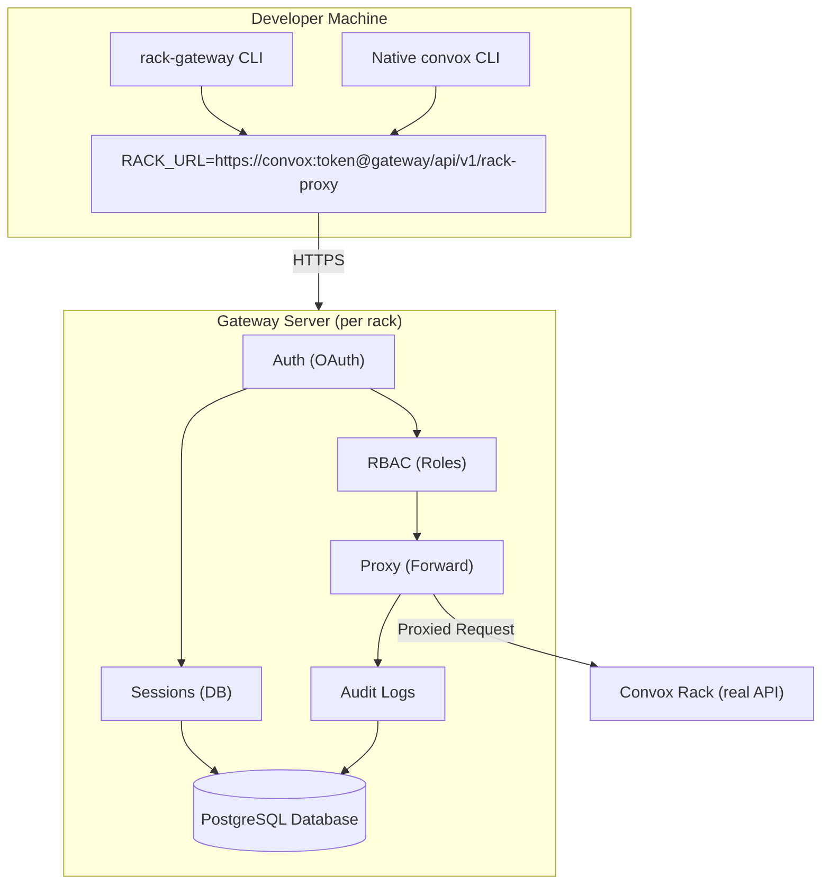
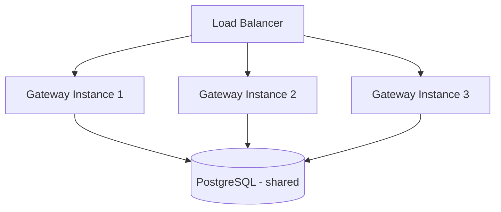

import { Aside } from '@astrojs/starlight/components';

This page explains the architecture of Rack Gateway and how its components interact.

## System Overview

Rack Gateway consists of three main components:

1. **Gateway API Server** - The core proxy that handles authentication, authorization, and request forwarding
2. **Web Admin UI** - A React SPA for user management, token administration, and audit log viewing
3. **CLI Client** - Runs Convox commands through the gateway (with the Convox Go SDK) and manages login, MFA and
   multi-rack configuration



## Request Flow

Let's trace a request through the system:

### 1. Developer Authentication

```bash
rack-gateway login staging https://gateway.example.com
```

1. CLI opens browser to gateway's OAuth endpoint
2. User authenticates with Google Workspace (and MFA, in the browser)
3. Gateway checks the account is a gateway user in the allowed domain, and creates a session
4. The browser returns to the CLI's `127.0.0.1` listener with a one-time code, which the CLI redeems for the
   session token
5. CLI stores token in `~/.config/rack-gateway/config.json`

### 2. Command Execution

```bash
rack-gateway apps
# or: convox apps (with RACK_URL set)
```

1. CLI points the Convox SDK at `RACK_URL=https://convox:<session-token>@gateway.example.com/api/v1/rack-proxy`
2. The SDK sends the request to the gateway with Basic Auth (the native `convox` CLI does the same with that
   `RACK_URL`)
3. Gateway extracts token from Basic Auth password (an inline MFA proof can follow it, as
   `<token>.totp.<code>` or `<token>.webauthn.<assertion>`)
4. Gateway validates session token
5. Gateway checks RBAC permissions for `convox:app:list`
6. Gateway checks the MFA the permission needs (none, a step-up, or a proof on this request)
7. If authorized, gateway forwards to real Convox rack. Only the request headers the Convox API uses (an allowlist) are forwarded; cookies, CSRF and MFA headers and any client-supplied identity headers are dropped. The gateway authenticates to the rack with its own credential and sets `X-Convox-Actor` to the signed-in user (or `token:<name>`), so the rack's own logs name the real caller. Query parameters are limited to the ones the Convox SDK sends; a request with any other is refused, because the rack would read options such as an exec command or release env from the query string without the gateway checking them.
   Before forwarding, the gateway writes an `attempted` audit entry, and refuses the request (503) if it can't.
8. Gateway records the result in the audit log
9. Response returned to user

### 3. Audit Log Entry

The audit entry goes into `audit.audit_event` (see [Audit Trail](/security/compliance/audit-trail/)). Each request
is also logged to stdout as JSON, for CloudWatch or another log pipeline:

```json
{
  "ts": "2026-01-15T10:30:00Z",
  "user_email": "developer@company.com",
  "method": "GET",
  "path": "/api/v1/rack-proxy/apps",
  "status": 200,
  "latency_ms": 234,
  "rbac_decision": "allow",
  "request_id": "550e8400-e29b-41d4-a716-446655440000",
  "client_ip": "100.64.0.12"
}
```

## Component Details

### Gateway API Server

The gateway server is a Go application that handles:

| Component | Responsibility |
|-----------|---------------|
| **OAuth Handler** | Google Workspace OAuth 2.0 + PKCE flow |
| **Session Manager** | Database-backed session storage, validation, expiry |
| **RBAC Engine** | Permission checking based on user roles |
| **Proxy** | HTTP/WebSocket forwarding to Convox rack |
| **Audit Logger** | Hash-chained audit events, written before acting; stdout JSON logs |
| **MFA Service** | TOTP, WebAuthn, YubiKey verification |
| **Admin API** | User, token, and settings management |

### Web Admin UI

A React single-page application served by the gateway:

- **User Management**: List, add, update, lock and delete users
- **API Tokens**: Create and manage CI/CD tokens
- **Audit Logs**: Search and filter audit trail
- **Settings and Integrations**: Configure MFA, sessions, deploy approvals, Slack and CI
- **Account Security**: Enroll MFA devices, manage trusted devices

### CLI Client

The `rack-gateway` CLI is recommended for interacting with Rack Gateway. It provides:

- **Login/Logout**: OAuth authentication flow with the gateway
- **Multi-Rack**: Configure and switch between multiple gateways
- **Convox Commands**: Runs Convox commands through the gateway, without the `convox` CLI
- **MFA Integration**: Handles step-up authentication prompts

<Aside type="note" title="CLI vs Native Convox CLI">
You can use the native Convox CLI by setting `RACK_URL` to the gateway proxy path. The `rack-gateway`
CLI makes OAuth login and multi-rack management easier, but it is not required.
</Aside>

## Database Schema

PostgreSQL stores all persistent state:

| Table | Holds |
|-------|-------|
| `users` | Email, name, roles, MFA enrollment and preference, lock state |
| `user_sessions` | Web and CLI sessions (token hashes), device, MFA and step-up times, expiry |
| `api_tokens` | Token hashes, owner, permissions, expiry, last use |
| `mfa_methods`, `mfa_backup_codes`, `trusted_devices` | MFA factors (TOTP secrets encrypted), backup code hashes, trusted browsers |
| `mfa_attempts`, `used_totp_steps`, `webauthn_challenges` | MFA rate limiting, TOTP replay protection, single-use WebAuthn challenges |
| `cli_login_states` | CLI logins in progress |
| `settings` | Global and per-app settings stored in the database |
| `deploy_approval_requests` | Deploy approval requests and what they were used for |
| `slack_integration` | The Slack workspace, bot token (encrypted) and channel routing |
| `audit.audit_event` | The append-only, hash-chained audit log |
| `audit_verification_status` | The latest audit verification run, for display |

Background jobs (anchors, audit verification, notifications) run on River, whose tables are in the same database.

## Security Architecture

### Authentication Layers

1. **OAuth 2.0 + PKCE**: Initial authentication with Google
2. **Session Tokens**: Opaque, database-backed tokens
3. **MFA**: Required for every user by default, with step-up MFA for sensitive operations
4. **API Tokens**: Scoped tokens for CI/CD

### Authorization Model

```
Permission Format: {scope}:{resource}:{action}

Examples:
- convox:app:list      (list applications)
- convox:process:exec  (exec into container)
- gateway:user:create  (create new user)
```

The roles for people build on each other:
- `viewer` < `ops` < `deployer` < `admin`

Each includes the permissions of the roles below it. The `cicd` role, for API tokens, is a separate narrow set.

### Audit Trail Security

- **Append-only**: the database refuses updates and deletes on audit events
- **Hash chain**: each event's HMAC covers the one before it
- **S3 WORM**: hourly anchors of the chain head in S3 Object Lock storage
- **Verification**: the gateway checks the chain and anchors every hour and alerts on failure
- **Secret Redaction**: env values are `[REDACTED]` unless an admin lists them as visible

## Deployment Topology

### Single-Tenant Design

Each gateway instance protects exactly one Convox rack:

```
Production Environment
├── Convox Rack API (internal)
├── Rack Gateway (public or VPN)
└── PostgreSQL Database

Staging Environment
├── Convox Rack API (internal)
├── Rack Gateway (public or VPN)
└── PostgreSQL Database (its own database; a server can host several)
```

### Network Security

<Aside type="caution" title="Recommended: Use Tailscale">
We strongly recommend using Tailscale or another VPN so that neither the Convox API nor Rack Gateway is exposed to the public internet.
</Aside>

With a private network:
- Gateway accessible only to team members
- No public attack surface
- Zero-trust network model
- Defense-in-depth even if tokens are compromised

#### Making the Convox API Fully Private

By default, Convox exposes its API publicly via nginx ingress. DocSpring maintains a [fork of Convox](https://github.com/DocSpring/convox/tree/docspring) that includes a `private_api` option to disable public access entirely.

See [Private Network Deployment](/deployment/private-network/) for complete setup instructions including:
- Terraform configuration for DocSpring's Convox fork
- Tailscale operator setup and ingress configuration
- ACL examples and verification steps
- Alternative private network options (PrivateLink, VPN, bastion)

## Scalability

Sessions, settings and the audit log live in the database, so you can run more than one instance:



The default `convox.yml` runs one instance. Some limits are kept per instance, in memory: the throttling of repeated
denial entries and the 10 concurrent WebSocket sessions per user or token.

## Next Steps

- [Quick Start](/getting-started/quick-start/): Set up your first gateway
- [System Requirements](/getting-started/system-requirements/): Prerequisites
- [Docker Deployment](/deployment/docker/): Production deployment
