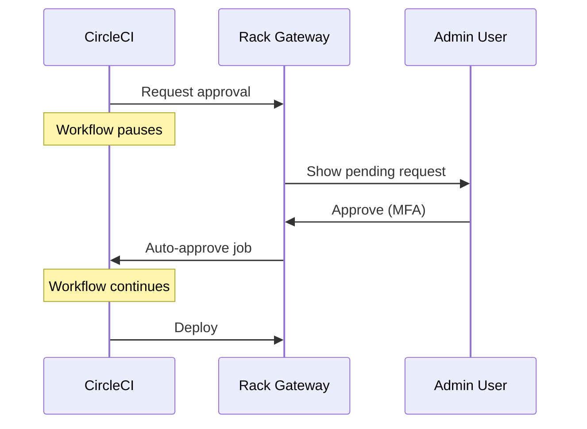
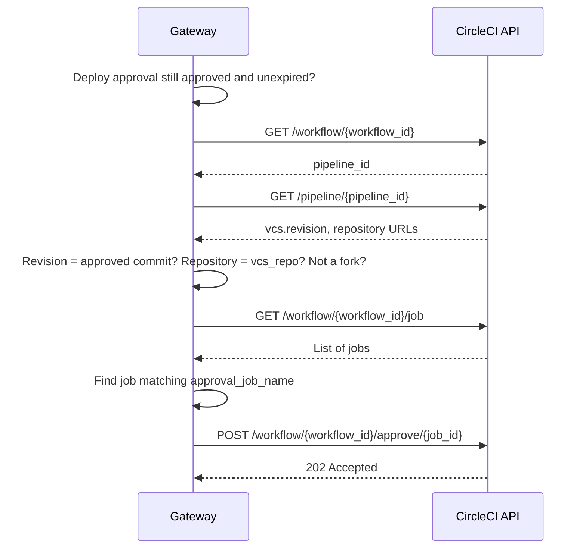

import { Aside, Steps, Tabs, TabItem } from '@astrojs/starlight/components';

Rack Gateway provides native CircleCI integration for automated deploy approvals. When configured, the gateway automatically approves CircleCI workflow jobs after an admin approves the deployment request.

## Overview

The integration streamlines the deployment workflow:



Admins only approve once in the gateway. CircleCI jobs proceed automatically.

## Configuration

### Gateway Environment Variables

```bash
# CircleCI personal API token of a user who can approve jobs in the project
CIRCLECI_TOKEN=your-circleci-api-token
```

**Getting a CircleCI Token:**

<Steps>

1. Sign in to CircleCI as the user the approvals should come from (ideally a dedicated machine user with write
   access to the project)
2. Visit https://app.circleci.com/settings/user/tokens
3. Click "Create New Token" and name it "Rack Gateway Deploy Approvals"
4. Copy the token immediately

</Steps>

Approving a job needs a personal API token: CircleCI project tokens can't call the v2 approval endpoint. Personal
tokens have no scopes; they act as that user.

### Per-App Settings

Each app using CircleCI needs these settings:

| Setting | Default | Description | Example |
|---------|---------|-------------|---------|
| `vcs_provider` | `github` | Version control provider (for pipeline links) | `github` |
| `vcs_repo` | none | Repository (org/repo) | `MyOrg/myapp` |
| `ci_provider` | `circleci` | CI system | `circleci` |
| `circleci_approval_job_name` | none | Approval job name | `approve_deploy_prod` |
| `circleci_auto_approve_on_approval` | `false` | Enable auto-approval | `true` |

<Tabs>
<TabItem label="Environment Variables">

```bash
# Per-app settings via environment
RGW_APP_MYAPP_SETTING_VCS_PROVIDER=github
RGW_APP_MYAPP_SETTING_VCS_REPO=MyOrg/myapp
RGW_APP_MYAPP_SETTING_CI_PROVIDER=circleci
RGW_APP_MYAPP_SETTING_CIRCLECI_APPROVAL_JOB_NAME=approve_deploy_production
RGW_APP_MYAPP_SETTING_CIRCLECI_AUTO_APPROVE_ON_APPROVAL=true
```

</TabItem>
<TabItem label="Web UI">

1. Navigate to **Apps**
2. Select your application
3. Open the **Settings** tab
4. Configure CircleCI integration settings
5. Save changes

</TabItem>
</Tabs>

## CircleCI Workflow Configuration

### Complete Example

```yaml
version: 2.1

workflows:
  deploy:
    jobs:
      - test
      - build:
          requires:
            - test

      # Request approval from Rack Gateway
      - request_approval:
          requires:
            - build

      # CircleCI approval job (auto-approved by gateway)
      - approve_deploy_production:
          type: approval
          requires:
            - request_approval

      # Deploy after approval
      - deploy:
          requires:
            - approve_deploy_production

jobs:
  test:
    docker:
      - image: cimg/node:18.0
    steps:
      - checkout
      - run: npm test

  build:
    docker:
      - image: cimg/node:18.0
    steps:
      - checkout
      - run: npm run build

  request_approval:
    docker:
      - image: cimg/base:current
    steps:
      - install_rack_gateway
      - run:
          name: Request deploy approval
          command: |
            rack-gateway deploy-approval request \
              --app myapp \
              --git-commit "$CIRCLE_SHA1" \
              --branch "$CIRCLE_BRANCH" \
              --ci-metadata "{\"workflow_id\":\"$CIRCLE_WORKFLOW_ID\",\"pipeline_number\":\"<< pipeline.number >>\"}" \
              --message "Deploy $CIRCLE_BRANCH@${CIRCLE_SHA1:0:7} to production"

  deploy:
    docker:
      - image: cimg/base:current
    steps:
      - checkout
      - install_rack_gateway
      - run:
          name: Deploy via Rack Gateway
          command: rack-gateway deploy --app myapp --wait

commands:
  install_rack_gateway:
    steps:
      - run:
          name: Install the rack-gateway CLI
          command: |
            VERSION=v0.1.10
            BASE=https://github.com/docspring/rack-gateway/releases/download/$VERSION
            curl -fsSLO $BASE/rack-gateway-linux-amd64.tar.gz
            curl -fsSLO $BASE/rack-gateway-linux-amd64.tar.gz.sha256
            sha256sum --check rack-gateway-linux-amd64.tar.gz.sha256
            tar xzf rack-gateway-linux-amd64.tar.gz
            sudo install -m 0755 rack-gateway-linux-amd64 /usr/local/bin/rack-gateway
```

Set `RACK_GATEWAY_API_TOKEN` (a token with the `cicd` role) and `RACK_GATEWAY_URL` in a CircleCI context or the
project's environment variables; CircleCI exports them to every job. Use one context per rack, each with its own
token.

### Key Points

1. **`request_approval` job**: Uses CLI to create approval request with CI metadata
2. **`approve_deploy_production` job**: CircleCI approval job (type: approval) that blocks workflow
3. **Job name must match**: Approval job name must match `circleci_approval_job_name` setting
4. **CI metadata**: Include `workflow_id` and `pipeline_number`
5. **Deploy job**: The deploy runs under the approval, so its manifest must reference pre-built images tagged with
   the commit (see [Git Commit Verification](/integrations/deploy-approvals/#git-commit-verification))

<Aside type="caution" title="Job Name Match">
The approval job name in `.circleci/config.yml` must **exactly match** the `circleci_approval_job_name` setting. This is case-sensitive.
</Aside>

## CI Metadata Format

The gateway requires specific metadata for auto-approval:

```json
{
  "workflow_id": "$CIRCLE_WORKFLOW_ID",
  "pipeline_number": "<< pipeline.number >>"
}
```

| Field | Source | Purpose |
|-------|--------|---------|
| `workflow_id` | `$CIRCLE_WORKFLOW_ID` | Identify workflow for job approval (must be a UUID) |
| `pipeline_number` | `<< pipeline.number >>` | Build pipeline URL for display (required for auto-approval) |

<Aside type="note">
`pipeline.number` uses CircleCI's pipeline parameter syntax (`<< >>`), not environment variable syntax (`$`).
</Aside>

## Private Gateways

A gateway that's only reachable on a private network (Tailscale, a VPN, a VPC) needs the CI job to join that
network before it calls the gateway. With Tailscale, run each job as an ephemeral node with a tag for CI, and let
your Tailscale ACLs allow that tag to reach only the gateway. Store the Tailscale auth key or OAuth client secret in
the same CircleCI context as the gateway token.

## Auto-Approval Flow

When admin approves in gateway:



The approval runs as a background job a moment after the admin approves. If the workflow was rerun, the gateway
approves the hold job in the newest workflow with the same name in that pipeline.

The `ci_metadata` comes from the CI job that requested the approval, so the gateway doesn't trust it on its
own: the hold job is only approved when the workflow's pipeline is building the approved commit of the app's
repository, and the job is re-checked against the deploy approval on every attempt (retries can run later,
after a rejection or expiry).

### What Gateway Needs

| Source | Data |
|--------|------|
| CI metadata | `workflow_id` (a CircleCI workflow UUID), `pipeline_number` (string) |
| App settings | `circleci_approval_job_name`, `vcs_repo` (`owner/repo`) |
| Gateway config | `CIRCLECI_TOKEN` |

## Pipeline URL Display

The gateway builds URLs for display in the web UI:

The request's page in the web UI links the CircleCI pipeline:

```
https://app.circleci.com/pipelines/{vcs_short}/{vcs_repo}/{pipeline_number}
```

**VCS Short Codes:**
- `github` → `gh`
- `bitbucket` → `bb`

**Example:**
```
https://app.circleci.com/pipelines/gh/MyOrg/myapp/1234
```

## Multiple Environments

For multiple deployment environments, use different approval job names:

### Staging Gateway

```bash
RGW_APP_MYAPP_SETTING_CIRCLECI_APPROVAL_JOB_NAME=approve_deploy_staging
```

### Production Gateway

```bash
RGW_APP_MYAPP_SETTING_CIRCLECI_APPROVAL_JOB_NAME=approve_deploy_production
```

### CircleCI Workflow

```yaml
workflows:
  deploy:
    jobs:
      - test
      - build

      # Staging
      - request_approval_staging:
          requires: [build]
      - approve_deploy_staging:
          type: approval
          requires: [request_approval_staging]
      - deploy_staging:
          requires: [approve_deploy_staging]

      # Production
      - request_approval_production:
          requires: [deploy_staging]
      - approve_deploy_production:
          type: approval
          requires: [request_approval_production]
      - deploy_production:
          requires: [approve_deploy_production]
```

## Troubleshooting

### CircleCI Card Isn't Enabled

The **Integrations** page shows CircleCI as enabled only when the gateway has a `CIRCLECI_TOKEN`.

<Steps>

1. Verify `CIRCLECI_TOKEN` is set on gateway
2. Restart gateway after adding environment variable
3. Check token hasn't been revoked

</Steps>

**Test token:**
```bash
curl -H "Circle-Token: YOUR_TOKEN" https://circleci.com/api/v2/me
```

### Job Not Auto-Approved

**Checklist:**

- [ ] `circleci_auto_approve_on_approval` is `true`
- [ ] `circleci_approval_job_name` matches exactly
- [ ] `ci_metadata` includes `workflow_id`
- [ ] `CIRCLECI_TOKEN` has correct permissions
- [ ] App `ci_provider` is set to `circleci`
- [ ] App `vcs_repo` is set to the repository CircleCI builds (`owner/repo`)
- [ ] The workflow was building the approved commit (not a later re-run of another commit)

**Check gateway logs:**
```bash
convox logs --app rack-gateway | grep -i circleci
```

Settings problems are logged as warnings when the request is approved, for example `CircleCI auto-approve enabled
but no approval_job_name configured for app myapp` or `CircleCI auto-approve enabled but no CircleCIToken
configured`. A failing approval job is logged with its attempts and retried.

**Common error messages:**

| Error | Cause |
|-------|-------|
| `approval job "xxx" not found in workflow` | Job name mismatch |
| `CircleCI API error (401)` / `(403)` / `(404)` | Token revoked, its user can't approve in the project, or the workflow doesn't exist |
| `ci_metadata.pipeline_number is required` | The request's `--ci-metadata` has no `pipeline_number` |
| `invalid CircleCI workflow_id` | `workflow_id` is not a UUID (the job is cancelled) |
| `CircleCI pipeline does not match the deploy approval` | The pipeline builds another commit or repository, is a fork, or its repository can't be determined (the job is cancelled; approve the hold manually after checking) |
| `deploy approval is no longer active` | The approval was rejected, expired or deployed before the job ran (the job is cancelled) |

### API Token Permissions

If you see `CircleCI API error (403)`:

1. The token's user needs write access to the project (enough to approve a hold job in the CircleCI UI)
2. Regenerate if necessary:
   - Visit https://app.circleci.com/settings/user/tokens
   - Create new token
   - Update `CIRCLECI_TOKEN`
   - Restart gateway

### Wrong Pipeline URL

**Verify settings:**
- `vcs_provider` is correct (`github`)
- `vcs_repo` is in `org/repo` format
- `pipeline_number` is in CI metadata

## Security Considerations

### Token Storage

- Store `CIRCLECI_TOKEN` as environment variable, never in git
- Use Convox secrets or AWS Secrets Manager
- Rotate tokens every 90 days

### Token Permissions

The CircleCI token can do anything its user can, in every project that user can reach:

- Use a dedicated machine user with access to only the projects you deploy
- Monitor approval audit logs

### Approval Validation

Before approving the hold job, the gateway checks:
- The request is pending, and the approver is an admin who passes MFA
- The app's `ci_provider` is `circleci`, `circleci_auto_approve_on_approval` is on, and `CIRCLECI_TOKEN` is set
- The CI metadata is valid, and the app has a `circleci_approval_job_name`
- The deploy approval is still approved and unexpired when the job runs
- The workflow's pipeline builds the approved commit of `vcs_repo`, and isn't from a fork

## Next Steps

- [GitHub Integration](/integrations/deploy-approvals/github/) - PR verification and comments
- [Approval Workflow](/integrations/deploy-approvals/workflow/) - Detailed workflow
- [API Tokens](/security/authentication/api-tokens/) - Token management
