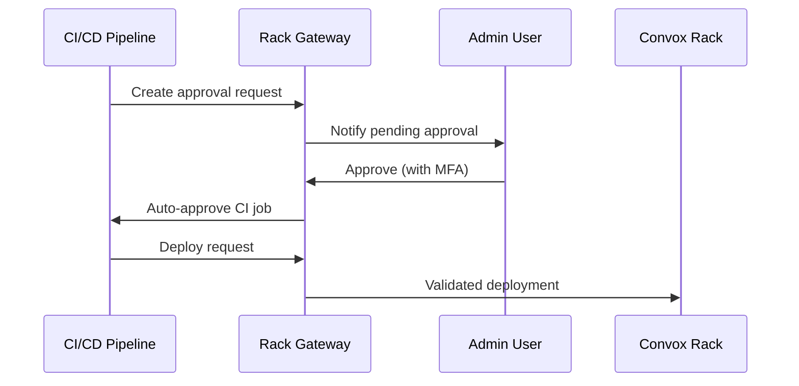
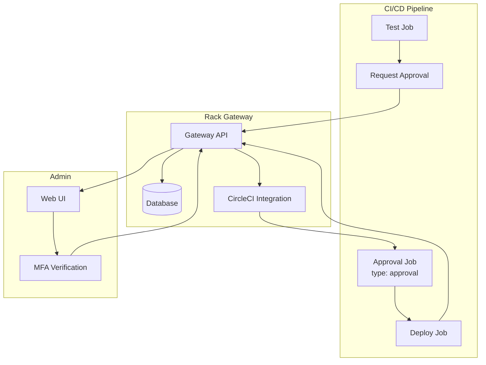
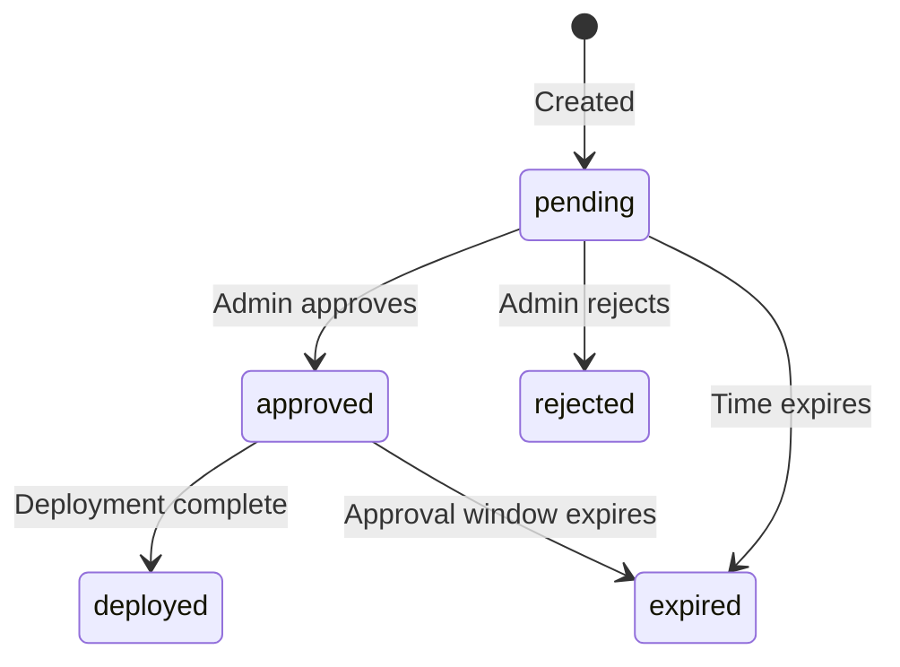

import { Aside, Steps, Tabs, TabItem } from '@astrojs/starlight/components';

Deploy approvals add a manual checkpoint before sensitive Convox deployment actions, ensuring human oversight of production changes.

## Overview

The deploy approval workflow integrates with CI/CD pipelines to enforce admin review:



## How It Works

<Steps>

1. **CI tests pass**

   After tests complete, CI pushes an approval request with git commit and CI metadata

2. **Admin reviews**

   Admin sees pending request in web UI with commit hash, branch, and PR link

3. **Admin approves**

   Approving asks for MFA every time (a recent step-up doesn't cover it)

4. **CI auto-approved**

   Gateway calls CI provider API to unblock the waiting job (if configured)

5. **Deploy validated**

   Gateway validates manifest matches approved commit during deployment

6. **Deployment completes**

   All deployment actions are gated by the approval

</Steps>

## Architecture



## Key Features

### Git Commit Verification

Every approval is tied to a specific full (40-character) git commit SHA. An API token deploying under an approval must:

- Build the archive it uploaded under that approval (one upload and one build per approval)
- Send no `git-sha`, or one equal to the approved commit (the gateway always uses the approved commit, never the client's)
- Reference only pre-built images, each tagged with the approved commit (`<sha>` or `<sha>-<suffix>`, e.g. `<sha>-amd64`) and matching the app's `service_image_patterns`. Every image a service runs is checked (its `image` and its `initContainer.image`); resource image overrides and any other `image` key are refused, and `${...}` can't change an image or the manifest's structure (see [What the Manifest Check Covers](/integrations/deploy-approvals/workflow/#what-the-manifest-check-covers))
- Run only commands listed in `approved_deploy_commands` (an empty list allows none)

`service_image_patterns` is required for approval-bound builds: the commit tag alone does not pin the image repository.

External builds (`convox build --external`) are refused for everyone: the rack would answer with its own API
password. The gateway never returns a build's `repository` field.

An archive upload doesn't say which commit it's for, so it binds to the token's newest open approval for the app.
The gateway refuses it (409) when that approval already has its archive (an upload is most likely a retry, and
uploads happen once per approval), or when several approvals for the app are waiting for an upload: reject the
ones that aren't being deployed.

Each step claims the approval before the gateway forwards it to the rack, so two concurrent requests under one
approval can't both reach the rack:

- **Upload**: the upload claims the approval's archive. A second upload while the first is in flight gets 409. An
  upload the rack refuses (or that fails before the gateway records it) releases the claim, so CI can upload again.
- **Archive objects**: an object that holds an approval's archive can't be uploaded again by anyone, admins
  included (409). The rack would replace the archive that the build's manifest is checked against.
- **Build**: an approval creates one build, only from an archive whose upload finished. A second build while the
  first is in flight, or after it, gets 409. A build the rack refuses releases the claim. The build's release is
  recorded once, from that build, and never replaced.
- **Promote**: one promote at a time; see the promote rules under [Several Apps per Commit](#several-apps-per-commit).

A claim held by a request that never finished (for example, the gateway restarted mid-upload) isn't released. Reject
the request and create a new one.

`convox builds import` is never covered by an approval: an imported build brings its own manifest and images, which
the gateway doesn't check. It needs `convox:build:import`, which only admins hold, and MFA.

### MFA on Every Approval

Approving, rejecting and extending a request ask for MFA every time, even within the step-up window:

- Admin must verify MFA for each approval
- Prevents approval with compromised session
- Auditable proof of human authorization
- API tokens can't approve

### Different Approver (Optional)

For segregation of duties, turn on **Require a different approver** (Settings > Deploy Approvals, or
`RGW_SETTING_DEPLOY_APPROVAL_REQUIRE_DIFFERENT_APPROVER=true`). Nobody can then approve or extend a deploy they
asked for: the user who created the request, or the owner of the API token it's for. They get a 403 that says
which. The approval's audit entry records `different_approver_required: true`.

It's off by default, so a team with one admin can still deploy.

### Time-Limited Approvals

Approvals expire after a configurable window (default 15 minutes):

- Prevents stale approvals from being used later
- Encourages timely deployment after approval
- Configurable via `RGW_SETTING_DEPLOY_APPROVAL_WINDOW_MINUTES`

### CI Integration

Native integration with CI providers:

- CircleCI auto-approval via API
- GitHub PR comments for status updates
- Extensible to other providers

## Request Lifecycle

The approval request progresses through these states:



| State | Description |
|-------|-------------|
| `pending` | Waiting for admin review |
| `approved` | Admin approved, CI can proceed |
| `rejected` | Admin rejected, deployment blocked |
| `expired` | Approval or pending state timed out |
| `deployed` | Deployment completed successfully |

## Database Schema

The `deploy_approval_requests` table tracks the complete lifecycle:

| Column | Type | Description |
|--------|------|-------------|
| `public_id` | UUID | External identifier for API access |
| `app` | varchar | Application name (a Convox app name that exists on the rack) |
| `git_commit_hash` | varchar | Git commit SHA (indexed) |
| `git_branch` | varchar | Branch name |
| `pr_url` | text | Pull request URL (from GitHub) |
| `ci_metadata` | JSONB | Provider-specific data |
| `message` | text | Human-readable context (at most 2000 characters) |
| `status` | varchar | Current state |
| `target_api_token_id` | bigint | CI/CD token that will use approval |
| `approved_by_user_id` | bigint | Admin who approved |
| `approval_expires_at` | timestamp | When approval expires |
| `object_url`, `build_id`, `release_id` | text | The archive, build and release made under the approval |

## Configuration

### Global Settings

| Setting | Default | Description |
|---------|---------|-------------|
| `RGW_SETTING_DEPLOY_APPROVALS_ENABLED` | `true` | Enable/disable approval checks |
| `RGW_SETTING_DEPLOY_APPROVAL_WINDOW_MINUTES` | `15` | How long approvals remain valid |
| `RGW_SETTING_DEPLOY_APPROVAL_REQUIRE_DIFFERENT_APPROVER` | `false` | Refuse approvals and extensions by the request's creator or its token's owner |

### Per-App Settings

Configure via UI or environment variables:

| Setting | Description |
|---------|-------------|
| `vcs_provider` | `github` (default, from `default_vcs_provider`) or `bitbucket`; used for CircleCI links. Commit verification and PR comments are GitHub-only |
| `vcs_repo` | Repository in org/repo format |
| `ci_provider` | CI system: `circleci` (default, from `default_ci_provider`) |
| `circleci_approval_job_name` | CircleCI approval job name |
| `circleci_auto_approve_on_approval` | Enable auto-approval (the gateway first checks the workflow's pipeline builds the approved commit of `vcs_repo`) |
| `service_image_patterns` | **Required.** Map of service name (or `*`) to an anchored regex; `{{GIT_COMMIT}}` is replaced with the approved commit, e.g. `{"*": "docker\\.io/org/app:{{GIT_COMMIT}}-amd64"}` |
| `approved_deploy_commands` | Exact commands a token may run under an approval (e.g. migrations); empty allows none |

<Aside type="tip">
Configure per-app settings via environment variables:
```bash
RGW_APP_MYAPP_SETTING_CI_PROVIDER=circleci
RGW_APP_MYAPP_SETTING_CIRCLECI_APPROVAL_JOB_NAME=approve_deploy_prod
```
</Aside>

## CLI Commands

### Create Request

```bash
rack-gateway deploy-approval request \
  --app myapp \
  --git-commit "$CIRCLE_SHA1" \
  --branch "$CIRCLE_BRANCH" \
  --ci-metadata "{\"workflow_id\":\"$CIRCLE_WORKFLOW_ID\",\"pipeline_number\":\"42\"}" \
  --message "Deploy to production"
```

### Approve Request

```bash
rack-gateway deploy-approval approve <request-id> \
  --notes "Reviewed diff, LGTM"
```

Asks for MFA every time. The command first shows the request (rack, app, full commit, message, branch,
pull request and requesting token). From a terminal it then asks you to press Enter before approving. Only a
pending request can be approved; one that is already approved or deployed counts as done.

### Approve a Commit (Several Apps, Several Racks)

```bash
# Every listed app's request for the commit, on every listed rack
rack-gateway deploy-approval approve --app web,worker --commit <sha> --rack us,eu

# Every app's request for the commit
rack-gateway deploy-approval approve --all-apps --commit <sha> --rack staging
```

One PIN for the run, then one key touch per approval. The command first finds the request of each listed app on
each listed rack. If any is missing, it approves nothing and exits non-zero, naming the missing `rack/app` pairs,
so a retry approves them all together. Requests that are already approved or deployed count as done.

From a terminal it asks you to press Enter before approving. Scripts and AI agents (no terminal) skip that prompt.
Instead, the macOS PIN dialog lists every approval the command makes (app, rack, short commit and message) above
the command line, and each approval needs a key touch. The dialog masks `KEY=value` arguments and the values of
flags that can carry secrets (tokens, passwords, keys, MFA codes); other flag values such as `--app`, `--rack` and
`--commit` are shown. Without a terminal the command line must also say exactly what is approved: an explicit
`--app` list and a full 40-character `--commit`, with no `--branch` or `--all-apps`.

`wait --approve --app a,b --commit <sha>` waits until every listed app has an approved (or deployed) request on
every rack, approving pending ones as they appear (each is shown first, with its commit), then prints what it
approved. In a terminal, `wait --approve` asks you to confirm (y/N) each request whose commit isn't exactly the full
`--commit`: with `--branch` and no `--commit` the newest request for a branch can be for any commit, and a short
`--commit` matches every commit that starts with it.

Without `--commit` (and `--branch`), the commands use the full SHA of the current git commit.

### List Pending

```bash
rack-gateway deploy-approval list --status pending
rack-gateway deploy-approval list --open --app api-proxy --commit <sha>
```

The table shows each request's app and short commit, and the full message. `-o json` prints each request as JSON,
including the pull request URL (`pr_url`) that GitHub verification found.

### Show Request

```bash
rack-gateway deploy-approval show <request-id>
rack-gateway deploy-approval show --app myapp --commit <sha> -o json
```

Prints the request's status, message, app, token, commit, branch, pull request (`PR:`) and approval times.
`-o json` prints the same fields as JSON, with the pull request as `pr_url`.

### Wait for Approval

```bash
rack-gateway deploy-approval request \
  --app myapp \
  --git-commit "$CIRCLE_SHA1" \
  --message "Deploy" \
  --wait \
  --timeout 20m
```

`--wait` polls every `--poll-interval` (5s) until the request is approved or rejected, and gives up after
`--timeout` (20 minutes by default; `0` waits indefinitely). A request made with a user session instead of an API
token must name the token that will deploy with `--target-api-token-id`.

## Several Apps per Commit

CI can deploy several apps from one pipeline, for the same commit and with the same API token (for example a
main app and a proxy). Each app gets its own request: an open (pending or approved) request is unique per commit,
target token and app. Creating a request again for the same app returns the open one (409 with that request);
`rack-gateway deploy-approval request` treats that as success only when the returned request is for the same
app and commit, and otherwise fails, because nothing was created.

An approval whose window has passed is marked `expired` (every few minutes, and before a new request is
created), so it no longer counts as open. So is a pending request older than `DEPLOY_APPROVAL_PENDING_MAX_AGE`
(7 days by default). Each expiry is audit-logged as `deploy_approval_request.expire` by `system`. An admin can
still extend a lapsed approval, which approves it again, unless another request for the same app and commit has
opened since. A request that expired while pending was never approved, so it can't be extended.

A successful promote marks the approval `deployed`, and the approval can't promote again: a second promote gets
409 "this deploy approval request has already been deployed". Only one promote per approval runs at a time: a
second promote while the first is in flight gets 409 "a promote with this deploy approval request is already in
progress". A promote the rack refuses leaves the approval approved, so it can be retried. A promote that timed out
or lost its connection may still be running on the rack, so a retry is refused for up to 15 minutes.

## RBAC Permissions

| Permission | Description | Roles |
|------------|-------------|-------|
| `gateway:deploy_approval_request:create` | Create requests | CI/CD, Deployer, Admin |
| `gateway:deploy_approval_request:read` | Read a request (what `--wait` polls) | CI/CD, Deployer, Admin |
| `gateway:deploy_approval_request:approve` | Approve, reject and extend | Admin (MFA every time) |
| `convox:deploy:deploy_with_approval` | Deploy when approved | CI/CD, Deployer, Admin |

`deploy_with_approval` lets a token upload, build and promote for an app only under an approved request for that
app and the token, within the limits described above. Listing requests (and the web UI's list) needs
`gateway:deploy_approval_request:list`, which only admins hold.

## Security Model

Even with a compromised CI/CD token, an attacker cannot:

- Deploy without admin approval
- Deploy different code than approved (manifest validation)
- Bypass pre-deploy command allowlist
- Reuse approvals across commits

**Attack requires:**
- Compromised CI/CD token AND
- Admin approval for attacker's malicious commit AND
- Image tags matching approved commit pattern

## Disabling Approvals

For staging or development racks, you can disable approvals:

```bash
RGW_SETTING_DEPLOY_APPROVALS_ENABLED=false
```

<Aside type="caution">
Only disable approvals in non-production environments where the security/convenience trade-off is acceptable.
</Aside>

## Next Steps

- [Approval Workflow](/integrations/deploy-approvals/workflow/) - Detailed workflow
- [CircleCI Integration](/integrations/deploy-approvals/circleci/) - CircleCI setup
- [GitHub Integration](/integrations/deploy-approvals/github/) - PR comments
