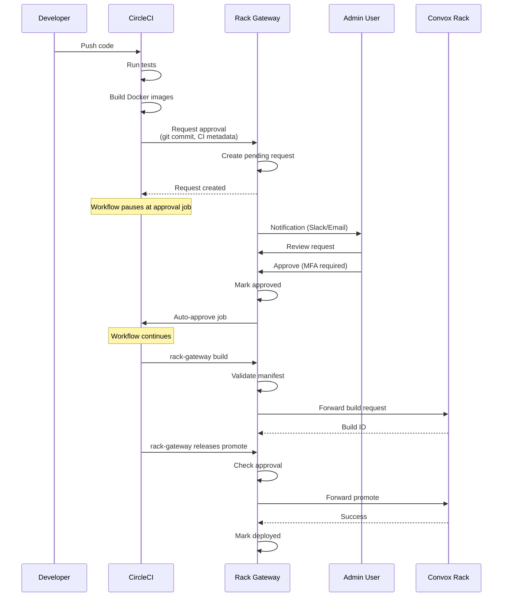
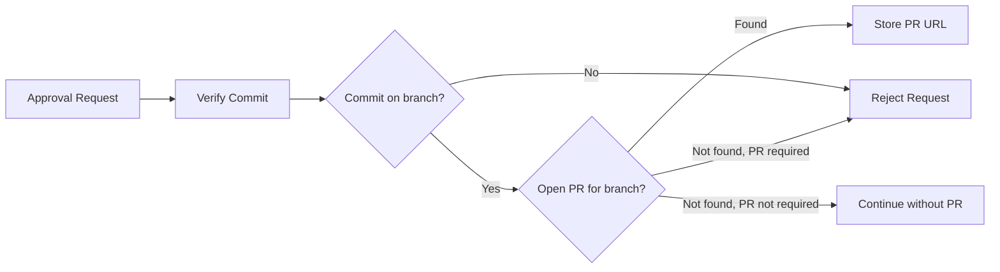
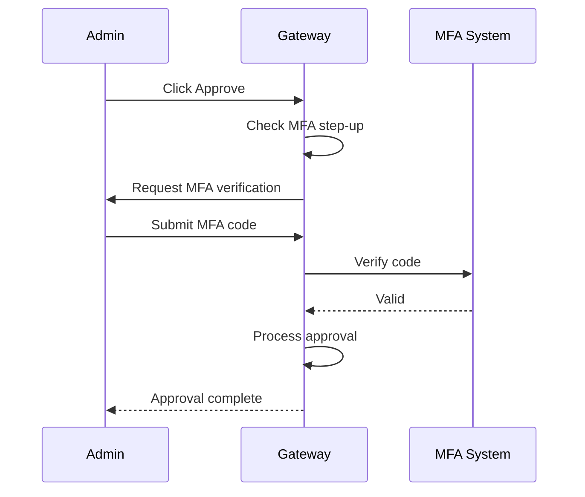
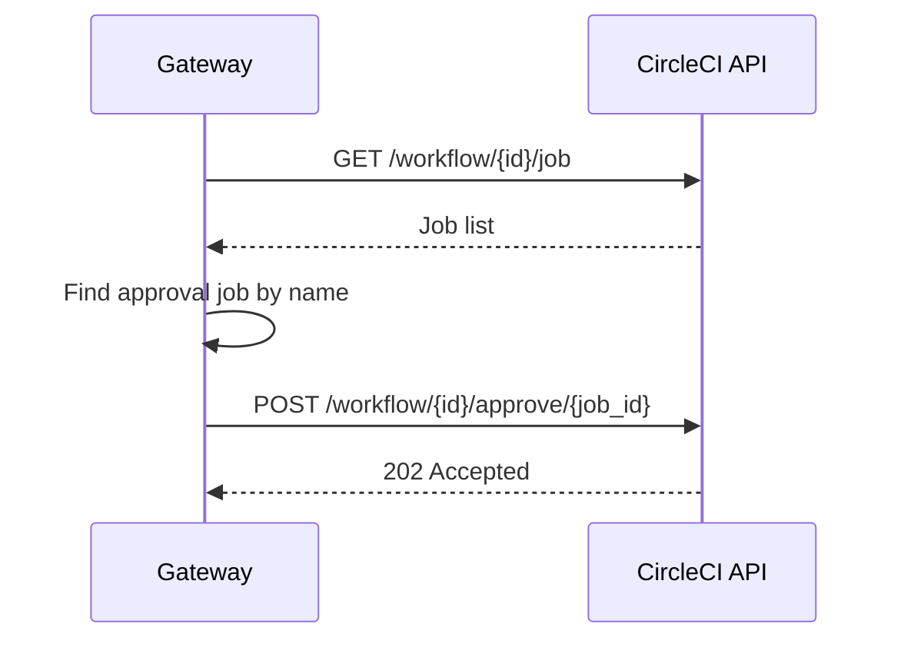
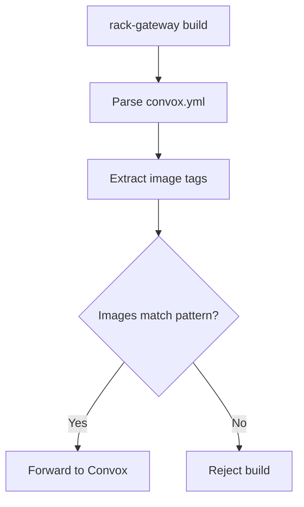
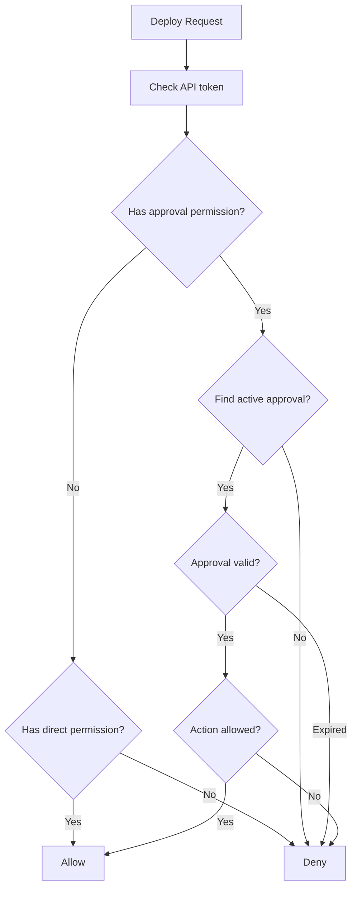

import { Aside, Steps, Tabs, TabItem } from '@astrojs/starlight/components';

This page provides a detailed walkthrough of the deploy approval workflow, from request creation to deployment completion.

## Complete Workflow



## Phase 1: Request Creation

When CI tests pass, the pipeline creates an approval request.

### Request Command

```bash
rack-gateway deploy-approval request \
  --app myapp \
  --git-commit "$CIRCLE_SHA1" \
  --branch "$CIRCLE_BRANCH" \
  --ci-metadata "{\"workflow_id\":\"$CIRCLE_WORKFLOW_ID\",\"pipeline_number\":\"<< pipeline.number >>\"}" \
  --message "Deploy $CIRCLE_BRANCH to production"
```

### What Gets Stored

| Field | Source | Purpose |
|-------|--------|---------|
| `git_commit_hash` | `--git-commit` | Identifies approved code |
| `git_branch` | `--branch` | Context for reviewers |
| `ci_metadata` | `--ci-metadata` | CI provider integration |
| `message` | `--message` | Human-readable description |
| `target_api_token_id` | Auto-detected | Token that will use approval |
| `app` | `--app` | Application name |
| `pr_url` | GitHub verification | The branch's open pull request, if it has one |

### GitHub Verification

GitHub verification is on by default (the app's `github_verification` setting). The gateway checks the commit
against the app's `vcs_repo` and refuses the request if the check fails, or if `GITHUB_TOKEN` or `vcs_repo` is
missing. Turning `github_verification` off for the app is the only way to skip it.



An open PR is required unless the app's `require_pr_for_branch` is off.

Verification modes:
- **latest**: Commit must be the latest on the branch
- **branch**: Commit must exist on the branch (uses git compare API)

## Phase 2: Admin Review

Admins see pending requests in the web UI.

### Request Details

The review UI shows:

- **Git commit hash** - The full SHA
- **Branch name** - Source branch
- **PR link** - If GitHub verification found one
- **CI pipeline** - Links to CircleCI pipeline
- **Message** - Context from CI
- **Created by** - CI/CD token used
- **Time** - When request was created

### Review Actions

| Action | Requires | Result |
|--------|----------|--------|
| **Approve** | MFA step-up | Request approved, CI auto-approved |
| **Reject** | None | Request rejected with notes |
| **Ignore** | None | Request expires automatically |

## Phase 3: Approval

<Steps>

1. **Admin clicks Approve**

   Initiates approval flow

2. **MFA challenge presented**

   Admin must verify with TOTP, WebAuthn, or backup code

3. **MFA verified**

   Server validates the MFA response

4. **Request marked approved**

   Status changes, expiration timer starts

5. **CI auto-approval triggered**

   If configured, gateway calls CI API

</Steps>

### MFA Step-Up Flow



### Approval Notes

Admins can add notes when approving:

```json
{
  "status": "approved",
  "approval_notes": "Reviewed diff, LGTM. PR #123 approved by team.",
  "approved_by_user_id": 42,
  "approved_at": "2024-01-15T10:30:00Z",
  "approval_expires_at": "2024-01-15T10:45:00Z"
}
```

## Phase 4: CI Auto-Approval

If CircleCI integration is configured, the gateway automatically approves the waiting job.

### CircleCI Flow



### Required Configuration

| Setting | Value | Example |
|---------|-------|---------|
| `CIRCLECI_TOKEN` | API token | `your-token` |
| `ci_provider` (per-app) | `circleci` | - |
| `circleci_approval_job_name` | Job name | `approve_deploy_prod` |
| `circleci_auto_approve_on_approval` | `true` | - |

<Aside type="tip">
The approval job name must exactly match the job name in your `.circleci/config.yml`.
</Aside>

## Phase 5: Build Validation

When CI calls `rack-gateway build`, the gateway validates the manifest.

### Manifest Validation



### Image Tag Pattern

There is no default: an approval-bound build is refused until the app's `service_image_patterns` setting
gives every service a pattern (its own, or `"*"`), and each pattern should name the image repository:

```json
{"*": "docker\\.io/myorg/app:{{GIT_COMMIT}}-amd64"}
```

```yaml
# convox.yml
services:
  web:
    image: docker.io/myorg/app:0123456789abcdef0123456789abcdef01234567-amd64
  worker:
    image: docker.io/myorg/app:0123456789abcdef0123456789abcdef01234567-amd64
```

Every service must use a pre-built image tagged with the full approved commit (`<sha>` or `<sha>-<suffix>`).
The gateway replaces `{{GIT_COMMIT}}` with the approved commit (regex-escaped) and requires each image to match
its pattern exactly. The commit always comes from the approval, never from the client.

The gateway reads the manifest from the uploaded archive as it streams from the rack, without holding the archive
in memory. It refuses an archive that contains the manifest more than once, because the rack writes each copy over the
one before. An archive may have at most 10,000 entries, 10 MB per file and 100 MB of files in total, and the manifest
at most 128 KB.

### What the Manifest Check Covers

These rules apply to every build of an app with `service_image_patterns`, whoever starts it, and to every
approval-bound build:

- **Every image a service runs is checked.** That's each service's `image` and its `initContainer.image`. An init
  container without an image runs its service's image; one with an image must match the service's pattern (and,
  for an approval-bound build, carry the approved commit). Timers have no image of their own: they run their
  service's. A service built from source (no `image`) is refused wherever a pattern applies, and always in an
  approval-bound build.
- **No other image keys.** A resource's image override (`resources.<name>.image`) is refused, and so is an `image`
  key anywhere else in the manifest, so an image field the gateway doesn't check can't run an image nobody approved.
- **`${...}` only as `${NAME}`, and never in an image.** The rack substitutes `${...}` with the app's environment
  (and, during the build, the build's build arguments) before it parses the manifest, and an unset name becomes
  empty. So a reference must be `${NAME}` (letters, digits and `_`, on one line), on a `key: value` or `- value`
  line (the key may contain `/`, as Kubernetes annotation keys do), either inside a quoted value or in an unquoted
  value made only of letters, digits and `_ . / @ + = ~ , % -`. Quote a value with spaces or colons that uses one.
  A checked image can't use `${...}` at all.
- **Checked again as the rack will load it.** A value can still change what the lines after it mean once it's
  substituted (a `"` or `[` swallows the lines that follow), and the app's environment is set separately from the
  manifest. So the gateway also loads the manifest with Convox's own parser, with the app's current environment and
  the build's arguments substituted, and checks the images in that result too. A manifest the rack couldn't load
  (a missing required environment variable, say) is refused.
- **Plain YAML structure.** Merge keys (`<<`) are refused, because the rack's YAML parser applies them in a different
  order than the gateway's. An anchor can't hold an image (write each image out where it's used), and a mapping
  can't repeat a key.

The build request itself is checked for everyone:

- The build may only use the parameters the Convox CLI sends: `url`, `manifest`, `description`, `git-sha`,
  `build-args`, `development`, `no-cache` and `wildcard-domain`, each at most once.
- **External builds (`convox build --external`) are refused.** The rack answers one with a registry URL that holds the
  rack's own API password, and the gateway never hands out the rack's credentials. Build responses never include a
  `repository` field.
- Each build argument must be `NAME=value`, with no whitespace, quotes or backslashes in the value. A bare `NAME`
  would take its value from the build process's environment, which holds the rack's credentials.
- When the manifest is checked, the build's `url` must be `object://<app>/<key>` for the app being built.

### What Gets Tracked

After successful build:

| Field | Value |
|-------|-------|
| `object_url` | S3 URL of build artifact |
| `build_id` | Convox build ID |

## Phase 6: Deploy Validation

Every deployment action validates the approval.

### Promotes Are Checked Too

A promote loads the release's manifest again, with the release's environment substituted, and takes its init
container images and resource images from that (each service itself runs the image its build pushed to the app's
registry). The environment can change between the build and the promote, so before forwarding a promote of an app
with `service_image_patterns`, and every approval-bound promote, the gateway reads the release from the rack and
loads its manifest the same way:

- each init container image must match its service's pattern, with `{{GIT_COMMIT}}` as the commit the release's
  build was made from (for an approval-bound promote, the approved commit, and the image must be tagged with it);
- no resource may override its image.

A promote the gateway refuses is answered with 403 and isn't forwarded, and one whose release it can't read with
502. Without patterns or an approval, promotes aren't checked.

### Gated Actions

| Action | Endpoint | Validation |
|--------|----------|------------|
| Build create | `POST /apps/:app/builds` | Manifest + approval |
| Object upload | `POST /apps/:app/objects` | Approval exists |
| Release promote | `POST /apps/:app/releases/:id/promote` | Release linked to approval |
| Process exec | `POST /apps/:app/processes/:id/exec` | Approval + command allowlist |

### Validation Flow



## Phase 7: Completion

After successful deployment, the request is marked as deployed.

### Final State

```json
{
  "status": "deployed",
  "build_id": "BABC123",
  "release_id": "RABC123",
  "deployed_at": "2024-01-15T10:42:00Z"
}
```

### Audit Trail

The complete workflow generates audit entries:

| Event | Actor | Details |
|-------|-------|---------|
| `deploy_approval_request.create` | CI/CD token | Commit, branch, message, GitHub verification result, PR URL |
| `deploy_approval_request.approve` | Admin user | Notes, MFA method |
| `build.create` | CI/CD token | Build ID, manifest |
| `release.promote` | CI/CD token | Release ID |
| `deploy_approval_request.reject` | Admin user | Notes |
| `deploy_approval_request.expire` | `system` | Previous status (approved or pending) |

The `deploy_approval_request.create` entry records what [GitHub verification](/integrations/deploy-approvals/github/)
did for the request:

| Detail | Value |
|--------|-------|
| `github_verification` | `passed`, or `skipped` when `github_verification` is off for the app |
| `github_verification_skip_reason` | Why verification was skipped (only when skipped) |
| `vcs_repo` | Repository the commit was verified against (only when passed) |
| `verify_git_commit_mode` | `latest` or `branch` (only when passed) |
| `require_pr_for_branch` | `true` or `false`: whether an open PR was required (only when passed) |
| `pr_url` | The branch's open pull request, if it has one |

With verification on, a request that fails it is refused, as is one the gateway can't check because `GITHUB_TOKEN`
or the app's `vcs_repo` is missing. No request or `create` entry exists for a refused request.

## Error Handling

### Common Errors

<Tabs>
<TabItem label="No Approval Found">

```
Error: No active deploy approval found for this commit
```

**Causes:**
- Approval request not created
- Approval expired
- Different commit hash

**Resolution:**
- Create new approval request
- Check commit hash matches exactly

</TabItem>
<TabItem label="Approval Expired">

```
Error: Deploy approval has expired (was approved 20 minutes ago)
```

**Causes:**
- Deployment took too long after approval
- Approval window is too short

**Resolution:**
- Request new approval
- Increase `RGW_SETTING_DEPLOY_APPROVAL_WINDOW_MINUTES`

</TabItem>
<TabItem label="Manifest Validation Failed">

```
Error: Image tag does not match approved commit
```

**Causes:**
- Image tags don't include commit hash
- Wrong commit hash in image tag

**Resolution:**
- Ensure images are tagged with approved commit
- Check image tag pattern matches your convention

</TabItem>
</Tabs>

### Retry Behavior

| Scenario | Behavior |
|----------|----------|
| CI job fails after approval | Approval still valid until expiry |
| Build fails | Can retry build with same approval |
| Promote fails | Can retry promote with same approval |
| Approval expired | Must create new request and get new approval |

## Best Practices

### For CI/CD Pipelines

- Always include accurate CI metadata
- Use descriptive messages with branch and commit
- Set appropriate timeout for `--wait` flag
- Handle approval rejection gracefully

### For Admins

- Review the diff before approving
- Add meaningful notes explaining approval
- Verify the PR is approved by team
- Check CI status before approving

### For Security

- Keep approval window short (15 min recommended)
- Require PR for production deployments
- Review audit logs regularly
- Use MFA for all admin accounts

## Next Steps

- [CircleCI Integration](/integrations/deploy-approvals/circleci/) - Complete CircleCI setup
- [GitHub Integration](/integrations/deploy-approvals/github/) - PR verification and comments
- [RBAC](/security/rbac/) - Permission configuration
