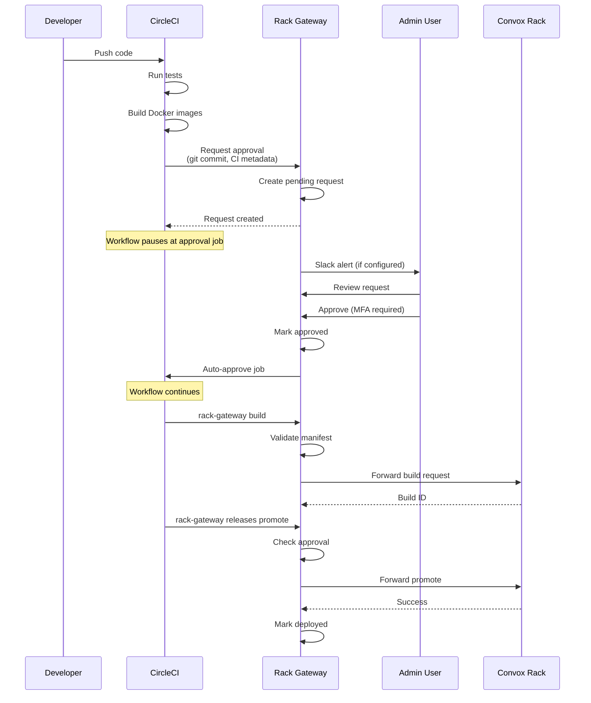
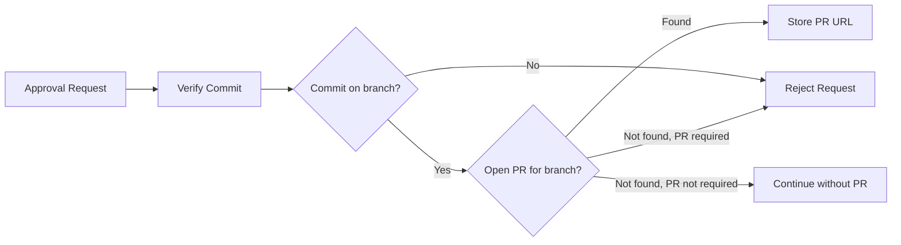
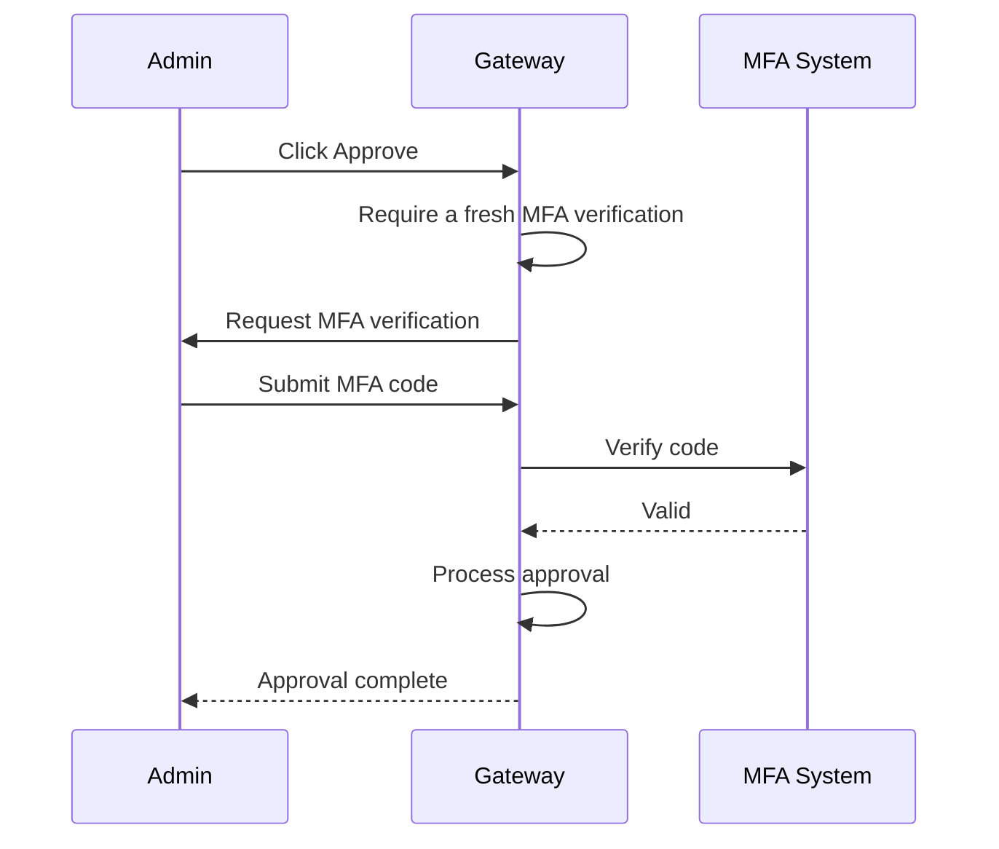
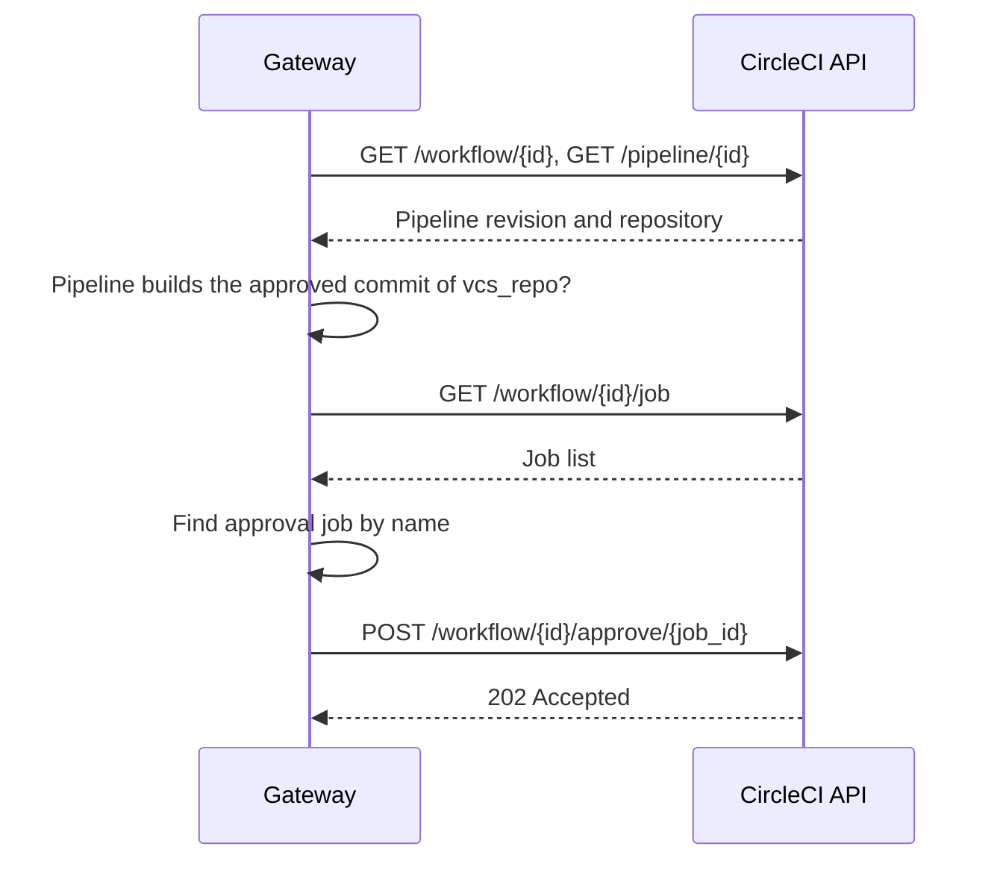
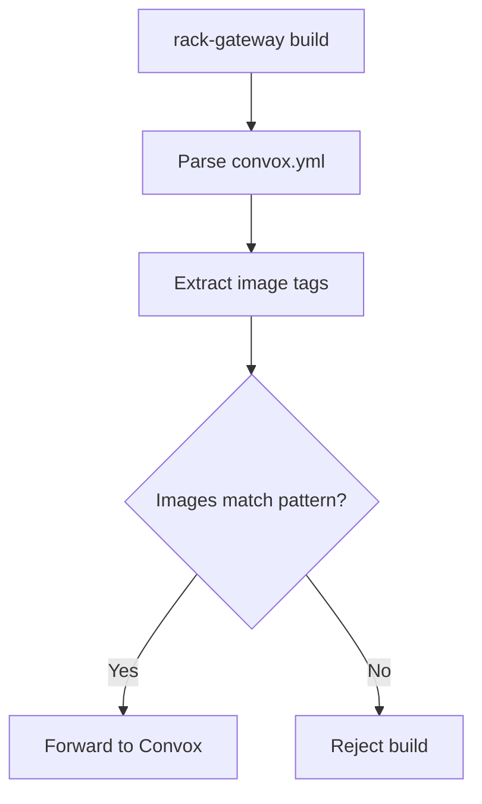
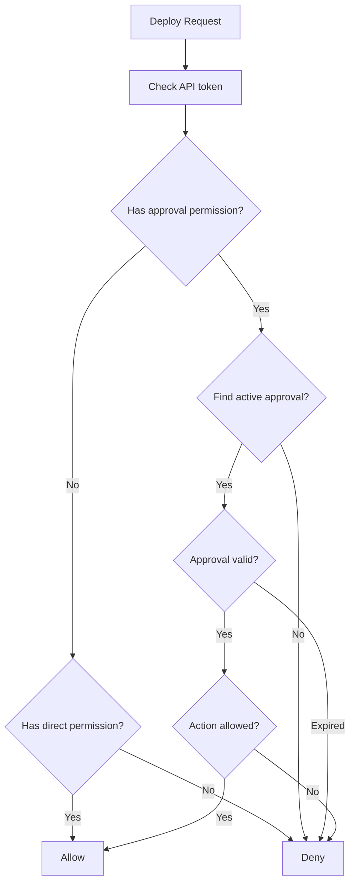

import { Aside, Steps, Tabs, TabItem } from '@astrojs/starlight/components';

This page provides a detailed walkthrough of the deploy approval workflow, from request creation to deployment completion.

## Complete Workflow



## Phase 1: Request Creation

When CI tests pass, the pipeline creates an approval request.

### Request Command

```bash
rack-gateway deploy-approval request \
  --app myapp \
  --git-commit "$CIRCLE_SHA1" \
  --branch "$CIRCLE_BRANCH" \
  --ci-metadata "{\"workflow_id\":\"$CIRCLE_WORKFLOW_ID\",\"pipeline_number\":\"<< pipeline.number >>\"}" \
  --message "Deploy $CIRCLE_BRANCH to production"
```

### What Gets Stored

| Field | Source | Purpose |
|-------|--------|---------|
| `git_commit_hash` | `--git-commit` | Identifies approved code |
| `git_branch` | `--branch` | Context for reviewers |
| `ci_metadata` | `--ci-metadata` | CI provider integration |
| `message` | `--message` | Human-readable description |
| `target_api_token_id` | The requesting API token, or `--target-api-token-id` | Token that will use approval |
| `app` | `--app` | Application name |
| `pr_url` | GitHub verification | The branch's open pull request, if it has one |

### GitHub Verification

GitHub verification is on by default (the app's `github_verification` setting). The gateway checks the commit
against the app's `vcs_repo` and refuses the request if the check fails, or if `GITHUB_TOKEN` or `vcs_repo` is
missing. Turning `github_verification` off for the app is the only way to skip it.



An open PR is required unless the app's `require_pr_for_branch` is off. Before checking the commit, the gateway
also refuses a request without `--branch`, and one from the app's `default_branch` or the repository's default
branch unless `allow_deploy_from_default_branch` is on (see [GitHub Integration](/integrations/deploy-approvals/github/#commit-verification)).

Verification modes:
- **latest**: Commit must be the latest on the branch
- **branch**: Commit must exist on the branch (uses git compare API)

## Phase 2: Admin Review

Admins see pending requests in the web UI.

### Request Details

The review UI shows:

- **Git commit hash** - The full SHA
- **Branch name** - Source branch
- **PR link** - If GitHub verification found one
- **CI pipeline** - Links to CircleCI pipeline
- **Message** - Context from CI
- **Created by** - CI/CD token used
- **Time** - When request was created

### Review Actions

| Action | Requires | Result |
|--------|----------|--------|
| **Approve** | Admin, MFA every time | Request approved, CI auto-approved. A request pending longer than `DEPLOY_APPROVAL_PENDING_MAX_AGE` has expired and can't be (`409`) |
| **Reject** | Admin, MFA every time | Request rejected with notes. Refused (`409`) once a promote has started under the approval: the rack may be applying it |
| **Extend** | Admin, MFA every time | A lapsed approval is approved again for a new window |
| **Ignore** | None | A pending request expires after `DEPLOY_APPROVAL_PENDING_MAX_AGE` (7 days) |

## Phase 3: Approval

<Steps>

1. **Admin clicks Approve**

   Initiates approval flow

2. **MFA challenge presented**

   Admin must verify with WebAuthn, TOTP, YubiKey OTP or a backup code. A recent step-up doesn't count:
   every approval asks again

3. **MFA verified**

   Server validates the MFA response

4. **Approver checked**

   With [Require a different approver](/integrations/deploy-approvals/#different-approver-optional) on, the
   request's creator and its API token's owner are refused with 403

5. **Request marked approved**

   Status changes, expiration timer starts

6. **CI auto-approval triggered**

   If configured, gateway calls CI API

</Steps>

### MFA Flow



### Approval Notes

Admins can add notes when approving:

```json
{
  "status": "approved",
  "approval_notes": "Reviewed diff, LGTM. PR #123 approved by team.",
  "approved_by_user_id": 42,
  "approved_at": "2024-01-15T10:30:00Z",
  "approval_expires_at": "2024-01-15T10:45:00Z"
}
```

## Phase 4: CI Auto-Approval

If CircleCI integration is configured, the gateway automatically approves the waiting job.

### CircleCI Flow



### Required Configuration

| Setting | Value | Example |
|---------|-------|---------|
| `CIRCLECI_TOKEN` | API token | `your-token` |
| `ci_provider` (per-app) | `circleci` | - |
| `circleci_approval_job_name` | Job name | `approve_deploy_prod` |
| `circleci_auto_approve_on_approval` | `true` | - |

<Aside type="tip">
The approval job name must exactly match the job name in your `.circleci/config.yml`.
</Aside>

## Phase 5: Build Validation

When CI calls `rack-gateway build`, the gateway validates the manifest.

### Manifest Validation



### Image Tag Pattern

There is no default: an approval-bound build is refused until the app's `service_image_patterns` setting
gives every service a pattern (its own, or `"*"`), and each pattern should name the image repository:

```json
{"*": "docker\\.io/myorg/app:{{GIT_COMMIT}}-amd64"}
```

```yaml
# convox.yml
services:
  web:
    image: docker.io/myorg/app:0123456789abcdef0123456789abcdef01234567-amd64
  worker:
    image: docker.io/myorg/app:0123456789abcdef0123456789abcdef01234567-amd64
```

Every service must use a pre-built image tagged with the full approved commit (`<sha>` or `<sha>-<suffix>`).
The gateway replaces `{{GIT_COMMIT}}` with the approved commit (regex-escaped) and requires each image to match
its pattern exactly. The commit always comes from the approval, never from the client.

The gateway reads the manifest from the uploaded archive as it streams from the rack, without holding the archive
in memory. It refuses an archive that contains the manifest more than once, because the rack writes each copy over the
one before. An archive may have at most 10,000 entries, 10 MB per file and 100 MB of files in total, and the manifest
at most 128 KB.

### What the Manifest Check Covers

These rules apply to every build of an app with `service_image_patterns`, whoever starts it, and to every
approval-bound build:

- **Every image a service runs is checked.** That's each service's `image` and its `initContainer.image`. An init
  container without an image runs its service's image; one with an image must match the service's pattern (and,
  for an approval-bound build, carry the approved commit). Timers have no image of their own: they run their
  service's. A service built from source (no `image`) is refused wherever a pattern applies, and always in an
  approval-bound build.
- **No other image keys.** A resource's image override (`resources.<name>.image`) is refused, and so is an `image`
  key anywhere else in the manifest, so an image field the gateway doesn't check can't run an image nobody approved.
- **`${...}` only as `${NAME}`, and never in an image.** The rack substitutes `${...}` with the app's environment
  (and, during the build, the build's build arguments) before it parses the manifest, and an unset name becomes
  empty. So a reference must be `${NAME}` (letters, digits and `_`, on one line), on a `key: value` or `- value`
  line (the key may contain `/`, as Kubernetes annotation keys do), either inside a quoted value or in an unquoted
  value made only of letters, digits and `_ . / @ + = ~ , % -`. Quote a value with spaces or colons that uses one.
  A checked image can't use `${...}` at all.
- **Checked again as the rack will load it.** A value can still change what the lines after it mean once it's
  substituted (a `"` or `[` swallows the lines that follow), and the app's environment is set separately from the
  manifest. So the gateway also loads the manifest with Convox's own parser, with the app's current environment and
  the build's arguments substituted, and checks the images in that result too. A manifest the rack couldn't load
  (a missing required environment variable, say) is refused.
- **The environment can't change under a checked build.** The rack's build reads the app's environment when it
  starts, after the gateway's check. So the gateway holds the app's env lock from reading the environment until the
  rack has created the build, and refuses an env change to the app (`env set`, `env unset`, a rollback, the web env
  editor) with `409 Conflict` until every build it checked has finished. A build stops holding up env changes when
  the rack reports it complete or failed, or an hour after it started (by then it has read the environment). Run
  the env change again once the build is done.
- **Plain YAML structure.** Merge keys (`<<`) are refused, because the rack's YAML parser applies them in a different
  order than the gateway's. An anchor can't hold an image (write each image out where it's used), and a mapping
  can't repeat a key.

The build request itself is checked for everyone:

- The build may only use the parameters the Convox CLI sends: `url`, `manifest`, `description`, `git-sha`,
  `build-args`, `development`, `no-cache` and `wildcard-domain`, each at most once.
- **External builds (`convox build --external`) are refused.** The rack answers one with a registry URL that holds the
  rack's own API password, and the gateway never hands out the rack's credentials. Build responses never include a
  `repository` field.
- Each build argument must be `NAME=value`, with no whitespace, quotes or backslashes in the value. A bare `NAME`
  would take its value from the build process's environment, which holds the rack's credentials.
- When the manifest is checked, the build's `url` must be `object://<app>/<key>` for the app being built.

### What Gets Tracked

After successful build:

| Field | Value |
|-------|-------|
| `object_url` | The uploaded archive (`object://<app>/...`) |
| `build_id` | Convox build ID |
| `release_id` | The build's release |

## Phase 6: Deploy Validation

Every deployment action validates the approval.

### Promotes Are Checked Too

A promote loads the release's manifest again, with the release's environment substituted, and takes its init
container images and resource images from that (each service itself runs the image its build pushed to the app's
registry). The environment can change between the build and the promote, so before forwarding a promote of an app
with `service_image_patterns`, and every approval-bound promote, the gateway reads the release from the rack and
loads its manifest the same way:

- each init container image must match its service's pattern, with `{{GIT_COMMIT}}` as the commit the release's
  build was made from (for an approval-bound promote, the approved commit, and the image must be tagged with it);
- no resource may override its image.

A promote the gateway refuses is answered with 403 and isn't forwarded, and one whose release it can't read with
502. Without patterns or an approval, promotes aren't checked.

### Gated Actions

| Action | Endpoint | Validation |
|--------|----------|------------|
| Object upload | `POST /apps/{app}/objects/tmp/{name}` | Approval waiting for its archive |
| Build create | `POST /apps/{app}/builds` | The approval's archive, manifest check |
| Build and build log read | `GET /apps/{app}/builds/{id}`, build logs | The approval's build |
| Release read and promote | `GET /apps/{app}/releases/{id}`, `POST .../promote` | The approval's release |
| Process start | `POST /apps/{app}/services/{service}/processes` | The approval's release, command in `approved_deploy_commands` |
| Process exec and stop | `SOCKET /apps/{app}/processes/{pid}/exec`, `DELETE /apps/{app}/processes/{pid}` | A process started under the approval |

Each check also requires that the token's owner could do the action themselves: an approval never gives a token
more than its owner's role.

The approval's `exec_commands` lists the commands it let through to each of its processes, in order. A command is
written to it before the exec reaches the rack (an exec the gateway can't record is refused), so a command whose
connection then failed is listed too. The audit log's `process.exec.start` events are the execs that started.

### Validation Flow



## Phase 7: Completion

After successful deployment, the request is marked as deployed.

### Final State

```json
{
  "status": "deployed",
  "build_id": "BABC123",
  "release_id": "RABC123"
}
```

### Audit Trail

The complete workflow generates audit entries:

| Event | Actor | Details |
|-------|-------|---------|
| `deploy_approval_request.create` | CI/CD token | Commit, branch, message, GitHub verification result, PR URL |
| `deploy_approval_request.approve` | Admin user | Notes, MFA method |
| `build.create` | CI/CD token | Build ID, manifest |
| `release.promote` | CI/CD token | Release ID |
| `deploy_approval_request.reject` | Admin user | Notes |
| `deploy_approval_request.expire` | `system` | Previous status (approved or pending) |

The `deploy_approval_request.create` entry records what [GitHub verification](/integrations/deploy-approvals/github/)
did for the request:

| Detail | Value |
|--------|-------|
| `github_verification` | `passed`, or `skipped` when `github_verification` is off for the app |
| `github_verification_skip_reason` | Why verification was skipped (only when skipped) |
| `vcs_repo` | Repository the commit was verified against (only when passed) |
| `verify_git_commit_mode` | `latest` or `branch` (only when passed) |
| `require_pr_for_branch` | `true` or `false`: whether an open PR was required (only when passed) |
| `pr_url` | The branch's open pull request, if it has one |

With verification on, a request that fails it is refused, as is one the gateway can't check because `GITHUB_TOKEN`
or the app's `vcs_repo` is missing. No request or `create` entry exists for a refused request.

## Error Handling

### Common Errors

<Tabs>
<TabItem label="No Valid Approval">

```
Error: You don't have permission to promote releases: this API token has no usable deploy approval for myapp:
its newest request, 3f2b9c1e-8d4a-4b6e-9f1a-2c7d5e8a1b0f (commit 0123456), was approved, but its approval
window ended at 2026-10-13T11:59:00Z
```

A token that relies on `deploy_with_approval` gets a 403 that says why, from its own newest request for the app:
it has none, or that request is waiting for approval, was rejected, has already been deployed, expired, or is
approved but doesn't cover this upload, build, release or command. The token can already read its own requests, so
the message reveals nothing new.

**Causes:**
- No request was created for this app and token, or it was rejected
- The approval window passed
- The request is for a different commit or token

**Resolution:**
- `rack-gateway deploy-approval show --app <app> --commit <sha>` shows the request and its status
- Create a new request, or ask an admin to extend a lapsed approval

</TabItem>
<TabItem label="Manifest Validation Failed">

```
Error: manifest validation failed: service web image "docker.io/myorg/app:latest" is not tagged with the approved commit 0123456789abcdef0123456789abcdef01234567
```

The build is refused with 403. Other messages name the rule that failed, for example `does not match required
pattern`, or `git-sha ... does not match the approved commit ...`.

**Causes:**
- Image tags don't include the full approved commit
- An image doesn't match the app's `service_image_patterns`

**Resolution:**
- Tag images with the full commit SHA, and reference those tags in `convox.yml`
- Check the pattern for each service

</TabItem>
</Tabs>

### Retry Behavior

| Scenario | Behavior |
|----------|----------|
| CI job fails after approval | Approval still valid until expiry |
| Upload or build refused by the rack | The claim is released, so CI can retry with the same approval |
| Build ran on the rack and failed | An approval makes one build: create a new request |
| Promote refused by the rack | Can retry promote with same approval |
| Promote timed out or lost its connection | It may still be running, or may have succeeded: the approval can't promote again. Check the rack, and create a new request if the promote didn't apply |
| Approval expired | Ask an admin to extend it, or create a new request. A build or process that started before it expired is still recorded on it |

## Best Practices

### For CI/CD Pipelines

- Always include accurate CI metadata
- Use descriptive messages with branch and commit
- Set appropriate timeout for `--wait` flag
- Handle approval rejection gracefully

### For Admins

- Review the diff before approving
- Add meaningful notes explaining approval
- Verify the PR is approved by team
- Check CI status before approving

### For Security

- Keep approval window short (15 min recommended)
- Require PR for production deployments
- Review audit logs regularly
- Use MFA for all admin accounts

## Next Steps

- [CircleCI Integration](/integrations/deploy-approvals/circleci/) - Complete CircleCI setup
- [GitHub Integration](/integrations/deploy-approvals/github/) - PR verification and comments
- [RBAC](/security/rbac/) - Permission configuration
