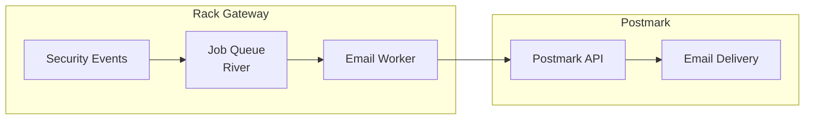
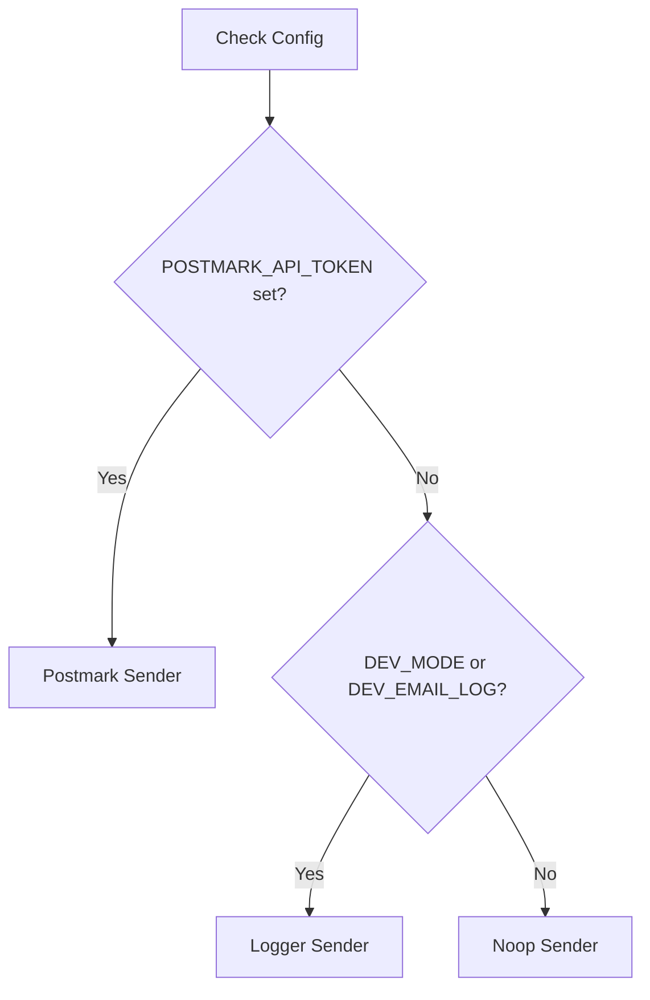

import { Aside, Steps, Tabs, TabItem } from '@astrojs/starlight/components';

Rack Gateway sends email notifications for security events, user management actions, and system alerts using Postmark.

## Features

- **Security Alerts**: New CLI logins, failed logins, MFA failures, rate limits
- **User Notifications**: Welcome emails, API tokens created for you, account locks and unlocks
- **Admin Alerts**: Users added, API tokens created, rack parameter changes, rate limits
- **Async Processing**: Background job queue for reliable delivery

## Architecture



## Setup

### 1. Create Postmark Account

<Steps>

1. Sign up at https://postmarkapp.com
2. Create a new server for Rack Gateway
3. Copy the Server API Token
4. Verify your sender domain

</Steps>

### 2. Configure Environment Variables

```bash
# Required to send email
POSTMARK_API_TOKEN=your-server-api-token

# Optional
POSTMARK_FROM=gateway@yourdomain.com   # Default: no-reply@<GOOGLE_ALLOWED_DOMAIN>
POSTMARK_STREAM=outbound               # Default: outbound
```

<Aside type="note">
The sender address (or its domain) must be verified in Postmark.
</Aside>

### 3. Verify Configuration

The gateway doesn't log which sender it chose. To check delivery, add a user (they get a welcome email) or create
an API token, then look at Postmark's activity log. Without `POSTMARK_API_TOKEN` the gateway sends nothing.

## Email Types

Every email names the gateway that sent it, so you can tell racks apart when one person gets email from several
gateways. The subject starts with `Rack Gateway (<RACK_DISPLAY_NAME>): `, for example
`Rack Gateway (Staging): New CLI Login`, and the email ends with a footer giving the gateway's name and URL. The
subjects below are shown without that prefix.

### Security Notifications

#### New CLI Login

Sent to the user whenever a CLI session is created for their account.

| Field | Content |
|-------|---------|
| Subject | New CLI Login |
| To | User email |
| Content | Time, device, IP address, user agent |

#### Failed MFA Verification

Sent to the user when MFA verification fails.

| Field | Content |
|-------|---------|
| Subject | Failed MFA Verification Attempt |
| To | User email |
| Content | Time, IP address, user agent |

#### Failed Login Attempt

Sent to the address that tried when a login fails after Google (for example an address that isn't a gateway user).

| Field | Content |
|-------|---------|
| Subject | Failed Login Attempt |
| To | User email |
| Content | Time, channel, status, IP, user agent |

#### Rate Limit Exceeded

Sent when a request is rate limited: to the signed-in user (if any), and to every admin who isn't locked
(looked up when it's sent, at most once per client IP in 15 minutes).

**To User:**
| Field | Content |
|-------|---------|
| Subject | Rate Limit Exceeded |
| To | User email |
| Content | Path, time, IP address |

**To Admins:**
| Field | Content |
|-------|---------|
| Subject | Rate Limit Exceeded - User \{email\} |
| To | All admin users |
| Content | User info, path, time, IP |

The same security email isn't sent again to the same recipient within 15 minutes (the admin alert, per client IP),
so a burst of failures produces one email.

### User Management

#### Welcome Email

Sent when a new user is added.

| Field | Content |
|-------|---------|
| Subject | Welcome |
| To | New user email |
| Content | Roles, inviter, gateway URL |

```
Hello Alice,

You have been added to the Production Rack Gateway by admin@example.com.

Your assigned roles: deployer, viewer

You can access the gateway at:
https://gateway.example.com

Please log in with your Google Workspace account to get started.

If you have any questions, please contact your administrator.

Welcome aboard!
```

#### User Added (Admin Notification)

Sent to all admins when a user is added.

| Field | Content |
|-------|---------|
| Subject | New user added: \{email\} |
| To | All admin users (BCC) |
| Content | User info, roles, creator, time |

#### Account Locked

Sent when a user account is locked.

| Field | Content |
|-------|---------|
| Subject | Account Locked |
| To | Locked user email |
| Content | Reason, contact instructions |

#### Account Unlocked

| Field | Content |
|-------|---------|
| Subject | Account Unlocked |
| To | Unlocked user email |

#### MFA Auto-Lock

Sent when an account is locked automatically after 5 failed MFA attempts in 5 minutes. The lock is recorded in
the audit log as `user.lock` by `system`.

| Field | Content |
|-------|---------|
| Subject | Account Locked - Multiple Failed Login Attempts |
| To | Locked user email |
| Content | Reason, contact instructions |

Every admin who isn't locked also gets **User locked: \{email\}**, asking them to check with the user before
unlocking the account.

### API Tokens

When an API token is created, its owner gets **New API token created** (the token's name and who created it),
and every other admin gets **API token created for \{email\}**.

### Rack Parameters

When rack parameters are changed through the gateway, every admin gets **\{email\} changed rack parameters**. It
names the changed parameters but never their values, which can hold credentials.

## Job Queue

Email notifications use River for async processing:

### Job Types

| Job Kind | Description |
|----------|-------------|
| `email:send:single` / `email:send:many` | Emails built by request handlers (API tokens, account locks and unlocks, MFA auto-lock, rack parameter changes) |
| `email:security:new_cli_session` | New CLI login notification |
| `email:security:failed_mfa` | Failed MFA notification |
| `email:security:failed_login` | Failed login notification |
| `email:security:rate_limit_user` | Rate limit user alert |
| `email:security:rate_limit_admin` | Rate limit admin alert |
| `email:user:welcome` | Welcome email |
| `email:user:added_admin` | Admin notification |

### Retry Behavior

A failed email job is retried with River's backoff (attempt⁴ seconds: 1s, 16s, 81s, about 4 minutes, 10 minutes
and so on), up to 11 attempts over about 7 hours, then discarded.

### Monitoring

Each failed attempt is logged with the job's kind, ID and attempt count (and reported to Sentry when configured):

```
[ERROR] job email:user:welcome failed: postmark send failed: 401 Unauthorized (id 1234, attempt 3 of 11)
```

## Development Mode

Without a Postmark token, emails can be logged instead of dropped:

```bash
DEV_EMAIL_LOG=true
# or, in a development (testbypass) build
DEV_MODE=true
```

They're logged at debug level under the `email.summary` and `email.body` topics, so also set `LOG_LEVEL=debug` and
`DEBUG_TOPICS=email.summary,email.body`:

```
[DEBUG email.summary] to=alice@example.com subject="Rack Gateway (Production): Welcome"
[DEBUG email.body] text=... html=...
```

## Configuration Reference

| Variable | Required | Default | Description |
|----------|----------|---------|-------------|
| `POSTMARK_API_TOKEN` | To send email | - | Postmark server API token |
| `POSTMARK_FROM` | No | `no-reply@<GOOGLE_ALLOWED_DOMAIN>` | Verified sender email |
| `POSTMARK_STREAM` | No | `outbound` | Message stream name |
| `DEV_EMAIL_LOG` | No | `false` | Log emails instead of sending |

## Sender Priority

The gateway selects email sender based on configuration:



| Sender | Behavior |
|--------|----------|
| Postmark | Sends via Postmark API |
| Logger | Logs to stdout (development) |
| Noop | Does nothing (silent) |

## Troubleshooting

### Emails not sending

<Steps>

1. **Verify configuration**
   - Check `POSTMARK_API_TOKEN` is set
   - Check `POSTMARK_FROM` (or the `no-reply@` default) is a verified sender
   - Restart gateway after changes

2. **Check Postmark**
   - Verify domain is verified
   - Check API token is valid
   - Review Postmark activity log

3. **Check gateway logs**
   - Look for email job errors
   - Check for Postmark API errors

</Steps>

### "401 Unauthorized" from Postmark

**Causes:**
- Invalid API token
- Token doesn't match server
- Server disabled

**Resolution:**
- Regenerate Postmark API token
- Verify using correct server token (not account token)

### "422 Inactive recipient"

**Causes:**
- Recipient email bounced previously
- Recipient marked as complaint

**Resolution:**
- Check Postmark suppressions list
- Contact recipient to verify email

### Emails going to spam

**Resolution:**
- Verify sender domain with SPF/DKIM/DMARC
- Use consistent "From" address
- Avoid spam trigger words

## Security Considerations

### Sender Verification

- Always verify your sender domain in Postmark
- Configure SPF, DKIM, and DMARC records
- Use a dedicated subdomain for gateway emails

### Content

- Emails never contain tokens, secrets or env var values; rack parameter emails name the parameters only
- Names and other user-supplied values are escaped in HTML emails
- Repeated security emails to the same recipient are suppressed for 15 minutes

## Best Practices

### For Production

- Use a verified production domain
- Monitor Postmark delivery rates
- Set up Postmark alerts for bounces
- Review suppression list regularly

### For Security

- Keep admin notification list current
- Review security email patterns
- Test email delivery regularly
- Archive emails for compliance if required

## Next Steps

- [Slack Integration](/integrations/slack/) - Real-time notifications
- [Audit Trail](/security/compliance/audit-trail/) - Event logging
- [Security Hardening](/security/hardening/) - Production security
