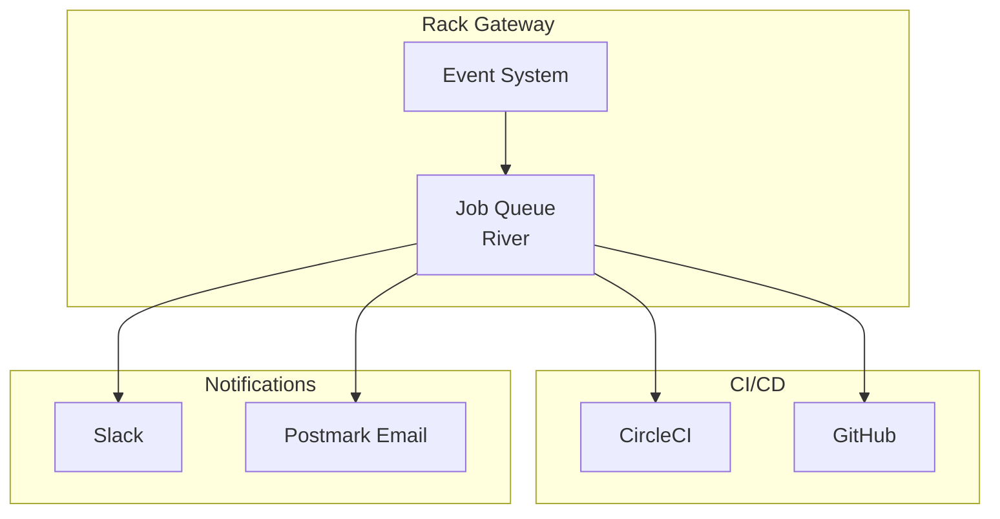

import { Card, CardGrid, Aside, Steps } from '@astrojs/starlight/components';

Rack Gateway integrates with external services for notifications, CI/CD automation, and enhanced security workflows.

## Available Integrations

<CardGrid>
  <Card title="Deploy Approvals" icon="approve-check">
    Require admin approval before CI/CD deployments.

    [Learn more →](/integrations/deploy-approvals/)
  </Card>
  <Card title="Slack" icon="discord">
    Send security and deployment notifications to Slack channels.

    [Learn more →](/integrations/slack/)
  </Card>
  <Card title="Email" icon="email">
    Receive security alerts via email using Postmark.

    [Learn more →](/integrations/email/)
  </Card>
</CardGrid>

## Integration Architecture

## Quick Setup

### Deploy Approvals

Enforce admin review before deployments:

<Steps>

1. **Configure CI/CD token**

   Create an API token with the `cicd` role

2. **Configure the app**

   Set the app's `vcs_repo` and `service_image_patterns`, and for CircleCI the approval job name and
   `circleci_auto_approve_on_approval`

3. **Set up CI workflow**

   Add an approval request step and a hold job to your CircleCI config

</Steps>

[Complete setup guide →](/integrations/deploy-approvals/)

### Slack Notifications

Get real-time notifications in Slack:

<Steps>

1. **Create Slack app**

   Use the provided manifest to create your Slack app

2. **Configure credentials**

   Set `SLACK_CLIENT_ID` and `SLACK_CLIENT_SECRET`

3. **Connect via UI**

   Navigate to Integrations and authorize Slack

4. **Configure channels**

   Route different event types to appropriate channels

</Steps>

[Complete setup guide →](/integrations/slack/)

### Email Notifications

Receive security alerts via email:

<Steps>

1. **Create Postmark account**

   Sign up at postmarkapp.com

2. **Configure gateway**

   Set `POSTMARK_API_TOKEN` and `POSTMARK_FROM`

3. **Automatic notifications**

   Security events are sent automatically

</Steps>

[Complete setup guide →](/integrations/email/)

## Event Types

Integrations can respond to these event categories:

Every audit log entry can be routed to Slack with an action pattern; the defaults are listed on the
[Slack](/integrations/slack/#default-channels) page. Email is sent for a fixed set of events:

| Category | Examples | Email |
|----------|----------|-------|
| **Authentication** | New CLI login, failed login | The user |
| **MFA** | Failed verification, automatic lock after 5 failures | The user |
| **User Management** | User added, locked, unlocked | The user; admins when a user is added |
| **API Tokens** | Token created | The owner and the other admins |
| **Rack Parameters** | Parameters changed | Admins |
| **Security** | Rate limit exceeded | The user and admins |

Deploy approval requests also reach CI and GitHub: approving one can approve the CircleCI hold job, and the
gateway can comment on the pull request.

## Configuration Reference

| Variable | Integration | Description |
|----------|-------------|-------------|
| `SLACK_CLIENT_ID` | Slack | OAuth client ID |
| `SLACK_CLIENT_SECRET` | Slack | OAuth client secret |
| `POSTMARK_API_TOKEN` | Email | Postmark API token |
| `POSTMARK_FROM` | Email | Sender email address |
| `CIRCLECI_TOKEN` | CircleCI | API token for job approval |
| `GITHUB_TOKEN` | GitHub | API token for commit verification and PR comments |
| `GITHUB_API_URL` | GitHub | REST API root for GitHub Enterprise (default `https://api.github.com`) |

See [Configuration Reference](/configuration/environment-variables/) for complete details.

## Next Steps

- [Deploy Approvals](/integrations/deploy-approvals/) - CI/CD approval workflow
- [Slack](/integrations/slack/) - Slack notifications
- [Email](/integrations/email/) - Email notifications
