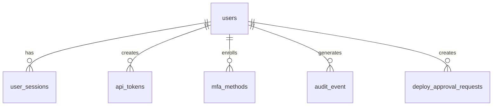

import { Aside, Steps } from '@astrojs/starlight/components';

Rack Gateway uses PostgreSQL for persistent storage. This guide covers database maintenance tasks including migrations, backups, and troubleshooting.

## Database Commands

The `rack-gateway-api` binary includes maintenance subcommands for database operations.

### Apply Migrations

Apply pending database migrations:

```bash
rack-gateway-api migrate
```

This command:
- Connects using the first of `RGW_DATABASE_URL`, `GATEWAY_DATABASE_URL` and `DATABASE_URL` that is set, or
  else the `PG*` environment variables
- Applies the migrations built into the binary (from `internal/gateway/db/migrations/`), each in its own
  transaction
- Uses `schema_migrations` table to track applied migrations
- Is safe to run repeatedly (idempotent)

Run it as the admin database user: on Convox, `convox run admin ./rack-gateway-api migrate -a rack-gateway` (the
`admin` service sets `RGW_DATABASE_URL` to `ADMIN_DATABASE_URL`). The app user can't change the schema.

<Aside type="tip">
Production gateways never migrate on startup (only development builds do), so run `migrate` as part of every
deploy, before promoting the new release. `scripts/deploy.sh` does this.
</Aside>

### Reset Database

Reset the database to a clean state (development only):

```bash
# Required safety guards
export RESET_RACK_GATEWAY_DATABASE=DELETE_ALL_DATA
export DEV_MODE=true # development (testbypass) builds only

rack-gateway-api reset-db
```

It drops every table and re-runs the migrations. The gateway creates the
[seed users](/configuration/environment-variables/#seed-users) again when it next starts.

<Aside type="danger">
This command **drops all tables and data**. It requires explicit environment variable guards to prevent accidental execution.
</Aside>

**Safety guards:**
1. `RESET_RACK_GATEWAY_DATABASE=DELETE_ALL_DATA` - Must be set exactly
2. Database must be marked as development, OR set `DISABLE_DATABASE_ENVIRONMENT_CHECK=1`
3. For a database not yet marked, `DEV_MODE=true` (development builds only) or `DISABLE_DATABASE_ENVIRONMENT_CHECK=1`

### Verify the Audit Log

Check the audit log's hash chain and its S3 anchors (read-only; exits non-zero on any integrity failure):

```bash
rack-gateway-api verify-audit [--from N] [--to N] [--hash-v2-from N] [--max-anchor-age 3h] [--no-anchors]
```

It needs `AUDIT_HMAC_SECRET`, and `AUDIT_HASH_V2_FROM` on a gateway upgraded from a version before hash v2. See
[Verification](/deployment/terraform/s3-worm-storage/#verification) for the permissions it needs and what it
checks. The gateway also runs this check every hour and alerts when it fails.

### Check Migration Status

Verify which migrations have been applied:

```bash
# Connect to database and check
psql $DATABASE_URL -c "SELECT * FROM schema_migrations ORDER BY version;"
```

## Backup Procedures

### Automated Backups (AWS RDS)

If using AWS RDS, configure automated backups:

```hcl
# Terraform configuration
resource "aws_db_instance" "gateway" {
  # Automated backups
  backup_retention_period = 30
  backup_window           = "03:00-04:00"

  # Point-in-time recovery
  copy_tags_to_snapshot = true
}
```

### Long-Term Retention (AWS Backup)

RDS automated backups keep at most 35 days. For longer retention (for example 12 monthly and 7 yearly backups),
add the instance to an AWS Backup plan, one per environment:

```hcl
resource "aws_backup_vault" "gateway" {
  name        = "rack-gateway-backups"
  kms_key_arn = aws_kms_key.backup.arn
}

resource "aws_backup_plan" "gateway" {
  name = "rack-gateway"

  rule {
    rule_name         = "daily"
    target_vault_name = aws_backup_vault.gateway.name
    schedule          = "cron(0 3 * * ? *)"
    lifecycle { delete_after = 7 }
  }

  rule {
    rule_name         = "monthly"
    target_vault_name = aws_backup_vault.gateway.name
    schedule          = "cron(0 5 1 * ? *)"
    lifecycle { delete_after = 365 }
  }

  rule {
    rule_name         = "yearly"
    target_vault_name = aws_backup_vault.gateway.name
    schedule          = "cron(0 6 1 1 ? *)"
    lifecycle { delete_after = 2555 }
  }
}

resource "aws_backup_selection" "gateway_rds" {
  name         = "rack-gateway-rds"
  plan_id      = aws_backup_plan.gateway.id
  iam_role_arn = aws_iam_role.backup.arn # a role AWS Backup can assume, with its RDS backup policy
  resources    = [aws_db_instance.gateway.arn]
}
```

Set the schedules and retention to your policy. The database is the only copy of the full audit log (the S3
anchors hold hashes), so its backups are your audit log retention.

### Manual Backup

Create a manual backup using `pg_dump` with the admin connection (the app user can't read every table):

```bash
# Full database backup
pg_dump "$ADMIN_DATABASE_URL" > rack_gateway_backup_$(date +%Y%m%d).sql

# Compressed backup
pg_dump "$ADMIN_DATABASE_URL" | gzip > rack_gateway_backup_$(date +%Y%m%d).sql.gz
```

### Restore from Backup

Prefer the RDS point-in-time restore to just before the problem. A restore to an earlier point loses the audit
events written since, and the S3 anchors written after that point still name them: `verify-audit` then fails with
`anchored event N is missing from the database`. Keep that report with your incident record.

<Steps>

1. **Stop the gateway service**

   ```bash
   convox scale gateway --count 0 -a rack-gateway
   ```

2. **Restore the database**

   Restore the RDS snapshot, or load a dump as the admin user into a database with the audit roles already
   created (`scripts/audit-roles.sql`, see [Database Users and Audit Roles](/deployment/database-setup/#database-users-and-audit-roles)):

   ```bash
   psql "$ADMIN_DATABASE_URL" < rack_gateway_backup_20240115.sql
   ```

3. **Run any pending migrations**

   ```bash
   convox run admin ./rack-gateway-api migrate -a rack-gateway
   ```

4. **Restart the service and verify the audit log**

   ```bash
   convox scale gateway --count 1 -a rack-gateway
   convox run admin ./rack-gateway-api verify-audit -a rack-gateway
   ```

</Steps>

## Schema Overview

The database contains these main tables:

| Table | Purpose |
|-------|---------|
| `users` | User accounts from OAuth |
| `user_sessions` | Active user sessions |
| `api_tokens` | API tokens for CI/CD |
| `mfa_methods` | User MFA enrollments |
| `audit.audit_event` | Immutable audit log entries |
| `mfa_backup_codes` | MFA backup codes |
| `trusted_devices` | Trusted devices (skip MFA at web login) |
| `settings` | Gateway configuration |
| `deploy_approval_requests` | Deploy approval requests |
| `river_job` | Background jobs (emails, Slack, CI, anchors) |

### Key Relationships



## Maintenance Tasks

### Cleanup Old Sessions

Expired and revoked sessions stay in the table (nothing prunes them). To clear old ones, as the admin user:

```sql
-- Sessions that ended more than 30 days ago
DELETE FROM user_sessions
WHERE (revoked_at IS NOT NULL AND revoked_at < NOW() - INTERVAL '30 days')
   OR expires_at < NOW() - INTERVAL '30 days';
```

Don't delete by `created_at`: a CLI session stays valid as long as it's used every 90 days.

### Audit Log Growth

Audit events are never deleted. The database refuses `UPDATE` and `DELETE` on `audit.audit_event`, and the hash
chain needs every event to verify. Plan storage for the log to grow (see
[Database Setup](/deployment/database-setup/#audit-log-considerations)):

```sql
-- Audit log volume per day
SELECT COUNT(*), DATE(timestamp) AS day
FROM audit.audit_event
GROUP BY DATE(timestamp)
ORDER BY day DESC
LIMIT 10;
```

### Vacuum and Analyze

Regular maintenance improves performance:

```sql
-- Analyze query statistics
ANALYZE;

-- Reclaim space from deleted rows
VACUUM ANALYZE;
```

For RDS, this happens automatically. For self-managed PostgreSQL, schedule regular maintenance.

## Connection Management

### Connection Pool Settings

Configure connection pooling (the defaults are shown; see
[Connection Pool](/deployment/database-setup/#connection-pool) for sizing):

```bash
DB_MAX_OPEN_CONNS=10     # Maximum connections per pool (each process has two)
DB_MAX_IDLE_CONNS=3      # Idle connections to keep warm, per pool
DB_CONN_MAX_LIFETIME=30m # Connection lifetime
DB_CONN_MAX_IDLE_TIME=10m # Idle timeout
```

### Monitoring Connections

```sql
-- Current active connections
SELECT count(*) FROM pg_stat_activity
WHERE datname = 'rack_gateway';

-- Connection details
SELECT usename, application_name, client_addr, state
FROM pg_stat_activity
WHERE datname = 'rack_gateway';
```

## Troubleshooting

### Migration Failures

If a migration fails:

1. Check the error message for the specific issue
2. Fix the underlying problem (permissions, constraints, etc.)
3. Re-run `rack-gateway-api migrate`

Each migration runs in a transaction with its `schema_migrations` row, so a failed migration leaves nothing
behind and is retried on the next run.

### Connection Issues

If the gateway can't connect to the database:

```bash
# Test connectivity
psql $DATABASE_URL -c "SELECT 1;"

# Check if host is reachable
nc -zv $PGHOST $PGPORT

# Verify SSL settings
psql "$DATABASE_URL?sslmode=require" -c "SELECT 1;"
```

### Slow Queries

Identify slow queries:

```sql
-- Enable query logging (if not already)
ALTER SYSTEM SET log_min_duration_statement = '1000';  -- Log queries > 1s

-- Check for long-running queries
SELECT pid, now() - pg_stat_activity.query_start AS duration, query
FROM pg_stat_activity
WHERE state = 'active'
ORDER BY duration DESC;
```

### Disk Space

Check database size:

```sql
SELECT pg_size_pretty(pg_database_size('rack_gateway'));

-- Size by table
SELECT relname, pg_size_pretty(pg_total_relation_size(relid))
FROM pg_catalog.pg_statio_user_tables
ORDER BY pg_total_relation_size(relid) DESC;
```

## Docker Development

When using the Docker development stack:

### Migrate

```bash
task docker:db:migrate
```

### Reset

```bash
task docker:db:reset
```

### Connect to Database

```bash
docker exec -it rack-gateway-postgres-1 psql -U postgres -d gateway_dev
```

## Best Practices

1. **Always run migrations before promoting a release** - Include in deployment scripts
2. **Use automated backups** - Configure RDS backup retention
3. **Monitor connection usage** - Prevent connection exhaustion
4. **Keep audit logs** - They can't be deleted; plan storage for them
5. **Test restore procedures** - Verify backups actually work, and run `verify-audit` on the restored copy

## Further Reading

- [AWS Infrastructure](/deployment/terraform/aws-infrastructure/) - RDS configuration
- [Production Checklist](/deployment/production-checklist/) - Pre-deployment verification
- [Troubleshooting](/operations/troubleshooting/) - Common issues
