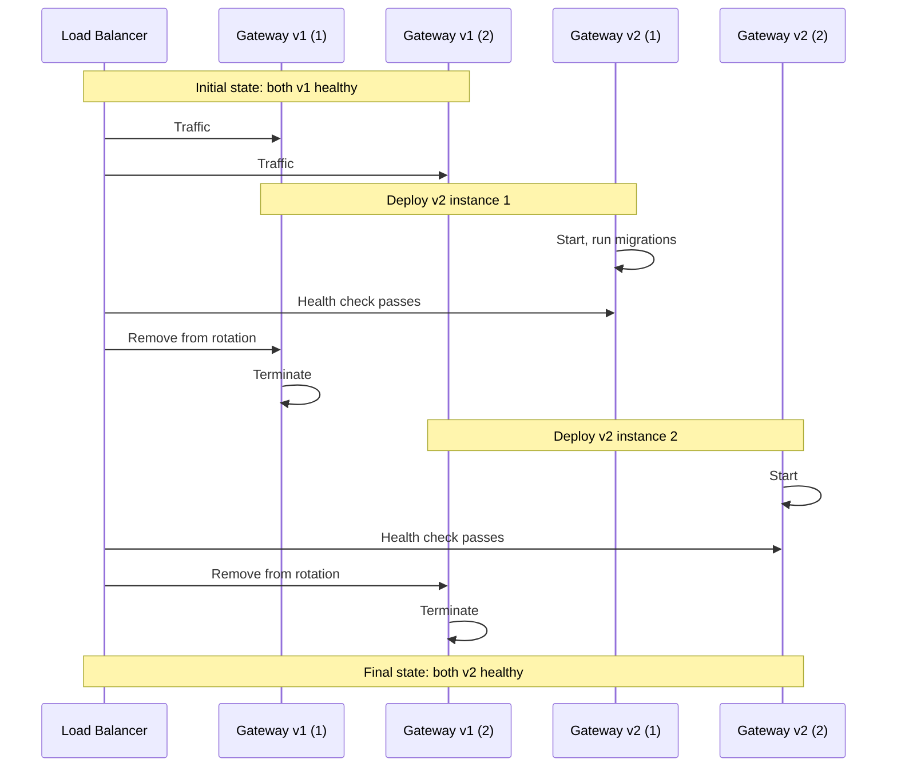

import { Aside, Steps } from '@astrojs/starlight/components';

This guide covers upgrading Rack Gateway to new versions, including planning, execution, and rollback procedures.

## Before Upgrading

### Check Release Notes

Always review the release notes for breaking changes:

1. Visit the [GitHub Releases](https://github.com/docspring/rack-gateway/releases)
2. Read all releases between your current and target version
3. Note any breaking changes or migration requirements

### Verify Current Version

```bash
# Check deployed version
convox ps -a rack-gateway | head -5

# Or via API
curl https://gateway.example.com/api/v1/health
```

### Backup Database

Create a backup before upgrading:

```bash
# RDS snapshot (AWS)
aws rds create-db-snapshot \
  --db-instance-identifier rack-gateway-prod \
  --db-snapshot-identifier rack-gateway-pre-upgrade-$(date +%Y%m%d)

# Or manual backup
pg_dump $DATABASE_URL > backup_pre_upgrade.sql
```

## Upgrade Procedures

### Convox Deployment

<Steps>

1. **Update the image tag**

   Edit `convox.yml`:
   ```yaml
   services:
     gateway:
       image: docker.io/docspringcom/rack-gateway:v1.2.0
   ```

2. **Review environment changes**

   Check if new environment variables are required:
   ```bash
   # Compare current env with docs
   convox env -a rack-gateway
   ```

3. **Build, migrate, then promote**

   The gateway doesn't run migrations on startup in production, so run them against the new release
   before promoting it:

   ```bash
   convox build -a rack-gateway                 # note the release ID it prints
   convox run admin -a rack-gateway --release RELEASE_ID ./rack-gateway-api migrate
   convox releases promote RELEASE_ID -a rack-gateway --wait
   ```

   `scripts/deploy.sh <rack>` does these three steps through the gateway, and `scripts/deploy_all.sh`
   runs them for every rack in turn.

4. **Verify deployment**

   ```bash
   # Check health
   curl https://gateway.example.com/api/v1/health

   # Check logs for errors
   convox logs -a rack-gateway --since 5m
   ```

</Steps>

### Docker Deployment

<Steps>

1. **Pull new image**

   ```bash
   docker pull docker.io/docspringcom/rack-gateway:v1.2.0
   ```

2. **Stop current container**

   ```bash
   docker-compose down
   ```

3. **Update docker-compose.yml**

   ```yaml
   services:
     gateway:
       image: docker.io/docspringcom/rack-gateway:v1.2.0
   ```

4. **Run migrations**

   ```bash
   docker-compose run --rm gateway rack-gateway-api migrate
   ```

5. **Start new version**

   ```bash
   docker-compose up -d
   ```

6. **Verify**

   ```bash
   curl http://localhost:8080/api/v1/health
   docker-compose logs -f
   ```

</Steps>

### Kubernetes Deployment

<Steps>

1. **Update deployment**

   ```yaml
   apiVersion: apps/v1
   kind: Deployment
   spec:
     template:
       spec:
         containers:
           - name: gateway
             image: docker.io/docspringcom/rack-gateway:v1.2.0
   ```

2. **Apply migration job**

   ```bash
   kubectl apply -f migration-job.yaml
   kubectl wait --for=condition=complete job/rack-gateway-migrate
   ```

3. **Roll out deployment**

   ```bash
   kubectl apply -f deployment.yaml
   kubectl rollout status deployment/rack-gateway
   ```

4. **Verify**

   ```bash
   kubectl get pods -l app=rack-gateway
   kubectl logs -l app=rack-gateway --tail=100
   ```

</Steps>

## Zero-Downtime Upgrades

For high-availability deployments:

### Prerequisites

- At least 2 gateway instances
- Load balancer with health checks
- Rolling deployment strategy

### Procedure



### Convox Rolling Deployment

Convox handles this automatically with proper configuration:

```yaml
services:
  gateway:
    scale:
      count: 3
    deployment:
      minimum: 2    # Keep 2 running during deploy
```

## Database Migrations

Migrations run automatically on startup only in development builds with `DEV_MODE=true`; the release image never
runs them on startup. In production, run them against the new release before promoting it:

```bash
convox run admin -a rack-gateway --release RELEASE_ID ./rack-gateway-api migrate
```

Migrations are idempotent; running them again is safe.

### Rollback Migrations

<Aside type="danger">
Rolling back migrations can cause data loss. Only do this if absolutely necessary and you have a backup.
</Aside>

1. Restore from backup if needed
2. Deploy the previous version
3. Migrations are forward-only. Most leave the schema usable by the previous version, but not all: a release note
   below says when the previous version can't run (or can't fully run) against the new schema.

## Rollback Procedures

### Quick Rollback (Convox)

```bash
# List previous releases
convox releases -a rack-gateway

# Rollback to previous release
convox releases rollback RELEASE_ID -a rack-gateway
```

### Image Rollback

```bash
# Update to previous image
convox env set IMAGE_TAG=v1.1.0 -a rack-gateway
convox deploy -a rack-gateway
```

### Database Rollback

If a migration caused issues:

1. Stop the gateway
2. Restore database from backup
3. Deploy previous version

```bash
# Stop gateway
convox scale gateway --count 0 -a rack-gateway

# Restore database (example for RDS)
aws rds restore-db-instance-from-db-snapshot \
  --db-instance-identifier rack-gateway-restored \
  --db-snapshot-identifier rack-gateway-pre-upgrade-20240115

# Update DATABASE_URL to point to restored instance
# Deploy previous version
```

## Release Notes That Need Action

### Audit hash v2 and `verify-audit`

This release changes how audit events are hashed (hash v2: every stored column, recomputable from the row) and
adds `rack-gateway-api verify-audit`, which checks the chain and the S3 anchors. The gateway also runs those checks
itself every hour and alerts when they fail.

1. **The previous version can't write audit events to the database once you've migrated.** The migration replaces
   `audit.append_audit_event`. From `migrate` until the new release is promoted, the running release's audit
   writes fail; requests aren't blocked, the failures are logged, and every event still goes to stdout (and so to
   CloudWatch). Promote straight after migrating (`scripts/deploy.sh` does). The same applies if you roll back:
   the earlier release can't write audit events to the database until you roll forward again. Events from those
   windows are only in the logs, never in the chain.
2. **Existing events become legacy (v1) events.** `verify-audit` can't recompute their HMAC (it covered values
   the database doesn't store exactly), so it only checks their `previous_hash` links. Events written from now on
   are hash v2 and fully checked.
3. **Pin where hash v2 starts.** Right after promoting, run `verify-audit` (see below). It prints
   `hash v2 from event N` or, before the new release has written an event, a failure naming the event that will
   be the first. Set `AUDIT_HASH_V2_FROM=N` in the gateway's environment and wherever else `verify-audit` runs.
   Without it, verification fails while legacy events exist, until an anchor written by this release (within the
   hour) confirms the start, and always without anchors. See
   [Pinning where hash v2 starts](/deployment/terraform/s3-worm-storage/#pinning-where-hash-v2-starts).
4. **Give the gateway's role `s3:ListBucketVersions` and `s3:GetObjectVersion` on the anchor bucket** (see
   [IAM Role for the Gateway](/deployment/terraform/s3-worm-storage/#iam-role-for-the-gateway)). The hourly
   verification reads every version of each anchor; without them every run fails and alerts. To run
   `verify-audit` elsewhere, it needs `AUDIT_HMAC_SECRET`, a database role that can read `audit.audit_event`
   (`audit_reader` is enough), and for the anchor checks `AUDIT_ANCHOR_BUCKET`, `AUDIT_ANCHOR_CHAIN_ID` and AWS
   credentials allowed `s3:ListBucket`, `s3:ListBucketVersions`, `s3:GetObject` and `s3:GetObjectVersion` on the
   anchor bucket and `kms:Decrypt` on its key.
5. **Run it once, and route its alerts to Slack.**

   ```bash
   convox run gateway -a rack-gateway ./rack-gateway-api verify-audit
   ```

   From then on the gateway runs the same checks every hour, sends failures to Sentry and Slack, and shows the
   latest result on the **Audit Logs** page
   ([Hourly verification in the gateway](/deployment/terraform/s3-worm-storage/#hourly-verification-in-the-gateway)).
   Slack integrations connected from this release on send the alerts (actions `audit_log.verification_failed` and
   `audit_log.verification_recovered`) to `#security`; for an existing integration, add `audit_log.verification_*`
   to a channel's action patterns on the **Integrations** page. The same goes for failed MFA verifications
   (`mfa.verify_failed`).
   Verification also fails when no anchor has been written for 3 hours.
6. **Expect findings in anchors from earlier versions.** Anchors written before this release have no `format`.
   Their `prev_anchor_hash` stopped naming the previous anchor once the bucket held 1000 anchors; those are
   counted, not failures. Earlier releases didn't serialise anchor writes, so concurrent runs could write an hour's
   key twice, which `verify-audit` reports as an overwritten anchor; check the versions' timestamps and contents
   to confirm they're from the same hour's job. Earlier releases also retried a failing anchor job for weeks;
   an anchor without a `format` stored more than 6 hours after its `ts_utc` gets a warning. Builds from before
   v0.0.1 wrote per-second keys (`anchor-YYYYMMDDTHHMMSSZ.json`, reported as not matching `ts_utc`) and
   `.sha256` files (ignored, with a warning). Locked anchors can't be changed, so these findings repeat on every
   run, and the hourly verification keeps failing (with a daily reminder), until the anchors' retention ends and
   they're deleted.

### Column encryption key required

TOTP seeds, YubiKey public IDs and the Slack bot token are now stored encrypted with a dedicated key. See
[Column Encryption](/configuration/environment-variables/#column-encryption).

1. **Set `COLUMN_ENCRYPTION_KEY` before deploying** (`openssl rand -base64 32`) and back it up. Every command
   that opens the database, including `migrate`, refuses to run without it, so a deploy without the key
   fails before the new release is promoted.
2. **Existing secrets are encrypted when the new release starts**, before it serves requests. The log shows
   a `Column encryption:` line with counts and a warning for each row encrypted. This happens at startup rather
   than in `migrate` because the previous release keeps serving while `migrate` runs. It runs again 10 minutes
   after startup, for anything the previous release stored during the rollout (a TOTP enrollment or a Slack
   reconnect); if it encrypts anything then, it reports it to Sentry. During this upgrade that can be a real
   enrollment from the rollout; after it, it means a secret was written straight into the database.
3. **Expect a short gap for TOTP and YubiKey OTP.** Once the new release has upgraded the data, any process
   still running the previous release can't read the encrypted values, so its TOTP and YubiKey OTP checks
   and Slack notifications fail until it is replaced. WebAuthn and backup codes keep working.
4. **Rolling back** to a release from before column encryption has the same effect until you deploy this
   release again.

### Test bypasses compiled out of the release image

The published image no longer contains the development and test bypasses. It refuses to start, `migrate`,
`reset-db` or `write-anchor` while any of these is set, naming each one:

- `DEV_MODE` or `E2E_TEST_MODE` set to a true value (`DEV_MODE=false` is fine)
- `COOKIE_SECURE=false` (session cookies always have `Secure`, so serve the gateway over HTTPS)
- `AWS_ENDPOINT_URL`, `AWS_ENDPOINT_URL_S3`, `AWS_ENDPOINT_URL_STS`, `AWS_ENDPOINT_URL_KMS` or `POSTMARK_API_BASE`
- a `GOOGLE_OAUTH_BASE_URL` that isn't `https://`

Before upgrading, remove them from the gateway's environment. `rack-gateway-api build-info` shows whether an image
has the bypasses compiled in.

A database the gateway first started with `DEV_MODE` on is marked `development`, and stays marked that way. Check
`SELECT environment FROM rgw_internal_metadata` on production databases; a production
gateway should report `production`.

### Secrets and env var lists checked at startup (v0.1.7)

Check these before upgrading:

- **Secrets:** `APP_SECRET_KEY` and `AUDIT_HMAC_SECRET` must each be at least 32 bytes, and neither can be the
  development value from this repository. `migrate` refuses weak ones too, so a deploy stops before it promotes.
  Generate new ones with `openssl rand -base64 32`. Changing `AUDIT_HMAC_SECRET` breaks verification of earlier
  audit events, so only replace it if it's actually weak.
- **Env var list variables:** `CONVOX_SECRET_ENV_VARS` and the `protected_env_vars`, `secret_env_vars` and
  `audit_visible_env_vars` setting variables must be a JSON array of names or a comma-separated list of names. A
  quoted value (`'"A,B"'`, as `jsonencode` of a string writes) or an invalid name stops the gateway from starting.
- **Stored lists and image patterns:** a stored env var list with an invalid name (for example `STRIPE_*`, which
  never matched anything) makes that app's env count as all secret and protected. Its env pages return 500 until
  you fix the list under **Apps → `{app}` → Settings**. A stored `service_image_patterns` value that isn't an object
  of valid patterns refuses the app's builds.
- **Promotes are checked against image patterns:** for an app with `service_image_patterns`, a promote now loads
  the release's manifest with the release's env, as the rack does, and is refused (403) if an init container image
  doesn't match the patterns, with `{{GIT_COMMIT}}` as the commit the release was built from, or a resource sets
  its own `image`. Check this before rolling back to an older release. See
  [Promotes are checked too](/integrations/deploy-approvals/workflow/#promotes-are-checked-too).

### Deploy approvals bound to commits (v0.1.3)

Approval-bound CI builds now have to use pre-built images tagged with the approved commit, from a repository
pinned by `service_image_patterns`. Builds are refused until the patterns are set, so plan the rollout:

1. **Set `service_image_patterns` right after the new version is live, not before.** Earlier versions require
   the build's `git-sha` once patterns are configured, and a CI build from a directory that isn't a git
   checkout sends none, so setting them first breaks deploys on the old version. Avoid running CI deploys
   until the patterns are set: a build refused in that window has already used up its approval's archive
   upload, so the request has to be rejected (or left to expire) and requested again.
2. **Check `approved_deploy_commands` is a JSON array of strings** for every app. An empty list (or a value of
   any other shape) now allows no commands, where it used to allow every command. The settings API refuses
   other shapes from this version on.
3. **Check `vcs_repo`** is `owner/repo` for apps using CircleCI auto-approval. Hold jobs are only approved when
   the workflow's pipeline builds the approved commit of that repository.
4. CircleCI approval jobs queued by the previous version are cancelled rather than run; approve those holds in
   CircleCI by hand.
5. Earlier versions stored `CIRCLECI_TOKEN` and `GITHUB_TOKEN` in background job arguments. Once the old
   version is fully drained, remove them from `river_job.args` and rotate both tokens.

## Version Compatibility

### API Compatibility

Rack Gateway maintains backward compatibility within major versions:

| Version Range | Compatibility |
|--------------|---------------|
| v1.x → v1.y | API compatible |
| v1.x → v2.x | Check migration guide |

### CLI Compatibility

The CLI should match the gateway major version:

| Gateway | CLI | Compatible |
|---------|-----|------------|
| v1.2.0 | v1.0.0 | Yes |
| v1.2.0 | v2.0.0 | Check release notes |

### Database Compatibility

Database migrations are usually additive within major versions. Rollback requires:

1. Previous version must be able to use the new schema (check the release notes above: after the audit hash v2
   migration, earlier versions can't write audit events to the database)
2. Or restore from backup

## Upgrade Checklist

Before upgrading:

- [ ] Read release notes for all versions
- [ ] Backup database
- [ ] Note any new required environment variables
- [ ] Schedule maintenance window (if not zero-downtime)
- [ ] Notify users of potential brief interruption

After upgrading:

- [ ] Verify health endpoints
- [ ] Check application logs for errors
- [ ] Test critical functionality (login, deploy)
- [ ] Monitor error rates for 24 hours
- [ ] Update documentation with new version

## Troubleshooting Upgrades

### Upgrade Stuck

```bash
# Check pod/container status
convox ps -a rack-gateway

# Check events
convox logs -a rack-gateway --since 5m
```

### Health Check Failing

```bash
# Test health endpoint directly
convox run gateway -a rack-gateway -- wget -q -O - http://localhost:8080/api/v1/health

# Check startup logs
convox logs -a rack-gateway | grep -i "start\|error"
```

### Database Migration Error

```bash
# Check migration status
convox run gateway -- rack-gateway migrate --dry-run

# View detailed error
convox run gateway -- rack-gateway migrate --verbose
```

## Further Reading

- [Database Maintenance](/operations/database-maintenance/) - Backup and restore procedures
- [Monitoring](/operations/monitoring/) - Verify upgrade success
- [Troubleshooting](/operations/troubleshooting/) - Resolve upgrade issues
