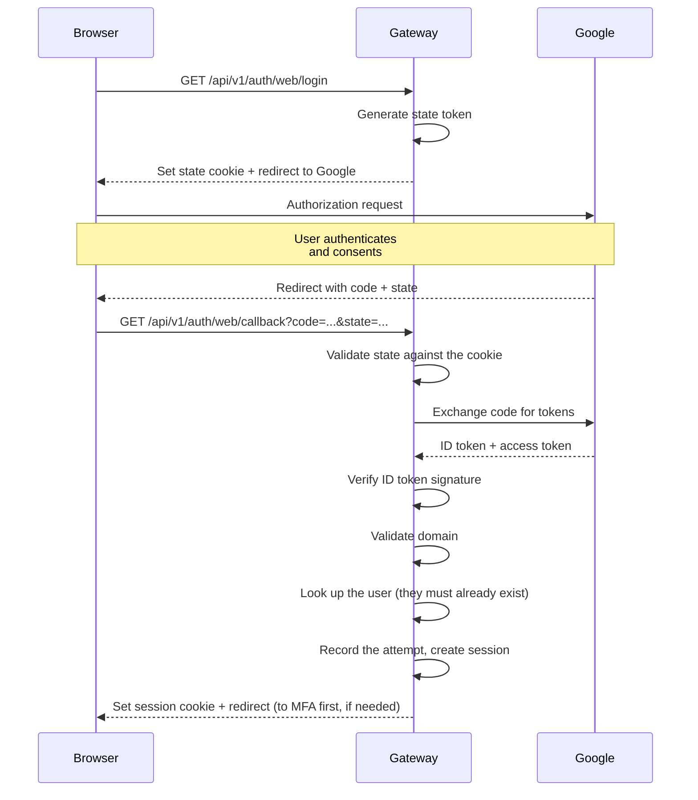
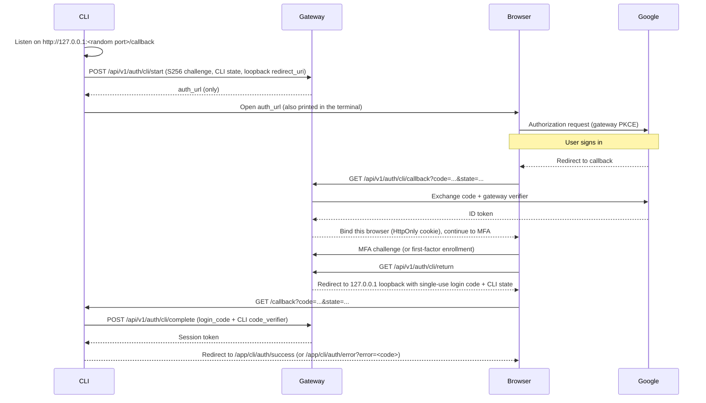

import { Aside, Steps } from '@astrojs/starlight/components';

Rack Gateway uses Google OAuth 2.0 with OpenID Connect (OIDC) for authentication. The implementation uses vetted libraries and follows security best practices including PKCE for CLI flows.

## OAuth Configuration

### Google Cloud Setup

Create a Google OAuth client with the redirect URIs `https://<DOMAIN>/api/v1/auth/web/callback` and
`https://<DOMAIN>/api/v1/auth/cli/callback`, and set `GOOGLE_CLIENT_ID`, `GOOGLE_CLIENT_SECRET` and
`GOOGLE_ALLOWED_DOMAIN`. See [OAuth Setup](/configuration/oauth-setup/) for the steps.

<Aside type="caution" title="Domain Restriction">
`GOOGLE_ALLOWED_DOMAIN` restricts sign-in to your organization. It is required: outside dev mode the gateway refuses to
start without it.
</Aside>

## Web OAuth Flow

The web flow uses standard OAuth 2.0 authorization code flow:



### Web Flow Parameters

| Parameter | Value | Purpose |
|-----------|-------|---------|
| `response_type` | `code` | Request authorization code |
| `scope` | `openid profile email` | Request user info |
| `state` | Random 32 bytes | CSRF protection |
| `access_type` | `online` | No refresh token needed |
| `prompt` | `select_account` | Always show account picker |
| `hd` | Allowed domain | Filter to organization accounts |

## CLI Login Flow (RFC 8252 loopback, with PKCE)

The CLI logs in with the [RFC 8252](https://www.rfc-editor.org/rfc/rfc8252) loopback flow. Two PKCE pairs
are involved: the gateway's own pair for the Google leg, and the CLI's pair, which proves that only the
CLI that started the login can finish it.



### What protects the login

- **Loopback redirect only.** `/auth/cli/start` only accepts a redirect URI of the form
  `http://127.0.0.1:<port>/callback` (or `http://[::1]:<port>/callback`). The login code is only ever sent to
  that address, so a login link someone else started delivers its code to *your* machine, never theirs.
- **Exchange before binding.** The gateway exchanges Google's authorization code at the callback, and only
  when that succeeds binds the login to the browser with an HttpOnly, SameSite=Lax cookie (path
  `/api/v1/auth/cli`). Every later browser step (MFA form, MFA submit, return, cancel) requires that cookie.
  The Google code is never stored.
- **Single-use login code.** The login code is 256 bits of randomness, stored only as a SHA-256 hash, valid
  for 2 minutes, issued once per login, and deleted when redeemed (a failed redemption also burns it).
- **CLI PKCE.** Redeeming the login code also requires the CLI's code verifier, which never leaves the CLI.
- **Honest result page.** The CLI holds the browser on its callback until it has redeemed the login code and
  saved the session, then redirects it (with `Referrer-Policy: no-referrer`, so the code isn't leaked as a
  referrer) to the gateway's success or error page. The error page only shows fixed messages for known error
  codes, so a crafted link can't put its own text on it.
- **Time limit.** The whole login must finish within 10 minutes.
- **First-factor enrollment.** A user with no MFA factor can enroll one during the login, but only in the
  browser bound to the login.
- **Visible initiator.** The MFA page shows the device name and IP that started the login, and the user gets
  a "New CLI Login" email when a CLI session is created. **Cancel Login** ends the login on the gateway and
  tells the waiting CLI.

### PKCE parameters (CLI pair)

| Parameter | Description |
|-----------|-------------|
| `code_verifier` | 64 random bytes, base64url encoded (86 characters); kept by the CLI |
| `code_challenge` | SHA-256(code_verifier), base64url encoded (43 characters) |
| `code_challenge_method` | Always `S256` |

### Same-machine requirement

The browser must run on the same machine as the CLI, because the login code is delivered to
`127.0.0.1`. To log in from a remote host (for example over SSH), forward the CLI's port: start
`rack-gateway login --no-open`, note the port in the printed "Waiting for the browser to return to
`http://127.0.0.1:<port>/callback`" line, and run `ssh -L <port>:127.0.0.1:<port> <host>` from the machine with
the browser before opening the printed login URL there.

### Upgrading

The gateway and CLI must both support the loopback flow. After upgrading the gateway, install the matching
rack-gateway CLI: an older CLI is told to upgrade, and a newer CLI refuses to log in to an older gateway.

## Token Verification

The gateway verifies Google's ID token using the `go-oidc` library:

<Steps>

1. **Signature verification**

   Validates the JWT signature against Google's public keys (fetched from OIDC discovery)

2. **Issuer validation**

   Confirms the token was issued by `https://accounts.google.com`

3. **Audience validation**

   Confirms the token was issued for our client ID

4. **Expiration check**

   Ensures the token hasn't expired

5. **Domain validation**

   Requires `email_verified`, and an email domain and `hd` claim that both match `GOOGLE_ALLOWED_DOMAIN`

6. **User lookup**

   The user must already exist: an admin adds them, or `ADMIN_USERS` (and the other seed variables) create them
   on first start. Signing in never creates a user.

</Steps>

### ID Token Claims

Claims extracted from Google's ID token:

```json
{
  "iss": "https://accounts.google.com",
  "aud": "your-client-id.apps.googleusercontent.com",
  "sub": "unique-user-id",
  "email": "user@yourcompany.com",
  "email_verified": true,
  "name": "User Name",
  "hd": "yourcompany.com"
}
```

| Claim | Description | Validation |
|-------|-------------|------------|
| `email` | User's email address | Required, domain checked |
| `email_verified` | Email verification status | Must be true |
| `name` | Display name | Used for user record |
| `hd` | Hosted domain | Must match allowed domain |

## Error Handling

### Common OAuth Errors

A failed web login redirects to the login error page, `/app/auth/error?error=<code>`, which shows a fixed message
for each code (never text from the URL or from Google):

| Code | Cause |
|------|-------|
| `unauthorized` | The account is outside `GOOGLE_ALLOWED_DOMAIN`, or isn't a gateway user. An admin must add them |
| `access_denied` | The user canceled or declined the sign-in at Google |
| `identity_provider_error` | Google returned another error |
| `missing_code` | The callback had no authorization code or state |
| `state_mismatch` | The state doesn't match this browser's login (an old tab, or a forged link). Start again |
| `exchange_failed` | Google wouldn't exchange the code. Check the client ID and secret |
| `session_failed` | The gateway couldn't create a session |
| `audit_unavailable` | The audit log couldn't record the login, so it was refused |

The CLI flow uses the same idea with its own page, `/app/cli/auth/error?error=<code>`.

If the gateway can't reach Google's OIDC discovery endpoint when it starts, it retries with exponential backoff for
up to 20 seconds, then exits with "failed to create OIDC provider". Check its outbound network access.

## Security Considerations

### State Parameter

- Generated using cryptographically secure random bytes
- Stored in a short-lived cookie (web) or server-side (CLI) and validated on callback
- Prevents CSRF attacks

### Token Storage

- ID tokens are verified and discarded immediately
- Session tokens (not OAuth tokens) are stored hashed
- No refresh tokens stored for web flow

### Redirect URI Validation

- Redirect URIs must exactly match those registered in Google Cloud Console
- No wildcards or pattern matching
- Separate URIs for web and CLI flows

### HTTPS Required

<Aside type="caution" title="Production Requirement">
OAuth flows require HTTPS in production. Google will reject OAuth requests to non-HTTPS redirect URIs (except localhost for development).
</Aside>

## Testing OAuth

### Local Development

For local development, use the mock OAuth server:

```bash
# Uses mock OAuth server at localhost:3345
task dev
```

The mock server simulates Google OAuth without requiring real credentials.

### Integration Testing

For integration testing against real Google OAuth:

1. Create a separate OAuth client for testing
2. Add `http://localhost:8447/api/v1/auth/*/callback` as redirect URIs
3. Use test accounts from your Google Workspace

## Troubleshooting

### "redirect_uri_mismatch"

The redirect URI in your request doesn't match any authorized URI in Google Cloud Console.

1. Check the exact URI (including protocol and path)
2. Ensure no trailing slashes mismatch
3. Verify `DOMAIN`: the redirect URIs are `https://<DOMAIN>/api/v1/auth/web/callback` and
   `https://<DOMAIN>/api/v1/auth/cli/callback`

### "invalid_client"

Client ID or secret is incorrect.

1. Verify `GOOGLE_CLIENT_ID` matches the Cloud Console
2. Verify `GOOGLE_CLIENT_SECRET` is correct
3. Ensure the OAuth client hasn't been deleted

### Account Picker Not Showing

If users aren't seeing the account picker:

1. Verify `prompt=select_account` is in the auth URL
2. Check if the browser has cached credentials
3. Try incognito/private browsing

## Next Steps

- [Sessions](/security/authentication/sessions/) - Session management after OAuth
- [API Tokens](/security/authentication/api-tokens/) - Token-based authentication for automation
- [Configuration](/configuration/oauth-setup/) - Complete OAuth setup guide
