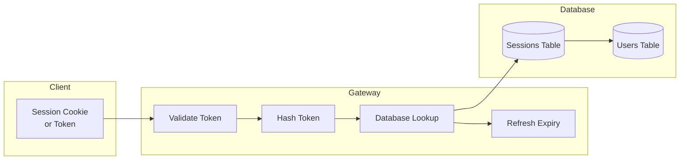
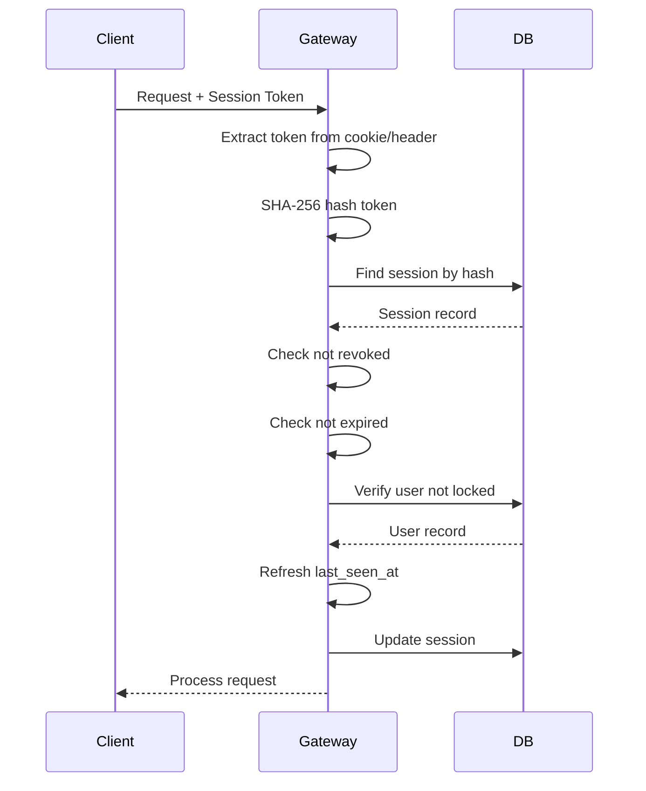
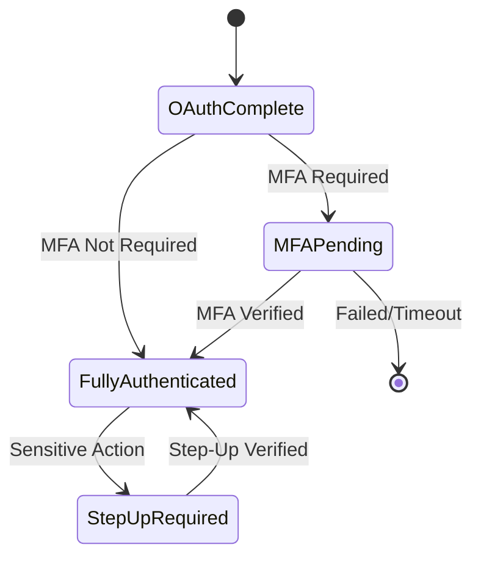

import { Steps } from '@astrojs/starlight/components';

Rack Gateway uses database-backed sessions to maintain authentication state after OAuth login. Sessions are designed for security, auditability, and revocability.

## Session Architecture



## Session Characteristics

| Property | Web Sessions | CLI Sessions |
|----------|--------------|--------------|
| **Storage** | HTTP-only cookie | Config file |
| **Default Lifetime** | 5 minutes idle | 90 days idle |
| **Expiration Type** | Sliding (activity-based) | Sliding (activity-based) |
| **CSRF Required** | Yes | No |
| **MFA Support** | Full | Full |

## Session Creation

Sessions are created after successful OAuth authentication:

<Steps>

1. **Generate token**

   32 bytes of cryptographically secure random data, base64url encoded

2. **Hash for storage**

   Token is SHA-256 hashed before database storage

3. **Record metadata**

   - Channel (web or cli)
   - IP address
   - User agent
   - Device name (CLI)
   - MFA status

4. **Set expiration**

   Based on configured timeout and channel type

</Steps>

### Session Token Format

```
Raw token:    QnJ4R2pKM...  (43 characters, base64url)
Stored hash:  a4b2c8d9...   (64 characters, hex SHA-256)
```

The raw token is never stored. Even with database access, sessions cannot be hijacked.

## Session Validation

Every authenticated request validates the session:



### Validation Checks

| Check | Description | Action on Failure |
|-------|-------------|-------------------|
| Token exists | Session found in database | 401 Unauthorized |
| Not revoked | `revoked_at` is null | 401 Unauthorized |
| Not expired | `expires_at` > now | 401 + auto-revoke |
| Not idle | `last_seen_at` + TTL > now | 401 + auto-revoke |
| User exists | Associated user found | 401 + auto-revoke |
| User not locked | `locked_at` is null | 401 + auto-revoke |

## Session Expiration

### Idle Timeout (Web)

Web sessions use sliding expiration based on activity:

```
Session Created: 10:00 AM
Last Activity:   10:03 AM
Timeout:         5 minutes
Expires:         10:08 AM (not 10:05!)
```

Each request refreshes the expiration, allowing continuous use without re-authentication.

### CLI Sessions

CLI sessions last 90 days from their last use, so a CLI used at least every 90 days stays signed in. Every command
still needs MFA for anything above read access (see [Step-Up Authentication](#step-up-authentication)), so a
copied CLI session token alone can only read.

### Configuring Timeout

```bash
# Set idle timeout to 15 minutes
RGW_SETTING_SESSION_TIMEOUT_MINUTES=15
```

The timeout is stored with each session, so existing sessions keep their original timeout when settings change.

## Session Revocation

Sessions can be revoked through multiple mechanisms:

### User-Initiated Logout

**Logout** in the web UI's sidebar revokes the web session. `rack-gateway logout` revokes the CLI session
(`POST /api/v1/auth/cli/logout` with the session token), then removes the rack and its token from the CLI's config.
Both are audited before the session is revoked, and refused if the audit log can't record them.

### Revoking Sessions

Users and administrators can revoke sessions from a user's page (**Users** → the user), which lists their active
sessions: **Revoke** for one, or **Revoke All**. Users can revoke their own; revoking anyone else's needs
`gateway:user:update` (admins). Either way it needs MFA on the request.

### Automatic Revocation

Sessions stop working when:

- The session expires (idle timeout)
- The user is locked (locking revokes every session)
- The user is deleted

## Session Metadata

Each session stores metadata for security and auditing:

| Field | Description |
|-------|-------------|
| `user_id` | Associated user |
| `token_hash` | SHA-256 of session token |
| `channel` | `web` or `cli` |
| `device_id` | Device identifier sent by the CLI |
| `device_name` | Device name sent by the CLI (the host name) |
| `ip_address` | Last seen IP address |
| `user_agent` | Last seen user agent |
| `created_at` | Session creation time |
| `last_seen_at` | Last activity timestamp |
| `expires_at` | Expiration timestamp |
| `revoked_at` | Revocation timestamp (null if active) |
| `mfa_verified_at` | MFA verification timestamp |
| `recent_step_up_at` | Recent step-up auth timestamp |

### Device Tracking

Sessions record the IP address and user agent of their last request, and CLI sessions the device that logged in,
so users can recognize their sessions. Users see their active sessions on their own page (**Users** → their name).

## MFA and Sessions

### MFA Verification

When MFA is required, sessions track verification status:



| Session Field | Purpose |
|---------------|---------|
| `mfa_verified_at` | Timestamp of initial MFA verification |
| `trusted_device_id` | Reference to trusted device (if remembered) |
| `recent_step_up_at` | Timestamp of recent step-up verification |

### Step-Up Authentication

For sensitive actions, users may need to re-verify MFA even within an active session:

- Configurable step-up window (`mfa_step_up_window_minutes`, default 10 minutes)
- Verifying a factor (TOTP, WebAuthn, YubiKey OTP or a backup code) sets `recent_step_up_at` and opens the window
- Subsequent step-up actions within the window don't require re-verification
- Only a verified factor opens the window. A login that needs no MFA challenge, or that a trusted device lets skip
  it, opens none, and trusting a device doesn't restart it
- Adding an MFA method needs no step-up for a user's first factor, and a step-up once they have one
- Some actions need MFA on every request, even within the window (see
  [MFA Requirements](/security/rbac/permissions/#mfa-requirements))

### Inline MFA Proofs

The CLI sends its MFA proof (a TOTP code or WebAuthn assertion) with every request of a command. Each proof
verifies only once: TOTP codes can't be replayed and WebAuthn challenges are single-use. The first request that
needs MFA verifies the proof and starts the session's step-up window, so the command's later requests within the
window need no further proof.

### WebAuthn Challenges

WebAuthn challenges are stored server-side in `webauthn_challenges`, bound to the user and the session that
started the ceremony, deleted when used and expired after 5 minutes. Clients only hold an opaque challenge ID.
User verification (PIN or biometric) is required, and each credential's signature counter must increase
(authenticators that always report 0 are allowed); the compare and store is a single statement.

## CSRF Protection

Web sessions require CSRF tokens:

### Token Derivation

```
CSRF Token = HMAC-SHA256(secret, "csrf|" + session_token)
```

The CSRF token is derived from the session token using HMAC, ensuring:
- Each session has a unique CSRF token
- Token cannot be guessed without knowing the session
- Validation is fast (no database lookup)

### Validation

Web requests include CSRF token in header:
```
X-CSRF-Token: <token>
```

API requests with bearer tokens don't require CSRF (token-based auth is inherently CSRF-safe).

## Session Records

Expired and revoked sessions stay in the database with their `revoked_at` and `expires_at`, so they can be matched
to audit entries later. They can't be used again.

## Security Best Practices

### Session Timeout Selection

| Use Case | Recommended Timeout |
|----------|---------------------|
| High-security production | 5 minutes |
| Standard production | 15 minutes |
| Internal/trusted network | 30 minutes |
| Development | 1 hour |

### Monitoring Sessions

Monitor for anomalies:
- Multiple concurrent sessions from different IPs
- Sessions from unusual geolocations
- Rapid session creation/destruction

### Incident Response

If a session is compromised:

<Steps>

1. **Revoke immediately**

   Admin revokes the specific session or all user sessions

2. **Lock account (if needed)**

   Lock the user account to prevent new sessions

3. **Review audit logs**

   Check what actions were taken with the compromised session

4. **Rotate secrets (if needed)**

   If actions accessed sensitive data, rotate affected credentials

5. **Unlock and notify**

   After securing, unlock account and notify user

</Steps>

## Next Steps

- [OAuth Flow](/security/authentication/oauth-flow/) - How sessions are created
- [API Tokens](/security/authentication/api-tokens/) - Alternative to sessions for automation
- [MFA Overview](/user-guide/mfa/) - Multi-factor authentication
