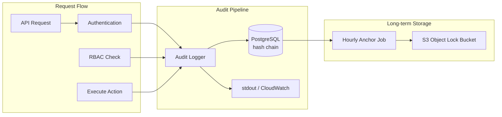
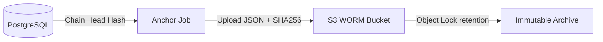

import { Aside, Steps, Tabs, TabItem } from '@astrojs/starlight/components';

Rack Gateway maintains a complete audit trail of all actions, providing the evidence needed for compliance audits and security investigations.

## Audit Architecture



## Audit Log Entry

Every request generates audit log entries. Each entry is a row in `audit.audit_event`, and the gateway also writes
it to stdout as one JSON line for CloudWatch:

```json
{
  "ts": "2024-01-15T10:30:00Z",
  "user_email": "developer@example.com",
  "user_name": "Alice Developer",
  "api_token_name": "ci-deploy",
  "action_type": "convox",
  "action": "release.promote",
  "resource": "myapp",
  "resource_type": "release",
  "status": "success",
  "rbac_decision": "allow",
  "http_status": 200,
  "latency_ms": 1250,
  "ip_address": "192.168.1.100",
  "user_agent": "rack-gateway/1.0.0",
  "event_count": 1,
  "request_id": "6f1c2a9e-..."
}
```

### Entry Fields

| Field | Description | Example |
|-------|-------------|---------|
| `timestamp` (`ts` on stdout) | Time the entry was written (UTC) | `2024-01-15T10:30:00Z` |
| `user_email` | User's email address (a token's owner for API tokens) | `alice@example.com` |
| `user_name` | User's display name | `Alice Developer` |
| `api_token_id`, `api_token_name` | The API token, when one made the request | `ci-deploy` |
| `action_type` | The scope of the permission the action needs: `convox`, `gateway`, `auth` or `security`. A request's attempt and result entries have the same type | `convox` |
| `action` | `<resource>.<verb>`, named after the route's permission | `release.promote`, `user.create`, `login.oauth_failed` |
| `resource` | Target resource | `myapp` |
| `resource_type` | Resource category | `app`, `build`, `release` |
| `command` | The command or path, where one applies | `releases promote RABCDEF` |
| `details` | JSON with more context. Never contains env var values unless the app lists them as visible (see below) | `{"reason":"..."}` |
| `status` | Outcome (`attempted` until a request's outcome is known, see below) | `success`, `failed`, `denied`, `error`, `alert` |
| `rbac_decision` | Access decision. On a request log line it's `deny` for any request the gateway refused (401, 403 or 429), `error` when the permission check failed, and `not_evaluated` for routes without authorization (login, health) | `allow`, `deny`, `error`, `not_evaluated` |
| `http_status` | HTTP response code | `200`, `403`, `500` |
| `response_time_ms` (`latency_ms` on stdout) | Request duration | `1250` |
| `ip_address` | Client IP | `192.168.1.100` |
| `user_agent` | Client identifier | `rack-gateway/1.0.0` |
| `request_id` | Request ID, generated by the gateway; shared by every entry of one request | `6f1c2a9e-...` |
| `event_count` | How many events the entry stands for (more than 1 for repeated denials) | `1` |
| `deploy_approval_request_id` | The deploy approval the request used, if any | `42` |
| `chain_index`, `previous_hash`, `event_hash` | The entry's place in the hash chain (database only) | |

## Secret Redaction

The gateway leaves sensitive values out of audit entries when it writes them, so they never reach the database,
stdout, CloudWatch or Slack:

| Data | What's logged |
|------|---------------|
| Env var values | `[REDACTED]`, unless the app's `audit_visible_env_vars` lists the key (see below) |
| Query parameters carrying login codes, OAuth values or tokens | `[REDACTED]` |
| Request bodies | Not logged |

### Environment Variable Changes

Every env var a release changes gets its own entry, with the resource `app/KEY` and `details` of
`{"old":"[REDACTED]","new":"[REDACTED]"}`:

| Action | Change |
|--------|--------|
| `env.set`, `env.unset` | Ordinary env var |
| `secret.set`, `secret.unset` | Secret env var |
| `env.set_protected`, `env.unset_protected` | Protected env var, changed with `--allow-protected` |

Values are redacted whatever the key's name: a password or a connection string under an ordinary name such as
`DATABASE_URL` is redacted too. To see the values of harmless settings such as `PORT` or `RAILS_ENV` in the audit
log and Slack, list them in the app's **Environment Variables Shown in Audit Logs** setting
(`audit_visible_env_vars`, under **Apps → `{app}` → Settings**). Names match exactly, ignoring case. A listed key
is still redacted when it is secret (its name contains `SECRET`, `TOKEN`, `PASSWORD`, `PASSWD`, `PASSPHRASE` or
`CREDENTIAL` or ends in `_KEY`, `_KEY_ID` or `_PASS`, or it is in the app's `secret_env_vars` or
`CONVOX_SECRET_ENV_VARS`), protected (`protected_env_vars`), or when its old or new value has credentials in it (a
URL with a user or password, or `password=`). Only a removed key is an `unset`: a key set to an empty value is a
`set`.

<Aside type="caution">
Earlier gateway versions logged the values of env vars that weren't secret or protected, and every rack
parameter value (also emailed to admins). Those entries keep them: `details` is part of each entry's hash chain
and the table is append-only, so they can't be rewritten. Slack messages and emails already sent keep them too. If
a credential was changed under a name those versions didn't treat as secret (such as `DATABASE_URL` or
`SMTP_PASSWORD`), or set
as a rack parameter, rotate it.
</Aside>

Refused protected changes are logged per key with `status: denied`: without `--allow-protected` as `env.set`,
and `--allow-protected` attempts refused for permissions, or for MFA while the session's step-up window is open,
as `env.set_protected`. When the step-up window has expired, the request is refused at the MFA check before the
env is looked at, like any other request needing MFA: that refusal is in the MFA attempt log and the request log,
not as `env.set_protected`.

## When the Audit Log Can't Be Written

### Nothing Happens Unrecorded

Every request the gateway acts on is recorded before it acts:

- every gateway API request, reads included;
- every proxied rack request, reads, logs and `exec` sessions included;
- the steps of signing in and out that act: creating a web or CLI session, a CLI login's MFA check, and revoking
  a session at sign-out (starting a sign-in is recorded first too).

If that entry can't be written (the database is down, say), the gateway refuses the request and does nothing:

```http
HTTP/1.1 503 Service Unavailable

{"error": "audit log unavailable; refusing to perform user.create"}
```

There are no exceptions: signing in, MFA verification, reads and signing out are refused too. An audit outage takes
the gateway out of service instead of letting anything through unrecorded, and it's loud:

- every failed write is logged and sent to Sentry;
- the health check (`GET /api/v1/health`) answers 503 for a minute after an audit write fails, unless a later write
  succeeds, so your platform's health checks and uptime monitoring see the outage. After that minute the health
  check passes again so traffic can return, but every request still has to write its audit entry before it acts,
  and gets 503 if it can't; the next failed write starts another minute;
- background jobs don't act unrecorded either: the deploy approval expiry writes its audit events in the same
  database transaction as the expiry, so if they can't be written, nothing expires and the job fails.

Once the audit log can be written again, the gateway works again without a restart. Anything that can't wait for
that has to be done outside the gateway, with the rack's own credentials.

Requests refused before they act (unauthenticated, denied, rate-limited) aren't affected: they're refused anyway.
Denials are recorded (see [Denied Requests](#denied-requests)), and a denial that can't be recorded is logged and
sent to Sentry.

### Attempt and Result Entries

The entry written before a request acts has `status: attempted`. Once the request has acted, its result entries
follow with their own status (`success`, `failed`, `error`, ...). Every entry of a request has the same
`request_id`, which the gateway generates for each request (a client's `X-Request-ID` is ignored), so an attempt
and its results pair up:

```sql
SELECT chain_index, timestamp, action, resource, status, http_status
FROM audit.audit_event
WHERE request_id = '6f1c...'
ORDER BY chain_index;
```

If the result can't be written after the request acted, the gateway logs an error and reports it to Sentry: what
the request did can't be undone, and the attempt entry is the record that it was made. Attempts are ordinary events in
the hash chain, so `verify-audit` checks them like any other.

In the web UI, a request's row shows its attempt until the result arrives, then the result. A row still showing
**attempted** has no recorded outcome. Slack is only sent results, so a channel hears about each action once.

## Denied Requests

Requests refused for lack of permission are recorded with `status: denied` and `rbac_decision: deny`, with the
reason in `details`: gateway API requests and proxied rack requests, including rack requests refused by a deploy
approval check or the destructive-actions policy, and requests for rack routes the gateway doesn't forward. Refused
API tokens (`token.validate`) and requests refused by a rate limit (`rate_limit.exceeded`) are recorded the same
way.

Denials are throttled so a script retrying a refused request can't flood the log. The first denial of an action
against a target (the resource, and for a rack request its method and path) for a user (or API token, or for a
request without either, its client IP) is written at once, so a denial against one target is never hidden among
others. Its repeats against the same target in the next minute are counted, and written as one entry
when the minute is up: `event_count` says how many there were, and `details.repeats_from` and
`details.repeats_until` when. The next denial after that is written at once again. The counts are kept in memory,
which works because a gateway runs as a single instance per rack: a restart can lose at most a minute's count of
repeats (never a first denial), and the gateway writes any pending count when it shuts down. While 1,000 runs are
being counted, the denials of requests without a user or token (from many client IPs at once) share one run, whose
count entry has `details.from_many_clients` and the last request's IP; users' and tokens' denials always keep their
own.

Recording a denial fails open: the caller gets the same 403 whether or not the entry could be written.

## Storage Layers

### PostgreSQL (Primary)

Audit logs are stored in PostgreSQL under the `audit.audit_event` table. The table is
append-only and protected by row-level security to prevent tampering.

### CloudWatch (Stream)

Logs are also written to stdout in structured JSON format for CloudWatch ingestion:

- Real-time streaming
- CloudWatch Logs Insights queries
- Integration with CloudWatch Alarms
- Cross-account log aggregation

### S3 WORM (Archival)

For compliance requirements, the gateway writes periodic **anchors** to S3 Object Lock.
Anchors capture the chain head hash and metadata (not full log exports).



Each anchor is locked for the bucket's default Object Lock retention (400 days in the example Terraform). See
[S3 WORM Storage](/deployment/terraform/s3-worm-storage/) for the configuration.

## Querying Audit Logs

### Web UI

1. Navigate to **Audit Logs** in the sidebar (admins see everyone's entries; every user sees their own on their
   profile)
2. Use filters to narrow results:
   - User
   - Time range (15 minutes to all time, or custom)
   - Status (for example `denied`)
   - Action type and resource type
   - Free-text search
3. Click entries to view full details
4. Export the filtered entries as CSV

### SQL Queries

For advanced queries, access the database directly:

<Tabs>
<TabItem label="Recent Activity">

```sql
SELECT
    timestamp,
    user_email,
    action,
    resource,
    status,
    rbac_decision
FROM audit.audit_event
WHERE timestamp > NOW() - INTERVAL '7 days'
ORDER BY timestamp DESC
LIMIT 100;
```

</TabItem>
<TabItem label="Denied Requests">

```sql
SELECT
    timestamp,
    user_email,
    action,
    resource,
    ip_address
FROM audit.audit_event
WHERE rbac_decision = 'deny'
  AND timestamp > NOW() - INTERVAL '30 days'
ORDER BY timestamp DESC;
```

</TabItem>
<TabItem label="User Activity Summary">

```sql
SELECT
    user_email,
    COUNT(*) as total_actions,
    COUNT(*) FILTER (WHERE status = 'success') as successful,
    COUNT(*) FILTER (WHERE rbac_decision = 'deny') as denied,
    MAX(timestamp) as last_activity
FROM audit.audit_event
WHERE timestamp > NOW() - INTERVAL '30 days'
GROUP BY user_email
ORDER BY total_actions DESC;
```

</TabItem>
<TabItem label="Deploy Activity">

```sql
SELECT
    DATE_TRUNC('day', timestamp) as day,
    COUNT(*) as deploys,
    COUNT(DISTINCT user_email) as deployers
FROM audit.audit_event
WHERE action = 'release.promote'
  AND status = 'success'
  AND timestamp > NOW() - INTERVAL '30 days'
GROUP BY DATE_TRUNC('day', timestamp)
ORDER BY day DESC;
```

</TabItem>
</Tabs>

## What Gets Logged

### Always Logged

| Category | Actions |
|----------|---------|
| **Authentication** | Login, logout, MFA verification and failures |
| **Requests** | Every gateway API and rack request, reads included, with its RBAC decision |
| **Deployments** | Build, release, promote, deploy approvals |
| **Environment** | Read, set, unset (values redacted), and secret reveals |
| **User Management** | Create, update, delete, lock, MFA reset |
| **Token Management** | Create, delete tokens |
| **Settings** | Configuration changes |

### Logged with Redaction

| Category | What's Redacted |
|----------|-----------------|
| **Environment Variables** | Values, unless listed in `audit_visible_env_vars` |
| **API Tokens** | Token strings |

### Not Logged

| Category | Reason |
|----------|--------|
| **Request Bodies** | May carry secrets; the relevant changes are logged on their own |
| **Health Checks** | Unauthenticated and change nothing |
| **Static Assets** | No security value |

## Notifications

Audit events can trigger notifications:

### Slack Integration

Connect Slack from **Integrations** in the web UI and choose, per channel, which audit actions it receives by pattern
(for example `login.*_failed`, `mfa.verify_failed`, `mfa_method.*`, `user.update_roles`, `api_token.*`,
`audit_log.verification_*`). Each message copies the entry's details, which never contain env var values unless the
app lists the key as audit-visible. See [Slack](/integrations/slack/).

### Email Alerts

With `POSTMARK_API_TOKEN` set, the gateway emails users about security events on their account (new CLI logins,
failed logins and MFA verifications, locks, new API tokens, rate limiting) and admins about new users, new API
tokens and rate limiting. See [Email](/integrations/email/).

## Log Integrity

### Tamper Detection

Audit logs include integrity measures:

1. **Request ID**: Unique, non-sequential identifier generated by the gateway (clients can't choose it)
2. **Timestamps**: Server-generated, not client-provided
3. **User context**: Extracted from verified session/token
4. **Hash chain**: Each event's HMAC covers all of its stored fields and the previous event's hash, and anchors in
   S3 Object Lock record the chain head every hour. The gateway checks both every hour, alerts through Sentry and
   Slack when the check fails, and shows the latest result on the Audit Logs page; `rack-gateway-api verify-audit`
   runs the same check by hand (see [Verification](/deployment/terraform/s3-worm-storage/#verification)).

### S3 WORM Protection

For immutable storage:

- Object Lock in Compliance mode
- A default retention as long as your auditors require (400 days in the example Terraform)
- SHA-256 checksums stored

## Compliance Use Cases

### SOC 2 Audits

Evidence for Common Criteria:

| Criterion | Evidence |
|-----------|----------|
| CC6.1 | Access logs showing authentication |
| CC6.2 | RBAC decision logs |
| CC6.3 | Session management logs |
| CC7.1 | Configuration change logs |
| CC7.2 | Deploy and change logs |

### Security Investigations

For incident response:

<Steps>

1. **Identify timeframe**

   When did the incident occur?

2. **Find affected users**

   ```sql
   SELECT DISTINCT user_email
   FROM audit.audit_event
   WHERE timestamp BETWEEN '2024-01-15 00:00:00' AND '2024-01-16 00:00:00';
   ```

3. **Trace actions**

   ```sql
   SELECT *
   FROM audit.audit_event
   WHERE user_email = 'suspect@example.com'
   ORDER BY chain_index;
   ```

4. **Check for anomalies**

   Unusual times, IPs, or action patterns

5. **Export evidence**

   Full logs with request IDs for forensics

</Steps>

## Best Practices

### Log Retention

- **PostgreSQL**: the gateway never deletes audit events (the table refuses `DELETE` and `UPDATE`), so they're
  kept for the life of the database. Size and back it up accordingly
- **S3 anchors**: set the bucket's default Object Lock retention to your retention requirement
- **CloudWatch**: set the app's log retention (`LOG_RETENTION_DAYS` in `convox.yml`)

### Monitoring

Set up alerts for:
- Multiple failed logins
- High rate of RBAC denials
- Admin actions outside business hours
- Unusual deployment patterns

### Regular Review

- Daily: Security team reviews failed logins
- Weekly: Review admin actions
- Monthly: Full access review
- Quarterly: Compliance report generation

## Next Steps

- [Data Retention](/security/compliance/data-retention/) - Configure retention policies
- [SOC 2](/security/compliance/soc2/) - SOC 2 control mapping
- [Hardening](/security/hardening/) - Security hardening guide
