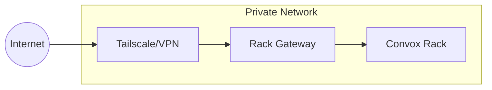

import { Aside, Steps } from '@astrojs/starlight/components';

This guide covers security best practices for hardening your Rack Gateway deployment.

## Network Security

### Private Network Deployment

Deploy the gateway on a private network, not exposed to the public internet:



**Options:**
- [Tailscale](/deployment/private-network/) - Zero-config VPN
- AWS VPN - Site-to-site VPN
- AWS PrivateLink - Private connectivity

<Aside type="caution" title="Do Not Expose Publicly">
The gateway should never be directly exposed to the public internet. Always use a VPN or private network solution.
</Aside>

### TLS Configuration

The gateway serves plain HTTP on `PORT` and expects TLS to end in front of it: the Convox router, a load balancer,
or Tailscale (`tailscale serve`). Set `DOMAIN` to the host name clients use; the gateway's public URL is
`https://<DOMAIN>`, and requests for any other host are refused.

```bash
DOMAIN=gateway.example.com
```

### The Rack Connection

The gateway calls the rack API over TLS with the rack's API key, but it can't authenticate the rack: the Convox rack
API serves a self-signed certificate that it generates again every time it starts, and no CA signs it. The
connection is encrypted, and an attacker would have to intercept traffic inside the rack's network to impersonate
the rack and capture the key. Run the gateway as an app on the rack it protects, so the connection stays inside
the cluster, and keep anything you don't trust off that network.

`ENABLE_RACK_TLS_PINNING=true` pins the first certificate the gateway sees and refuses any other until the pin is
refreshed. It narrows the window to first use and refreshes, but each rack update replaces the certificate and needs
a refresh.

### Firewall Rules

Restrict network access:

| Port | Source | Destination | Protocol |
|------|--------|-------------|----------|
| 443 | VPN/Tailscale | Gateway | HTTPS |
| 5432 | Gateway | RDS | PostgreSQL |
| 5443 | Gateway | Convox rack API | HTTPS |

Block all other inbound traffic to the gateway.

## Authentication Hardening

### OAuth Configuration

Secure your OAuth setup:

```bash
# Required: Restrict to your domain
GOOGLE_ALLOWED_DOMAIN=yourcompany.com

# Strong secret key (generate with: openssl rand -base64 32)
APP_SECRET_KEY=<random-32-byte-value>
```

<Aside type="tip">
Generate secrets using a cryptographically secure method:
```bash
openssl rand -base64 32
```
</Aside>

### MFA Enforcement

MFA settings (**Settings** → MFA Configuration, or `RGW_SETTING_*` variables):

| Setting | Default | Recommendation |
|---------|---------|----------------|
| `mfa_require_all_users` | `true` | Keep it on. The CLI requires enrollment from every user regardless |
| `mfa_step_up_window_minutes` | `10` | Shorter for higher security |
| `mfa_trusted_device_ttl_days` | `30` | Shorter, such as 7, for higher security. A trusted device only skips the login challenge; it never opens a step-up window |

The CLI verifies the gateway's TLS certificate (system roots) for all requests, including websockets, and
refuses plain `http://` gateways except on loopback, so serve the gateway over HTTPS with a publicly trusted
or system-trusted certificate.

### Session Security

Browser sessions end after `session_timeout_minutes` of inactivity (default 5; **Settings** → Session
Configuration, or `RGW_SETTING_SESSION_TIMEOUT_MINUTES`). The session cookie is `HttpOnly`, `SameSite=Lax` and, in
the published image, always `Secure`.

## RBAC Hardening

### Role Assignment

Follow least privilege principles:

| User Type | Role | Notes |
|-----------|------|-------|
| Most engineers | Viewer | Start here, upgrade as needed |
| Active developers | Deployer | Only if deploying regularly |
| On-call/SRE | Ops | Debug without deploy access |
| CI/CD pipelines | CI/CD token | Never Deployer or Admin |
| Platform admins | Admin | 2-3 people maximum |

### API Token Security

Secure your API tokens:

<Steps>

1. **Use CI/CD role for automation**

   Never give deployer or admin to CI/CD pipelines

2. **Rotate tokens regularly**

   Production tokens: quarterly minimum

3. **Use separate tokens per environment**

   Different tokens for staging vs production

4. **Monitor token usage**

   Review unused tokens monthly

5. **Delete unused tokens immediately**

   Don't keep "just in case" tokens

</Steps>

### Admin Access

Restrict administrative access:

- Maximum 2-3 admin users
- Require MFA for all admins
- Review admin actions weekly
- Document who has admin access and why

## Secrets Management

### Environment Variables

Mark sensitive environment variables in each app's settings (or pin them with `RGW_APP_<APP>_SETTING_*`):

- **`secret_env_vars`**: values masked unless the caller holds `convox:secret:read` and asks to reveal them, and
  changed only with `convox:secret:set`. Names containing `SECRET`, `TOKEN`, `PASSWORD`, `PASSWD`, `PASSPHRASE` or
  `CREDENTIAL`, or ending in `_KEY`, `_KEY_ID` or `_PASS`, are secrets already; `CONVOX_SECRET_ENV_VARS` adds names
  for every app.
- A value with credentials in it, such as `postgres://app:password@db/app`, a URL with a secret query parameter
  (`?api_key=...`, `?token=...`, `?sig=...`) or a connection string with `password=`, is masked the same way whatever
  its name. Changing it still needs only `convox:env:set`, so a deployer can replace a `DATABASE_URL` they can't
  read.
- **`protected_env_vars`**: values masked as secrets are (a `convox:secret:read` holder who asks to reveal them sees
  them), and changed only by an admin with `--allow-protected` and MFA.

Changing either list needs MFA on that request, even within the step-up window, as changing a protected value does.

Audit log entries (and so Slack) never show env var values unless the app lists the key in
`audit_visible_env_vars`; secret and protected keys stay hidden even then.

### Commands' Env Vars

A command run with `run` or `exec` gets every env var of the app unless the app limits them. Set
`command_env_vars` to the env vars the app needs to boot, and let each command ask for the others it needs
(`--env`). Point the database URL at a read-only user with `command_env_read_only`, so a command can change data
only when it's run with `--write`. See [Env vars](/user-guide/cli/commands/#env-vars).

Convox gives every app process `RACK_URL`, which holds the rack's API password, unless the rack's
`system-env-disable` feature gate is on. The gateway keeps it from every command it runs, but the app's own
processes still have it, and an `exec` can read it from the process it runs in. The gate also removes `RACK`, which
the gateway reads, so set `RACK` on the gateway app (and any other app that reads it) before turning the gate on:
`convox rack params set api_feature_gates=system-env-disable=true`, or `api_feature_gates =
"system-env-disable=true"` in the rack's Terraform. Convox reads each gate as `name=value` and ignores a bare name.
New processes stop getting Convox's `RACK` and `RACK_URL` at once (a `RACK` you set yourself stays); running ones
keep them until their app's next promote. Then rotate the rack's API password, which every process could read until
now, and set the gateway's `RACK_TOKEN` to the new one.

### Secret Storage

Store secrets securely:

| Secret | Storage Location | Notes |
|--------|-----------------|-------|
| `GOOGLE_CLIENT_SECRET` | AWS Secrets Manager | Or Convox environment |
| `APP_SECRET_KEY` | AWS Secrets Manager | Critical - rotate annually |
| `COLUMN_ENCRYPTION_KEY` | AWS Secrets Manager | Critical - back it up; without it TOTP enrollments and the Slack integration are lost. Rotation is not supported yet |
| `DATABASE_URL` | Convox environment | With password |
| API tokens | CI/CD secrets | GitHub/CircleCI secrets |

Never store secrets in:
- Git repositories
- Environment files checked into git
- Logs or audit trails
- Error messages

## Database Security

### PostgreSQL Configuration

Secure your database:

```hcl
# RDS configuration (Terraform)
resource "aws_db_instance" "gateway" {
  # Encryption at rest
  storage_encrypted = true
  kms_key_id        = aws_kms_key.rds.arn

  # Network isolation
  publicly_accessible = false
  vpc_security_group_ids = [aws_security_group.rds.id]

  # Audit logging
  enabled_cloudwatch_logs_exports = ["postgresql"]
}
```

### Database Access

Restrict database access:

- Gateway application only (no direct access)
- Separate admin credentials for migrations
- VPC-only access (no public endpoint)
- Encrypted connections (require SSL)

## Audit and Monitoring

### Audit Configuration

Enable comprehensive auditing:

Audit logging is always on and can't be turned off: every request is recorded before the gateway acts on it, and a
request whose audit entry can't be written is refused. Set `AUDIT_HMAC_SECRET` (required in production) so the
entries are hash-chained, and set the heartbeat URLs so a monitor alerts when the gateway or its hourly audit
verification stops running (see [Heartbeats](/operations/monitoring/#heartbeats)).

### S3 WORM for Compliance

Anchor the chain in an S3 bucket with Object Lock:

```bash
AUDIT_ANCHOR_BUCKET=rack-gateway-audit-anchor-production
AUDIT_ANCHOR_CHAIN_ID=production
```

See [S3 WORM Storage](/deployment/terraform/s3-worm-storage/) for the bucket, IAM and verification.

### Security Alerting

Connect the [Slack integration](/integrations/slack/) and route security events to a channel by action pattern,
for example `login.*_failed`, `mfa.verify_failed`, `mfa_method.*`, `user.update_roles`, `api_token.*` and
`audit_log.verification_*`. With `POSTMARK_API_TOKEN` set, the gateway also emails users about failed logins, new CLI
logins, locks and new API tokens, and admins about new users, new API tokens and rate limiting (see
[Email](/integrations/email/)).

**Alert on:**
- Failed logins and MFA verifications
- MFA method changes and account locks
- Role changes
- API token creation and deletion
- Audit log verification failures

## Deployment Hardening

### Container Security

The published image runs the gateway as a non-root user. On Convox, keep the service `internal: true` so it is only
reachable inside the rack's network (and through Tailscale), and deploy a pinned image tag, never `:latest`. See
the repository's `convox.yml`.

### Health Checks

`GET /api/v1/health` needs no authentication and reveals no internal details. It fails for a minute after any
audit write fails, so a load balancer takes an instance with a broken audit log out of service.

## Security Checklist

### Pre-Production

- [ ] Gateway on private network (VPN/Tailscale)
- [ ] HTTPS enforced with valid certificate
- [ ] OAuth domain restriction configured
- [ ] MFA required for all users
- [ ] Session timeout ≤ 15 minutes
- [ ] Admin users ≤ 3
- [ ] CI/CD uses CI/CD role tokens
- [ ] `command_env_vars` and `command_env_read_only` set for each app
- [ ] Database encrypted and VPC-only
- [ ] Audit logging enabled
- [ ] S3 WORM configured (if required)
- [ ] Security alerts configured
- [ ] Incident response runbook created

### Ongoing

- [ ] Weekly admin action review
- [ ] Monthly token audit
- [ ] Quarterly access review
- [ ] Annual secret rotation
- [ ] Regular security scanning
- [ ] Incident response testing

## Security Headers

The gateway sets secure HTTP headers:

| Header | Value | Purpose |
|--------|-------|---------|
| `Strict-Transport-Security` | `max-age=63072000` | Force HTTPS |
| `X-Content-Type-Options` | `nosniff` | Prevent MIME sniffing |
| `X-Frame-Options` | `DENY` | Prevent clickjacking |
| `Content-Security-Policy` | Strict policy | Prevent XSS |
| `Referrer-Policy` | `strict-origin-when-cross-origin` | Keep paths out of other sites' referrers |
| `X-XSS-Protection` | `1; mode=block` | XSS filter in old browsers |

### Content Security Policy

The gateway uses a strict CSP:

```
default-src 'self';
connect-src 'self';
script-src 'self' 'nonce-xxx';
style-src 'self' 'nonce-xxx';
img-src 'self' data:;
base-uri 'self';
form-action 'self';
frame-ancestors 'none'
```

With `SENTRY_JS_DSN` set, `connect-src` and `img-src` also allow the Sentry host, and violations are reported to
Sentry.

## Incident Response

### Compromised Account

<Steps>

1. Lock the account immediately (this signs out every session and stops the user's API tokens)
2. Check that no sessions remain
3. Review audit logs for suspicious activity
4. Rotate any accessed secrets
5. Investigate root cause
6. Unlock after re-verification

</Steps>

### Compromised Token

<Steps>

1. Delete the token immediately
2. Review audit logs for token usage
3. Create replacement token
4. Update affected systems
5. Investigate how token was exposed

</Steps>

### Suspected Breach

<Steps>

1. Lock all non-admin accounts
2. Revoke all sessions
3. Rotate all secrets
4. Enable enhanced logging
5. Review last 30 days of audit logs
6. Engage security team / incident response

</Steps>

## Next Steps

- [Private Network](/deployment/private-network/) - VPN deployment
- [SOC 2](/security/compliance/soc2/) - Compliance alignment
- [Audit Trail](/security/compliance/audit-trail/) - Audit logging
