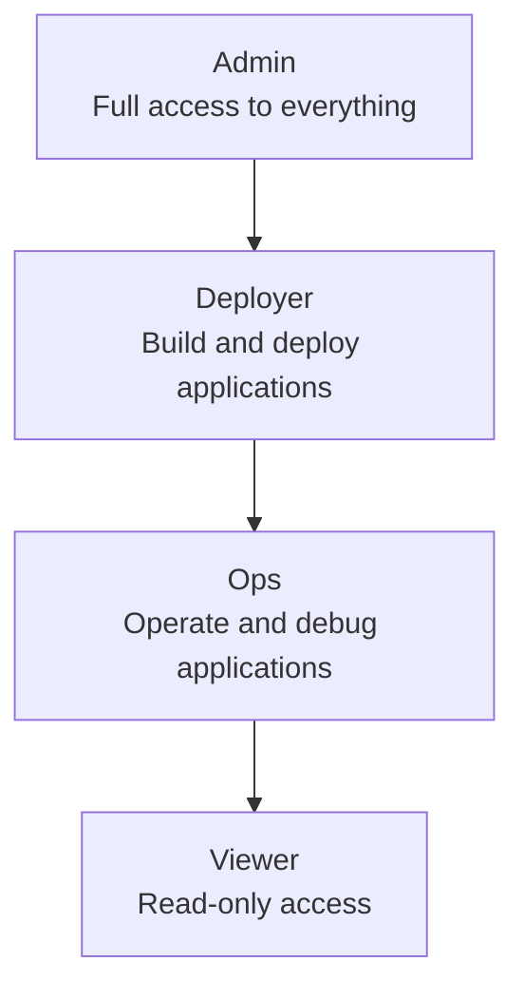

import { Aside } from '@astrojs/starlight/components';

Rack Gateway uses Role-Based Access Control (RBAC) to manage what users can do. Each user holds one or more roles, and their permissions are everything those roles grant.

## The Roles

Rack Gateway has four built-in roles for people, arranged in a hierarchy, and a fifth, CI/CD, that only API tokens
can hold:



Each role includes all permissions of the roles below it. See [Roles](/security/rbac/roles/) for CI/CD.

## Role Capabilities

| Role | Can Do | Cannot Do |
|------|--------|-----------|
| **Viewer** | List apps, view logs, see builds, read processes | Any write operations |
| **Ops** | All Viewer + restart apps, exec into containers, manage processes | Build, deploy, create apps |
| **Deployer** | All Ops + build, deploy, update apps, manage environment, create their own API tokens | Create or delete apps, user management |
| **Admin** | Everything including user management, settings, destructive operations | Nothing restricted |

## Permission Format

Permissions follow a consistent format:

```
{scope}:{resource}:{action}
```

Examples:
- `convox:app:list` - List applications
- `convox:process:exec` - Execute commands in containers
- `convox:build:create` - Create new builds
- `gateway:user:create` - Create gateway users

## Role Details

### Viewer

Read-only access for monitoring and observability.

**Allowed operations:**
- List applications
- View application status and processes
- Read logs
- View builds (not releases - they contain secrets)
- View rack information

**Use case:** Stakeholders who need visibility but shouldn't make changes.

### Ops

Operational access for incident response and debugging.

**Inherits:** All Viewer permissions

**Additional operations:**
- Restart applications
- Execute commands in containers (`exec`)
- Run one-off processes and stop processes
- View environment variables (secret values stay masked) and list releases

**Use case:** On-call engineers and operations staff.

### Deployer

Deployment access for engineers who ship code.

**Inherits:** All Ops permissions

**Additional operations:**
- Create builds
- Create and promote releases
- Update applications and scale their services
- Set environment variables
- Request deploy approvals, and create API tokens for their own CI pipelines

**Use case:** Software engineers and DevOps.

### Admin

Full administrative access.

**Inherits:** All Deployer permissions

**Additional operations:**
- Delete applications
- Manage users and roles
- Configure gateway settings
- View and manage all API tokens
- Access audit logs
- Perform destructive operations

**Use case:** Platform administrators and security team.

## How RBAC Works

When a request comes through the gateway:

```
Request → Extract User → Check Role → Map to Permission → Allow/Deny
```

1. **Extract User** - Identify the user from session or API token
2. **Check Role** - Read the user's current roles from the database (on every request, so a change applies at once)
3. **Map to Permission** - Convert the API endpoint to a permission. An endpoint without one is refused
4. **Allow/Deny** - Check whether the roles grant the permission, then whether its [MFA requirement](/security/rbac/permissions/#mfa-requirements) is met

### Example: Deploying an App

```bash
rack-gateway deploy -a myapp
```

1. User identified as `developer@company.com`
2. User has role `deployer`
3. A deploy uploads the source (`convox:object:create`), creates a build (`convox:build:create`) and promotes the
   release (`convox:release:promote`)
4. Deployer role includes these permissions → **Allowed** (the CLI asks for MFA once, for the step-up window)

### Example: Deleting an App

```bash
rack-gateway apps delete myapp
```

1. User identified as `developer@company.com`
2. User has role `deployer`
3. Delete maps to `convox:app:delete`
4. Deployer role does NOT include this → **Denied**

## API Tokens and RBAC

API tokens hold their own permissions, given as a role shortcut or as individual permissions:

```bash
# Create a token with the CI/CD role's permissions
rack-gateway api-token create --name "CI/CD" --role cicd
```

Every request a token makes needs the permission in the token *and* in its owner's current roles. A token can't be
given more than its owner's roles allow, and if the owner is demoted, locked or deleted, the token loses what the
owner lost.

<Aside type="note" title="Token Scope">
An admin can create a viewer-level token: it can do only what a viewer can. A deployer can't create an admin-level
token.
</Aside>

## Assigning Roles

Roles are assigned by administrators through the web UI:

1. Go to **Users**
2. Edit the user
3. Tick the roles they should have
4. Save changes (this needs MFA)

Role changes take effect immediately, for requests already signed in too.

## RBAC and Audit Logging

All RBAC decisions are logged:

```json
{
  "timestamp": "2024-01-15T10:30:00Z",
  "user_email": "developer@company.com",
  "action_type": "convox",
  "action": "app.delete",
  "resource": "myapp",
  "resource_type": "app",
  "status": "denied",
  "rbac_decision": "deny",
  "http_status": 403
}
```

This provides a complete trail of access decisions for compliance.

## Best Practices

1. **Start with Viewer** - Give new users viewer access, upgrade as needed
2. **Separate Ops and Deploy** - Not everyone who deploys needs exec access
3. **Limit Admins** - Only a few trusted users should be admins
4. **Use API Tokens for CI/CD** - Don't use personal sessions in automation
5. **Regular Reviews** - Periodically review who has what role

See [RBAC Best Practices](/security/rbac/best-practices/) for detailed guidance.

## Next Steps

- [Roles](/security/rbac/roles/) - Detailed role definitions
- [Permissions](/security/rbac/permissions/) - Complete permission reference
- [Best Practices](/security/rbac/best-practices/) - Implementation patterns
