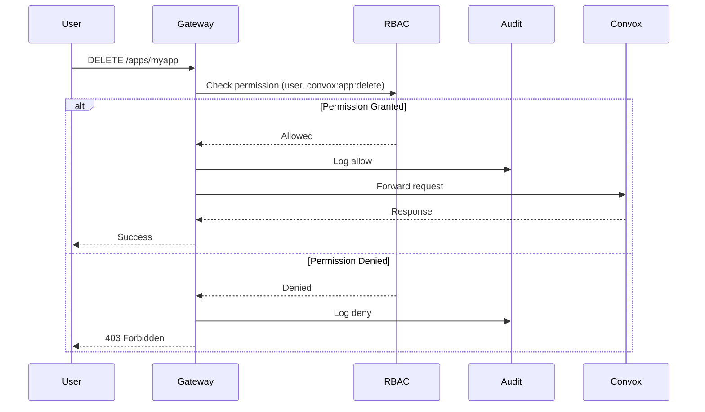

import { Aside, Tabs, TabItem } from '@astrojs/starlight/components';

Rack Gateway uses a structured permission system based on scopes, resources, and actions.

## Permission Format

Every permission follows a three-part format:

```
{scope}:{resource}:{action}
```

**Examples:**
- `convox:app:list` - List Convox applications
- `convox:process:exec` - Execute commands in containers
- `gateway:user:create` - Create gateway users
- `gateway:deploy_approval_request:read` - View deploy approval requests

## Scopes

Permissions are organized into four scopes:

| Scope | Description |
|-------|-------------|
| `convox` | Operations passed through to the Convox API |
| `gateway` | Operations implemented within the gateway itself |
| `auth` | Authentication-related operations |
| `security` | Security-specific operations |

## Resources

### Convox Resources

Resources that map to Convox API operations:

| Resource | Description |
|----------|-------------|
| `app` | Applications |
| `build` | Docker image builds |
| `deploy` | Deployment operations |
| `env` | Environment variables |
| `instance` | EC2/container instances |
| `log` | Application logs |
| `object` | Build artifacts and objects |
| `process` | Running processes/containers |
| `rack` | Rack configuration |
| `release` | Application releases |
| `secret` | Secret env var values (`convox:secret:read` reveals them) |

The gateway forwards only the rack API routes it has a permission for (see
[Rack API Routes](#rack-api-routes)). Requests to any other route are refused with `404` and logged as denied,
whatever the caller's role, so Convox's certificates, registries, resources, instance keyroll and terminate, and
canceling an app update aren't available through the gateway (the `rack-gateway` CLI has no commands for them).
Three requests the Convox CLI makes for itself are refused without a denial entry (see
[Denied Requests](/security/compliance/audit-trail/#denied-requests)).

### Gateway Resources

Resources specific to the gateway:

| Resource | Description |
|----------|-------------|
| `api_token` | API tokens for automation |
| `audit_log` | The gateway audit log |
| `deploy_approval_request` | Deploy approval requests |
| `integration` | Third-party integrations |
| `job` | Background jobs |
| `setting` | A single gateway or app setting |
| `setting_group` | A group of settings saved together (one settings form) |
| `user` | Gateway users |

### Security Resources

| Resource | Description |
|----------|-------------|
| `secret` | `security:secret:update` refreshes the pinned rack TLS certificate |

### Auth Resources

Authentication and MFA resources:

| Resource | Description |
|----------|-------------|
| `auth` | Authentication sessions |
| `mfa_backup_codes` | MFA recovery codes |
| `mfa_method` | MFA methods (TOTP, WebAuthn) |
| `mfa_preferences` | Preferred MFA method |
| `mfa_verification` | MFA verification challenges |
| `trusted_device` | Trusted device tokens |

## Actions

| Action | Description |
|--------|-------------|
| `approve` | Approve a request |
| `create` | Create a new resource |
| `delete` | Delete a resource |
| `deploy_with_approval` | Deploy requiring prior approval |
| `exec` | Execute commands |
| `generate` | Generate credentials/codes |
| `import` | Import external resources |
| `list` | List resources |
| `manage` | General management operations |
| `promote` | Promote a release |
| `read` | Read/view a resource |
| `restart` | Restart a service |
| `run_privileged` | Start a process with privileged options |
| `set` | Set a value |
| `set_protected` | Change or remove a protected value |
| `start` | Start a resource |
| `stop` | Stop a resource |
| `terminate` | Terminate a resource |
| `unset` | Remove a value |
| `update` | Update a resource |
| `update_name` | Update only the name |

## Complete Permission Reference

### Convox Scope (`convox:*`)

<Tabs>
<TabItem label="Apps">

| Permission | Description | Roles |
|------------|-------------|-------|
| `convox:app:list` | List all applications | viewer, ops, deployer, cicd, admin |
| `convox:app:read` | View application details | viewer, ops, deployer, cicd, admin |
| `convox:app:create` | Create new application | admin |
| `convox:app:update` | Update application settings | deployer, admin |
| `convox:app:delete` | Delete application | admin |
| `convox:app:restart` | Restart application | ops, deployer, admin |

</TabItem>
<TabItem label="Builds">

| Permission | Description | Roles |
|------------|-------------|-------|
| `convox:build:list` | List builds | viewer, ops, deployer, admin |
| `convox:build:read` | View build details | viewer, ops, deployer, admin |
| `convox:build:create` | Create new build | deployer, admin |
| `convox:build:update` | Update a build | admin |
| `convox:build:import` | Import an exported build (its manifest and images aren't checked) | admin |

</TabItem>
<TabItem label="Releases">

| Permission | Description | Roles |
|------------|-------------|-------|
| `convox:release:list` | List releases | ops, deployer, admin |
| `convox:release:read` | View release details | deployer, admin |
| `convox:release:create` | Create release | deployer, admin |
| `convox:release:promote` | Promote release to production | deployer, admin |

<Aside type="note">
Releases contain environment variable snapshots, so viewing releases is more restricted than viewing builds.
</Aside>

</TabItem>
<TabItem label="Environment">

| Permission | Description | Roles |
|------------|-------------|-------|
| `convox:env:read` | View environment variables | ops, deployer, admin |
| `convox:env:set` | Set environment variables | deployer, admin |
| `convox:env:unset` | Remove environment variables | deployer, admin |
| `convox:env:set_protected` | Change or remove an app's protected environment variables with `--allow-protected` | admin |

<Aside type="caution" title="Sensitive Data">
Environment variables often contain secrets (API keys, database passwords). Only grant `env:read` to users who need to debug configuration issues.
</Aside>

<Aside type="note">
Secret values come back masked unless the caller also holds `convox:secret:read` and asks for them (the web UI's reveal button). Revealing them needs a recent MFA step-up.
</Aside>

<Aside type="note">
`set_protected` is checked in addition to `release:create` when an `env set` or `env unset` names a protected key with `--allow-protected`. The request must also carry MFA, which the gateway verifies even within the step-up window. API tokens can never change protected env vars, whatever their permissions. See [Protected env vars](/user-guide/cli/commands/#protected-env-vars).
</Aside>

</TabItem>
<TabItem label="Processes">

| Permission | Description | Roles |
|------------|-------------|-------|
| `convox:process:list` | List running processes | viewer, ops, deployer, cicd, admin |
| `convox:process:read` | View process details | viewer, ops, deployer, cicd, admin |
| `convox:process:start` | Start a process | ops, deployer, admin |
| `convox:process:exec` | Execute command in container | ops, deployer, admin |
| `convox:process:terminate` | Terminate a process | ops, deployer, admin |
| `convox:process:run_privileged` | Start a process with options that escape the release (`Image`, `Volumes`, `Privileged`, node placement) | admin |

<Aside type="note">
`run_privileged` is checked in addition to `process:start` whenever a `run` request carries one of those options. API tokens can never send them, whatever their permissions.
</Aside>

</TabItem>
<TabItem label="Infrastructure">

| Permission | Description | Roles |
|------------|-------------|-------|
| `convox:instance:list` | List instances | viewer, ops, deployer, cicd, admin |
| `convox:instance:read` | View instance details | viewer, ops, deployer, cicd, admin |
| `convox:rack:read` | View rack configuration | viewer, ops, deployer, cicd, admin |
| `convox:log:read` | Stream logs | viewer, ops, deployer, admin |
| `convox:object:create` | Upload build artifacts | deployer, admin |

</TabItem>
</Tabs>

### Gateway Scope (`gateway:*`)

<Tabs>
<TabItem label="Users">

| Permission | Description | Roles |
|------------|-------------|-------|
| `gateway:user:list` | View the team directory (names, emails, roles, locked status) | viewer, ops, deployer, admin |
| `gateway:user:read` | View any user's details, sessions, lock reasons and MFA preferences | admin |
| `gateway:user:create` | Create new user | admin |
| `gateway:user:update` | Change a user's roles, lock or unlock them, revoke their sessions | admin |
| `gateway:user:update_name` | Change a user's display name | admin |
| `gateway:user:delete` | Delete user | admin |
| `gateway:audit_log:read` | Read and export every user's audit log | admin |

<Aside type="note">
Every user may view their own details, list and revoke their own sessions, and read their own audit log without these permissions (revoking a session still needs MFA on that request). API tokens can't use these endpoints at all.
</Aside>

</TabItem>
<TabItem label="API Tokens">

| Permission | Description | Roles |
|------------|-------------|-------|
| `gateway:api_token:read` | List and view your own tokens | viewer, ops, deployer, admin |
| `gateway:api_token:create` | Create tokens for yourself | deployer, admin |
| `gateway:api_token:update` | Rename or change permissions of your own tokens | deployer, admin |
| `gateway:api_token:delete` | Delete your own tokens | deployer, admin |
| `gateway:api_token:manage` | See and change every user's tokens, and create tokens for other users | admin |

<Aside type="note">
A token's permissions must be within its owner's current role when it is created or edited, and every request a token makes is checked against both the token's permissions and the owner's current role. Tokens never manage tokens.
</Aside>

</TabItem>
<TabItem label="Deploy Approvals">

| Permission | Description | Roles |
|------------|-------------|-------|
| `gateway:deploy_approval_request:create` | Create approval request | deployer, cicd, admin |
| `gateway:deploy_approval_request:read` | View approval status | deployer, cicd, admin |
| `gateway:deploy_approval_request:list` | List every request and its audit trail | admin |
| `gateway:deploy_approval_request:approve` | Approve/reject request | admin |
| `convox:deploy:deploy_with_approval` | Execute approved deploy (API tokens) | deployer, cicd, admin |

<Aside type="note">
`deploy_with_approval` only matters for API tokens; it lets a token run the build, release and process actions of an approved deploy. Deployers hold it so they can issue CI tokens for themselves; it gates actions a deployer already has directly.
</Aside>

</TabItem>
<TabItem label="Settings">

| Permission | Description | Roles |
|------------|-------------|-------|
| `gateway:setting:{key}` | Modify specific setting | admin |
| `gateway:setting_group:{group}` | Modify a setting group | admin |

Settings are controlled by key or group. See [Settings](/user-guide/web-ui/settings/) for available keys.

</TabItem>
<TabItem label="Integrations">

| Permission | Description | Roles |
|------------|-------------|-------|
| `gateway:integration:read` | View the Slack integration and list its channels | admin |
| `gateway:integration:create` | Connect Slack | admin |
| `gateway:integration:update` | Change Slack channels and alerts, send a Slack test message or a Sentry test event | admin |
| `gateway:integration:delete` | Disconnect Slack | admin |

</TabItem>
<TabItem label="Jobs">

| Permission | Description | Roles |
|------------|-------------|-------|
| `gateway:job:list` | List background jobs | admin |
| `gateway:job:read` | View a background job | admin |
| `gateway:job:update` | Retry a job | admin |
| `gateway:job:delete` | Delete a job | admin |

</TabItem>
</Tabs>

### Auth Scope (`auth:*`)

These permissions control MFA and authentication operations:

| Permission | Description | Notes |
|------------|-------------|-------|
| `auth:mfa_method:create` | Enroll new MFA method | Self-service |
| `auth:mfa_method:update` | Rename an MFA method | Self-service |
| `auth:mfa_preferences:update` | Choose the preferred MFA method | Self-service |
| `auth:mfa_method:delete` | Remove MFA method | Self-service |
| `auth:mfa_backup_codes:generate` | Generate backup codes | Self-service |
| `auth:mfa_verification:create` | Initiate MFA challenge | System |
| `auth:trusted_device:create` | Trust a device | Self-service |
| `auth:trusted_device:delete` | Remove trusted device | Self-service |

<Aside type="tip">
Every signed-in user holds the auth permissions for their own account, whatever their role. API tokens hold none of them.
</Aside>

### Security Scope (`security:*`)

| Permission | Description | Roles |
|------------|-------------|-------|
| `security:secret:update` | Refresh the pinned rack TLS certificate | admin |

## MFA Requirements

Each permission also says how recently the caller must have verified MFA. A request needs the strictest level of
any permission it uses:

| Level | What the request needs |
|-------|------------------------|
| None | A signed-in session |
| Step-up | An MFA verification within the step-up window (`mfa_step_up_window_minutes`, 10 minutes by default). The CLI asks once per command |
| Step-up once enrolled | Nothing for a user's first MFA method; step-up once they have one |
| Always | An MFA proof verified on that request, even within the step-up window |

Reads and lists need none. Any other permission needs **always** unless it's listed below:

| Level | Permissions |
|-------|-------------|
| None | `convox:object:create`, `gateway:deploy_approval_request:create`, `auth:mfa_verification:create`, and the settings `ci_provider`, `circleci_approval_job_name`, `default_branch`, `github_post_pr_comment`, `vcs_provider`, `vcs_repo` |
| Step-up once enrolled | `auth:mfa_method:create` |
| Step-up | `convox:app:create`, `convox:app:update`, `convox:app:restart`, `convox:build:create`, `convox:build:update`, `convox:release:create`, `convox:release:promote`, `convox:env:set`, `convox:env:unset`, `convox:process:stop`, `convox:process:terminate`, `convox:secret:read`, `gateway:user:update_name`, `gateway:integration:create`, `gateway:integration:update`, `gateway:integration:delete`, `gateway:job:update`, `gateway:job:delete`, the `vcs_and_ci_defaults` and `session_configuration` setting groups, the settings `allow_deploy_from_default_branch`, `approved_deploy_commands`, `audit_visible_env_vars`, `circleci_auto_approve_on_approval`, `service_image_patterns`, `verify_git_commit_mode`, and the `auth` permissions other than those above and `auth:mfa_method:delete` |

So these always need MFA on the request itself: running a command in an app (`convox:process:exec`, and
`convox:process:start` except `convox run`'s placeholder start, whose command comes as an exec), deleting apps, importing builds, creating, changing, locking and
deleting users, revoking sessions, creating, changing and deleting API tokens, approving, rejecting and extending deploy approvals, removing an MFA method, refreshing the rack TLS certificate,
changing protected env vars, privileged process options, and the settings that protect secrets, loosen deploy
checks or require justifications (`mfa_configuration`, `allow_destructive_actions`, `deploy_approvals`,
`vcs_ci_deploy`, `protected_env_vars`, `secret_env_vars`, `github_verification`, `require_pr_for_branch`, and
`require_command_justification`, gateway-wide and per app).

API tokens can't verify MFA, so MFA levels don't apply to them; what a token may do is limited by its permissions and
its owner's role. The levels are defined in `internal/gateway/rbac/mfa_requirements.go`.

## Wildcard Permissions

Admin role uses wildcard permissions:

| Permission | Matches |
|------------|---------|
| `convox:*:*` | All Convox operations |
| `gateway:*:*` | All Gateway operations |
| `security:*:*` | Security operations (e.g. refreshing the rack TLS certificate) |

Wildcards match any value in that position:
- `convox:app:*` would match all app actions
- `convox:*:read` would match all read actions

<Aside type="caution" title="Admin Only">
Only the admin role holds wildcard permissions. The roles are defined in code (`internal/gateway/rbac/roles_config.go`); there are no custom roles.
</Aside>

## Permission Checking

When a request arrives, the gateway:

1. **Identifies the user** from session or API token
2. **Maps the endpoint** to a permission (e.g., `DELETE /apps/myapp` → `convox:app:delete`). Every gateway endpoint under `/api/v1` is declared in a route policy table with the permissions it needs; an endpoint that isn't in the table is refused.
3. **Checks the caller's current roles** against the required permission. Roles are read from the database on every request, so a demotion takes effect immediately. An API token must hold the permission itself *and* its owner's current role must allow it.
4. **Logs the decision** to audit trail



## Endpoint to Permission Mapping

Common API endpoints and their required permissions:

| Endpoint | Method | Permission |
|----------|--------|------------|
| `/api/v1/rack-proxy/apps` | GET | `convox:app:list` |
| `/api/v1/rack-proxy/apps/:name` | GET | `convox:app:read` |
| `/api/v1/rack-proxy/apps/:name` | DELETE | `convox:app:delete` |
| `/api/v1/rack-proxy/apps/:name/builds` | POST | `convox:build:create` |
| `/api/v1/rack-proxy/apps/:name/builds/import` | POST | `convox:build:import` |
| `/api/v1/rack-proxy/apps/:name/processes` | GET | `convox:process:list` |
| `/api/v1/rack-proxy/apps/:name/processes/:id/exec` | GET (WebSocket) | `convox:process:exec` |
| `/api/v1/apps/:app/env` | GET | `convox:env:read` |
| `/api/v1/apps/:app/env` | PUT | `convox:env:set` |
| `/api/v1/rack-proxy/apps/:name/releases/:id/promote` | POST | `convox:release:promote` |

## Rack API Routes

These are the only rack API routes the gateway forwards (under `/api/v1/rack-proxy`), from
`internal/gateway/rbac/http_routes.go`:

| Route | Permission |
|-------|------------|
| `GET /apps`, `GET /apps/{name}`, `GET /apps/{app}/services`, `GET /apps/{app}/budget`, `GET /apps/{app}/budget/shutdown-state` | `convox:app:list`, `convox:app:read` |
| `POST /apps` | `convox:app:create` |
| `PUT /apps/{name}`, `PUT /apps/{app}/services/{name}` | `convox:app:update` |
| `POST /apps/{app}/restart`, `POST /apps/{app}/services/{service}/restart` | `convox:app:restart` |
| `DELETE /apps/{name}` | `convox:app:delete` |
| `GET /apps/{app}/builds`, `GET /apps/{app}/builds/{id}`, `GET /apps/{app}/builds/{id}.tgz` | `convox:build:list`, `convox:build:read` |
| `POST /apps/{app}/builds`, `PUT /apps/{app}/builds/{id}` | `convox:build:create`, `convox:build:update` |
| `POST /apps/{app}/builds/import` | `convox:build:import` |
| `POST /apps/{app}/objects/tmp/{name}` | `convox:object:create` |
| `GET /apps/{app}/releases`, `GET /apps/{app}/releases/{id}` | `convox:release:list`, `convox:release:read` |
| `POST /apps/{app}/releases` | `convox:release:create` |
| `POST /apps/{app}/releases/{id}/promote` | `convox:release:promote` |
| `GET /apps/{app}/processes`, `GET /apps/{app}/processes/{pid}` | `convox:process:list`, `convox:process:read` |
| `POST /apps/{app}/services/{service}/processes` | `convox:process:start` |
| `DELETE /apps/{app}/processes/{pid}` | `convox:process:terminate` |
| `GET /apps/{app}/processes/{pid}/exec` (WebSocket) | `convox:process:exec` |
| App, process, build and rack logs (`.../logs`, HTTP or WebSocket) | `convox:log:read` |
| `GET /instances`, `GET /instances/{id}` | `convox:instance:list`, `convox:instance:read` |
| `GET /system`, `/system/capacity`, `/system/metrics`, `/system/processes`, `/system/releases` | `convox:rack:read` |

The gateway doesn't route `PUT /system` (`convox rack update`, `rack scale` and `rack params set`): Convox v3 racks
don't implement it, and racks are updated with Terraform.

## Next Steps

- [Roles](/security/rbac/roles/) - Role definitions and capabilities
- [Best Practices](/security/rbac/best-practices/) - Implementation patterns
