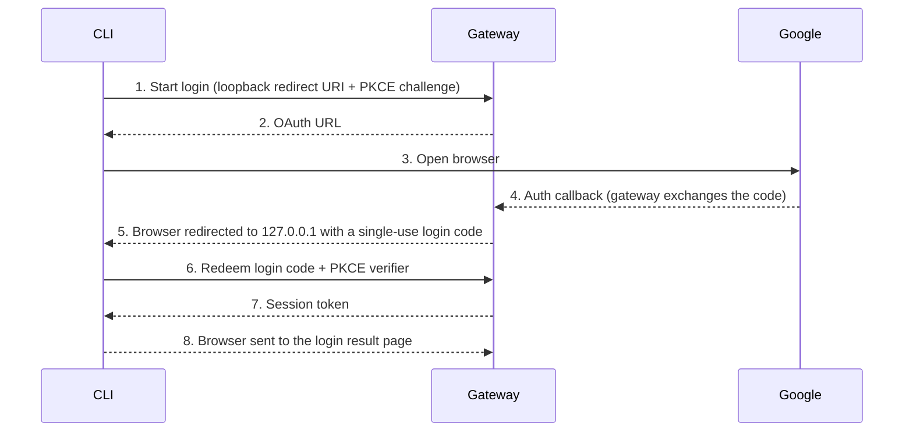

import { Aside, Steps } from '@astrojs/starlight/components';

The `rack-gateway` CLI uses OAuth to authenticate you with the gateway. This page covers the login flow, session management, and troubleshooting authentication issues.

## Login Flow

<Steps>

1. **Run the login command**
   ```bash
   rack-gateway login production https://gateway.example.com
   ```
   - `production` is an alias you choose for this rack
   - The URL is your gateway's address

2. **Browser opens automatically**

   Your default browser opens to the gateway's OAuth page. If it doesn't open automatically, the CLI prints a URL you can copy.

3. **Continue with Google**

   Authenticate with your Google Workspace account. The gateway validates that your email domain is allowed.

4. **Return to terminal**

   After successful authentication, the browser shows **Authentication Complete** and you can close it. The CLI
   receives a session token and stores it locally.

5. **Verify connection**
   ```bash
   rack-gateway rack
   # Shows rack information if authentication succeeded
   ```

</Steps>

## What Happens During Login



The CLI:
1. Listens on `http://127.0.0.1:<random port>/callback` and starts the login with the gateway
2. Prints the login URL and opens your browser to Google's sign-in page
3. After you sign in (and complete MFA, or enroll a first factor), the browser is sent back to the CLI's
   local listener with a single-use login code
4. Redeems the code together with its PKCE verifier for a session token
5. Stores the session token in your config file
6. Sends the browser on to the gateway's result page: **Authentication Complete**, or what went wrong

The whole login must finish within 10 minutes. The browser must be on the **same machine** as the CLI,
because the login code is delivered to `127.0.0.1` (see [Logging in from a remote host](#logging-in-from-a-remote-host)).
**Cancel Login** on the approval page ends the login and the CLI exits.

## Session Storage

Session tokens are stored in `~/.config/rack-gateway/config.json`:

```json
{
  "current": "production",
  "gateways": {
    "production": {
      "url": "https://gateway.example.com",
      "token": "Fz2kQ...",
      "email": "developer@company.com",
      "expires_at": "2024-02-15T10:30:00Z",
      "session_id": 1024,
      "channel": "cli",
      "device_id": "8f4c4b8c-...",
      "device_name": "dev-mbp",
      "mfa_verified": true
    }
  }
}
```

<Aside type="caution" title="Protect Your Config">
The config file contains session tokens. The CLI keeps it readable only by you: every time it saves the file it
sets the directory to `700` and the file to `600` (removing any group or other permissions), and it replaces the
file atomically, so a crash never leaves a partial config. Don't copy it anywhere less private.
</Aside>

## Session Lifecycle

### Session Duration

CLI sessions last 90 days from their last use. Sessions can be:
- **Revoked** by you or an administrator in the web UI
- **Expired** after 90 days without use
- **Ended** when your account is locked or deleted

### Checking Session Status

```bash
# Test your current session
rack-gateway test-auth
```

```
Testing authentication to https://gateway.example.com...
✓ Authentication successful
  User is enrolled in MFA: true
  MFA required: true
  Enrolled methods:
  ...
```

`rack-gateway rack` shows who you're logged in as and when the session expires.

### Session Expiration

When your session has expired or been revoked, commands fail with an authentication error. Run
`rack-gateway login` to sign in again to the current rack (the rack and its URL are kept).

## Logout

```bash
# Log out of the current rack (or pass --rack)
rack-gateway logout
```

This ends the session on the gateway (a copy of the token stops working), then removes the rack, with its URL and
session token, from your local config. If the gateway can't be reached, nothing is removed and the command fails;
`rack-gateway logout --local` removes the rack anyway, and you can revoke the session later under your account's
sessions in the web UI. To use the rack again, run `rack-gateway login <rack> <gateway-url>`.

## Using API Tokens

For CI/CD or automation, you can use API tokens instead of OAuth sessions:

```bash
# Set via environment variable
export RACK_GATEWAY_API_TOKEN="rgw_..."
rack-gateway apps

# Or pass directly
rack-gateway apps --api-token "rgw_..."
```

API tokens:
- Don't require interactive login
- Have their own permissions, limited by their owner's role
- Can be scoped to specific operations
- Should be created via the web UI or `api-token` command

See [API Tokens](/user-guide/web-ui/api-tokens/) for creating and managing tokens.

## MFA During Login

MFA during login happens in the browser: after Google, the gateway asks for your MFA method (or, if you have none
yet, has you enroll one) before it sends the browser back to the CLI. The page shows the device name and IP that
started the login, so you can check it's yours, and **Cancel Login** stops it.

A CLI login asks for MFA whenever MFA applies to you: always with the default `mfa_require_all_users`, otherwise
once you have enrolled a method. A trusted device doesn't skip it.

After login, commands that need MFA ask for it in the terminal:
- **TOTP** - Enter the code from your authenticator app
- **WebAuthn** - Touch your security key when prompted (CLI builds with WebAuthn support)
- **YubiKey OTP** - Touch a YubiKey that types a one-time password
- **Backup codes** - Enter a backup code if you've lost access to your device

See [MFA Verification](/user-guide/cli/mfa-verification/) for details.

## Troubleshooting

### "Browser didn't open"

The CLI tries to open your default browser. If it fails:

```bash
# The CLI always prints the login URL; open it manually in a browser on the same machine
rack-gateway login production https://gateway.example.com
# Output: Open this URL in your browser to log in (on this machine): https://accounts.google.com/...
```

### "OAuth callback failed"

After Google, the gateway sends the browser to the CLI's local listener on `127.0.0.1`. Issues can include:
- **Gateway not reachable**: DNS/VPN/Tailscale issues
- **Browser on another machine**: the redirect to `127.0.0.1` can't reach the CLI (see below)
- **Local firewall or security software** blocking connections to `127.0.0.1`
- **Login took longer than 10 minutes**: retry `rack-gateway login`

### Logging in from a remote host

When the CLI runs on a remote machine (for example over SSH), forward its listener port to the machine with
the browser. Run `rack-gateway login --no-open` on the remote host, note the port in the printed
"Waiting for the browser to return to `http://127.0.0.1:<port>/callback`" line, then from the machine with
the browser run:

```bash
ssh -L <port>:127.0.0.1:<port> <remote-host>
```

and open the printed URL in the browser there.

### "Gateway is older than this CLI" / "CLI is too old"

The gateway and CLI must both support the loopback login. Upgrade whichever side is older; after upgrading
the gateway, install the matching rack-gateway CLI.

### "Not authorized"

The login page says you aren't authorized when your Google account is outside the gateway's
`GOOGLE_ALLOWED_DOMAIN`, or when you aren't a gateway user yet. Ask an administrator to add you.

### "Session invalid" after working previously

Possible causes:
1. **Your session was revoked** (by you, an administrator, or a lock) - Log in again
2. **It expired** after 90 days without use - Log in again
3. **Your account is locked** - Ask an administrator

### "Permission denied" errors

You're authenticated but your role doesn't allow the operation:

```
Error: You don't have permission to promote releases.
```

Contact your administrator to adjust your role if needed.

## Environment Variables

| Variable | Description |
|----------|-------------|
| `RACK_GATEWAY_API_TOKEN` | API token for authentication (bypasses OAuth) |
| `GATEWAY_CLI_CONFIG_DIR` | Override config directory location |
| `RACK_GATEWAY_RACK` | Override current rack for this command |
| `RACK_GATEWAY_URL` | Gateway URL for `RACK_GATEWAY_API_TOKEN`. Without an API token it must match the rack's configured URL (a session token is never sent to another gateway). Not allowed with `--rack all` or a list of racks |

## Next Steps

- [Multi-Rack](/user-guide/cli/multi-rack/) - Work with multiple racks
- [MFA Verification](/user-guide/cli/mfa-verification/) - Step-up authentication
- [Commands](/user-guide/cli/commands/) - Full command reference
